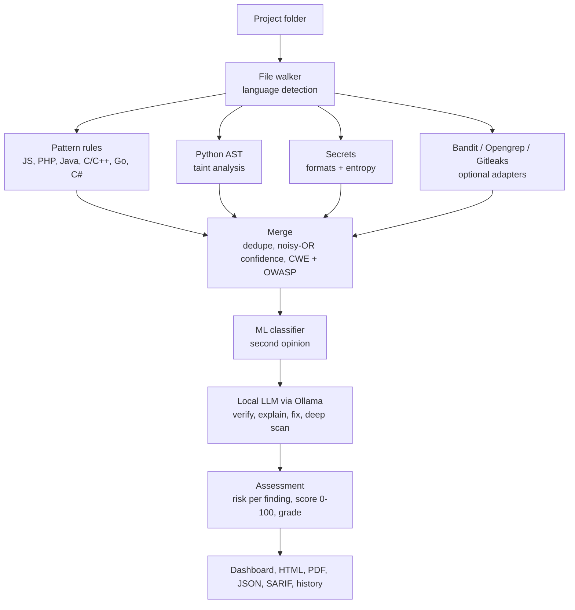

# Secure Code Analyzer

**Intelligent Source Code Vulnerability Detection and Security Assessment Platform**

A local tool: choose a project folder, and it scans the source code with several static
analysis engines, reviews the results with AI, scores the project, and produces reports.
The code never leaves your computer.

> الشرح الكامل بالعربية: **[docs/GUIDE_AR.md](docs/GUIDE_AR.md)** ·
> هيكل بحث التخرج: **[docs/THESIS_OUTLINE_AR.md](docs/THESIS_OUTLINE_AR.md)** ·
> Architecture: [docs/ARCHITECTURE.md](docs/ARCHITECTURE.md)


## Quick start

Requirement: **Python 3.10 or newer** ([python.org](https://www.python.org/downloads/); on
Windows tick *Add python.exe to PATH* during installation).

**Windows:** download the repository (Code → Download ZIP), unzip it, double-click `run.bat`.

**Linux / macOS:**

```bash
git clone https://github.com/blackangiliq/graduate_project.git
cd graduate_project
./run.sh
```

The first run creates a virtual environment and installs the requirements (a few minutes).
The dashboard then opens at <http://localhost:8501>. Press **Use sample**, then **Run scan**
to see a full example on the deliberately vulnerable app in `samples/vulnerable_app`.

Manual installation, if you prefer:

```bash
python -m venv .venv
.venv\Scripts\activate            # Windows   (Linux/macOS: source .venv/bin/activate)
pip install -r requirements.txt
python -m sca ui                  # dashboard
python -m sca scan path/to/project --format html,json,sarif,pdf    # command line
python -m sca doctor              # shows which engines and AI parts are available
```

## What it does



| Stage | What happens | Code |
|---|---|---|
| Static engines | 69 pattern rules for JavaScript/TypeScript, PHP, Java, C/C++, Go and C#; a Python AST engine that traces user input from sources to dangerous sinks; a secrets detector (known key formats + Shannon entropy); adapters for Bandit, Opengrep/Semgrep and Gitleaks | `sca/engines/`, `sca/rules/` |
| Merge | The same issue found by several engines becomes one finding; confidences are combined with a noisy-OR | `sca/merge.py` |
| ML classifier | TF-IDF + logistic regression gives each finding a probability; trainable on PrimeVul / DiverseVul | `sca/ai/classifier.py` |
| LLM review | A local model (Ollama) judges each finding, explains it in English or Arabic and proposes a fix; an optional deep scan audits whole files | `sca/ai/llm.py` |
| Assessment | Risk score 0-10 per finding, project score 0-100 with a grade A-F, CWE and OWASP Top 10 (2021) mapping | `sca/scoring.py`, `sca/cwe.py` |
| Output | Web dashboard, self-contained HTML report, PDF, JSON, SARIF 2.1.0, scan history in SQLite | `app.py`, `sca/report/` |

## Enabling the AI review (optional)

The static scan and the ML classifier work out of the box. For LLM review:

1. Install [Ollama](https://ollama.com).
2. Download a code model: `ollama pull qwen2.5-coder:7b` (about 5 GB; on a machine with
   little RAM use `qwen2.5-coder:1.5b`).
3. Restart the dashboard and tick **LLM review of findings**, or on the command line:
   `python -m sca scan path/to/project --llm --lang ar`

## Measured results

`python evaluation/evaluate.py` scans the labelled samples and compares the output with
`samples/ground_truth.json` (71 labelled vulnerabilities, 21 safe decoy lines, and a
second folder with no vulnerabilities at all).

| Configuration | TP | FP | FN | Precision | Recall | F1 |
|---|---:|---:|---:|---:|---:|---:|
| Bandit only (Python baseline) | 15 | 4 | 56 | 0.789 | 0.211 | 0.333 |
| Pattern rules + secrets | 48 | 3 | 23 | 0.941 | 0.676 | 0.787 |
| + Python AST taint engine | 65 | 3 | 6 | 0.956 | 0.915 | 0.935 |
| All static engines | 65 | 7 | 6 | 0.903 | 0.915 | 0.909 |

Read these numbers with care: the samples were written together with the tool, so they
show that the pipeline works, not how it performs on unseen code. The six misses are cases
static analysis is known to struggle with (a missing access check, a data flow across two
functions, an unchecked `memcpy` length, an integer overflow, prototype pollution, a
password passed as a positional argument). The full list of misses and false positives is in
[evaluation/results.md](evaluation/results.md). For the thesis, repeat the measurement on a
public benchmark; the guide explains how.

## What was and was not tested

- Tested here (Linux, Python 3.13): 132 automated tests, the command line, the dashboard
  (driven headlessly and in a real browser), all four report formats, the evaluation.
- The LLM layer was tested against a **fake Ollama server** that imitates the API. It has
  not been run against a real model in the build environment, so verdict quality depends on
  the model you install.
- The Opengrep/Semgrep and Gitleaks adapters were tested on sample tool output only; the
  real binaries were not installed in the build environment.
- `experiments/train_codebert.py` is an optional, clearly marked experiment that was not
  executed.
- Windows is covered by the CI workflow (`.github/workflows/ci.yml`); check the Actions tab
  for its status.

## Limits

Static analysis cannot prove that code is secure. This tool misses logic flaws and most
data flows that cross functions or files, its rules for languages other than Python work
line by line, and AI reviews can be wrong. The security score is a heuristic of this tool,
not an official CVSS score. Use it to find and prioritise problems, not as a certificate.

`samples/vulnerable_app` is intentionally insecure and exists only as test input. Never
deploy it. Some antivirus products may flag it.

## Project layout

```
app.py                 Streamlit dashboard
run.bat / run.sh       one-click launchers
sca/
  __main__.py          command line (scan, ui, doctor, history, train)
  pipeline.py          runs every stage in order
  walker.py            file discovery, language detection, secret masking
  engines/             rules_engine, python_ast, secrets, external (Bandit/Semgrep/Gitleaks)
  rules/               YAML rules: javascript, php, java, c_cpp, other (Go, C#)
  merge.py             deduplication and noisy-OR confidence
  cwe.py               CWE + OWASP knowledge base (English and Arabic)
  ai/                  classifier (ML), llm (Ollama), seed_corpus
  scoring.py           risk score, project score, grade
  storage.py           SQLite history and LLM cache
  report/              HTML, PDF, SARIF, JSON
samples/               vulnerable_app, safe_app, ground_truth.json
evaluation/            evaluate.py, results.md
tests/                 132 tests
docs/                  Arabic guide, thesis outline, architecture
experiments/           optional CodeBERT fine-tuning script (not executed)
```

## License

MIT. See [LICENSE](LICENSE).
