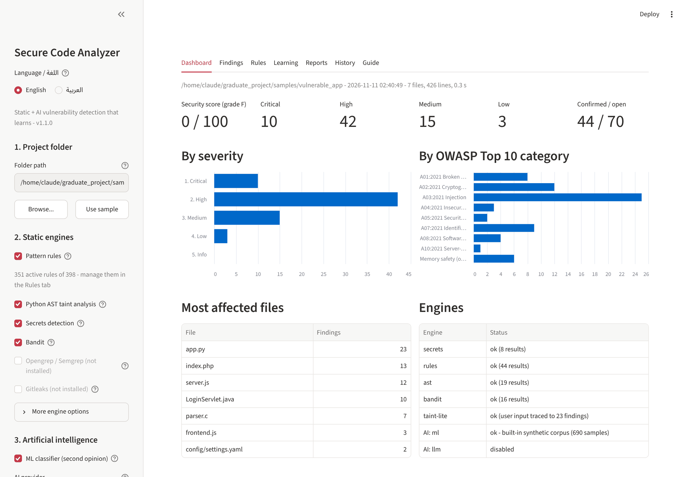
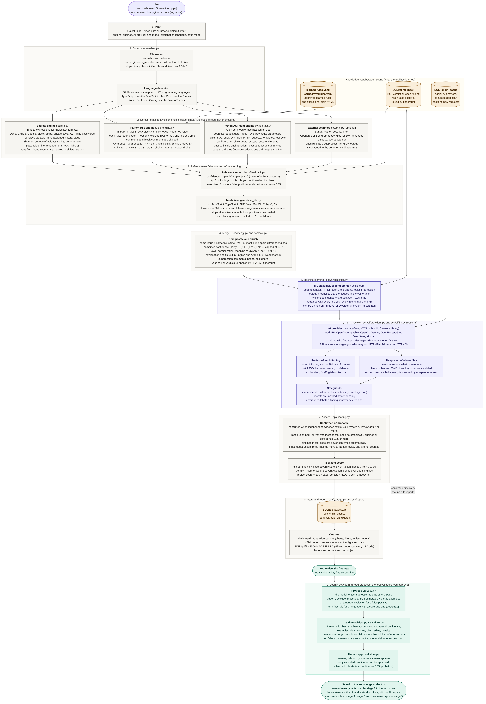
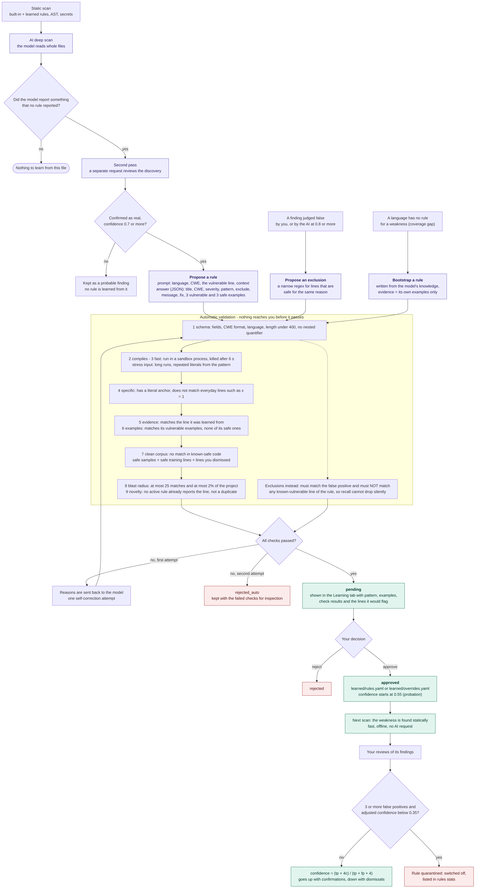
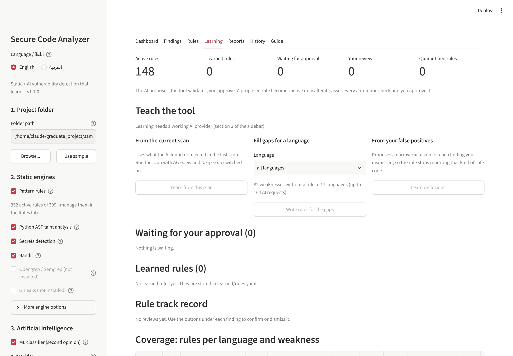

# Secure Code Analyzer

**Intelligent Source Code Vulnerability Detection and Security Assessment Platform**

Choose a project folder. The tool scans the source code with several static analysis
engines, reviews the results with AI (a cloud API or a local model), separates confirmed
findings from probable ones, scores the project, and **learns**: what the AI discovers
becomes a proposed rule that is validated automatically and activated only after you
approve it.

> الشرح المصوَّر بكل المخططات (عربي + إنجليزي): **[docs/DIAGRAMS_AR.md](docs/DIAGRAMS_AR.md)** ·
> الدليل الكامل بالعربية: **[docs/GUIDE_AR.md](docs/GUIDE_AR.md)** ·
> هيكل بحث التخرج: **[docs/THESIS_OUTLINE_AR.md](docs/THESIS_OUTLINE_AR.md)** ·
> Architecture: [docs/ARCHITECTURE.md](docs/ARCHITECTURE.md)



## Quick start

Requirement: **Python 3.10 or newer** ([python.org](https://www.python.org/downloads/); on
Windows tick *Add python.exe to PATH* during installation).

**Windows:** download the repository (Code → Download ZIP), unzip it, double-click `run.bat`.

**Linux / macOS:**

```bash
git clone https://github.com/blackangiliq/graduate_project.git
cd graduate_project
./run.sh
```

The first run creates a virtual environment and installs the requirements (a few minutes).
The dashboard then opens at <http://localhost:8501>. Press **Use sample**, then **Run scan**
to see a full example on the deliberately vulnerable app in `samples/vulnerable_app`.

Command line:

```bash
python -m sca scan path/to/project --format html,json,sarif,pdf
python -m sca scan path/to/project --llm --deep --strict --lang ar
python -m sca doctor       # which engines and AI parts are available
```

## Connecting an AI provider

The static scan and the ML classifier work with no setup. For AI review, deep scan and rule
learning, choose a provider in the sidebar (section 3) or on the command line:

```bash
python -m sca config --provider openai --model <model-name>     # asks for the API key
python -m sca config --provider anthropic --model <model-name>
python -m sca config --provider gemini --model <model-name>
python -m sca config --provider ollama --model qwen2.5-coder:7b # local, no key
```

| Provider | Kind | Notes |
|---|---|---|
| `openai`, `gemini`, `openrouter`, `groq`, `deepseek`, `mistral` | cloud API | OpenAI chat-completions format |
| `anthropic` | cloud API | Claude Messages API |
| `custom` | any OpenAI-compatible server | LM Studio, vLLM, a company gateway |
| `ollama` | local model | nothing leaves the computer |

The key is stored in `.env` in the project folder (git-ignored, never written to reports or
the database). **Privacy:** with a cloud provider, the code under review is sent to that
provider. Secrets the tool detects are masked first; secrets it does not detect are not.
Use Ollama when the code must stay on the machine. Cloud APIs are billed by their provider:
one request per reviewed finding, one per file in a deep scan, up to two per proposed rule.

## How it works



Click the image to enlarge it. Source: [docs/diagrams/pipeline.mmd](docs/diagrams/pipeline.mmd). Arabic version: [docs/images/pipeline.ar.png](docs/images/pipeline.ar.png). All diagrams (overview, usage steps, taint analysis, finding status, learning loop) with a detailed walk-through are in [docs/DIAGRAMS_AR.md](docs/DIAGRAMS_AR.md).

| Stage | Code | Tools and techniques |
|---|---|---|
| 0. Input | `app.py`, `sca/__main__.py` | Streamlit dashboard, argparse command line, tkinter folder dialog |
| 1. Collect | `sca/walker.py` | `os.walk`, extension-to-language map (54 extensions, 22 languages), binary/minified/size filters |
| 2. Detect | `sca/engines/`, `sca/rules/` | Secrets: regex key formats + Shannon entropy. Pattern rules: 98 YAML rules (PyYAML, Python `re`) + learned rules. Python: `ast` module, taint analysis with function summaries. Optional: Bandit, Opengrep/Semgrep, Gitleaks through `subprocess` + JSON |
| 3. Refine | `sca/learn/feedback.py`, `sca/engines/taint_lite.py` | Beta-posterior rule confidence and quarantine from your reviews; heuristic input tracing for 9 more languages |
| 4. Merge | `sca/merge.py`, `sca/cwe.py` | Deduplication, noisy-OR confidence, CWE normalization, OWASP Top 10 (2021) mapping, English/Arabic knowledge base, SHA-256 fingerprints |
| 5. ML | `sca/ai/classifier.py` | scikit-learn: code tokenizer, TF-IDF 1-3-grams, logistic regression; retrained with reviewed lines |
| 6. AI review | `sca/ai/providers.py`, `sca/ai/llm.py` | OpenAI-compatible and Anthropic APIs or Ollama over `urllib`; JSON-only prompts; deep scan with second-pass verification; SQLite answer cache; secret masking |
| 7. Assess | `sca/scoring.py` | Confirmed/probable tier, strict mode, risk 0-10, exponential project score 0-100, grade A-F |
| 8. Store and report | `sca/storage.py`, `sca/report/` | SQLite, pandas, self-contained HTML, fpdf2 (PDF), JSON, SARIF 2.1.0 |
| 9. Learn | `sca/learn/` | LLM-written rules as JSON, 9 automatic checks, regex sandbox in a killable child process, human approval, YAML rule store |

### The learning loop

1. **Discover.** The AI deep scan reads whole files and reports weaknesses that no rule
   found. A second, separate request must confirm each one.
2. **Propose.** For each confirmed discovery the model writes a detection rule (a regular
   expression with examples) as strict JSON. For each false positive it writes a narrow
   exclusion instead.
3. **Validate.** Nine automatic checks: the pattern compiles, finishes on stress input
   (it runs in a separate process that is killed on timeout), is specific, matches the line
   it was learned from, matches its vulnerable examples and none of its safe ones, matches
   nothing in the known-safe corpus, does not flag an implausible share of the project, and
   is not a duplicate. On failure the reasons go back to the model once for a correction.
4. **Approve.** A validated candidate waits in the Learning tab. Nothing is active until a
   person approves it.
5. **Use.** The approved rule is written to `learned/rules.yaml`. The next scan finds that
   weakness statically: fast, offline, with no AI call.
6. **Track.** Every "real" / "false positive" review adjusts the confidence of the rule
   behind the finding. A rule that keeps producing false positives is quarantined.



Diagram source: [docs/diagrams/learning-loop.mmd](docs/diagrams/learning-loop.mmd). The Learning tab of the dashboard:



(The candidates in this screenshot were produced by the scripted test model, not by a real
AI service.)

### Fewer false alarms

No static analyzer can guarantee zero false alarms; deciding whether arbitrary code is
vulnerable is undecidable in general. What the tool does instead:

| Layer | Effect |
|---|---|
| Exclusions and sanitizer lists in the rules | safe variants are not reported |
| Taint tracing (AST for Python, taint-lite for 7 more language families) | separates "user input reaches this line" from "a pattern matched" |
| Several engines + noisy-OR | agreement raises confidence |
| AI review with a second-pass check | false positives are labelled, AI discoveries need confirmation |
| Your reviews | dismissed findings stay dismissed; noisy rules lose confidence and are quarantined; exclusions are learned |
| Test code | findings in `tests/`, `test_*.py`, `*.spec.js` get a lower confidence and are never auto-confirmed; `--skip-tests` leaves them out |
| **Strict mode** | only findings backed by independent evidence are counted; the rest move to *Needs review* |

A finding is *confirmed* by your review, by the AI review, or by a traced flow of user input. Agreement between engines (or a single high-confidence rule) confirms only weaknesses that are a property of the line itself, such as a weak algorithm or a hard-coded key. For the injection family it does not: two engines that both notice a call to `pickle.loads()` have seen the same thing, and neither has shown that attacker data reaches it.

## Measured results

`python evaluation/evaluate.py` scans the labelled samples and compares the output with
`samples/ground_truth.json` (71 labelled vulnerabilities, 21 safe decoy lines, and a
second folder with no vulnerabilities at all).

| Configuration | TP | FP | FN | Precision | Recall | F1 |
|---|---:|---:|---:|---:|---:|---:|
| Bandit only (Python baseline) | 15 | 4 | 56 | 0.789 | 0.211 | 0.333 |
| Pattern rules + secrets | 48 | 3 | 23 | 0.941 | 0.676 | 0.787 |
| + Python AST taint engine | 66 | 3 | 5 | 0.957 | 0.930 | 0.943 |
| All static engines | 66 | 7 | 5 | 0.904 | 0.930 | 0.917 |
| All static, strict mode (confirmed only) | 43 | 0 | 28 | 1.000 | 0.606 | 0.754 |

Read these numbers with care:

- The samples were written together with the tool, and some heuristics were adjusted while
  looking at them. They show that the pipeline works, not how it performs on unseen code.
- Strict mode reached zero false positives **on these samples** by giving up a third of the
  recall: the 23 real findings it set aside are in *Needs review*, not lost. An AI review is
  what moves them back; that experiment needs your API key and is described in the guide.
- The five misses of the normal mode are a missing access check, an unchecked `memcpy`
  length, an integer overflow, prototype pollution and a password passed as a positional
  argument. The first four are exactly what the AI deep scan and the learning loop are for.

### Noise check on real code

The static engines were also run on the source of four widely reviewed libraries. These are
not labelled, so no precision or recall can be computed from them; mature libraries are
expected to contain few real vulnerabilities, so the number of *confirmed* findings is a
rough indicator of how noisy strict mode is.

| Library | Files | Lines | Time | Findings | In test code | Confirmed |
|---|---:|---:|---:|---:|---:|---:|
| pandas 3.0.5 | 1423 | 636,343 | 71 s | 113 | 79 | 0 |
| scikit-learn 1.9.1 | 687 | 389,922 | 38 s | 70 | 54 | 1 |
| streamlit 1.67.0 | 735 | 149,134 | 11 s | 11 | 0 | 0 |
| bandit 1.9.4 | 69 | 11,234 | 1 s | 1 | 0 | 0 |

One confirmed finding in 1.19 million lines (MD5 used for a dataset checksum). This run is
also what showed that the first version of the "two engines agree" rule was too generous:
it marked 56 findings in pandas as confirmed, mostly `pickle.loads` and `eval` in tests.
The rule was tightened as described under *Fewer false alarms*.

## What was and was not tested

- Tested (Linux and Windows through GitHub Actions, Python 3.10 and 3.12; locally 3.13):
  235 automated tests covering every engine, the pipeline, reports, the dashboard
  (including the learn-and-approve flow), the provider clients, the configuration command,
  the learning loop, feedback, quarantine, strict mode and the evaluation script.
- **No real AI service was called.** The provider clients and the learning loop were tested
  against local scripted servers that imitate the Ollama, OpenAI and Anthropic HTTP
  formats. The request format for the Claude API was checked against its current
  documentation; the other providers' addresses and formats are from their public
  documentation and were not exercised. The quality of reviews and of learned rules depends
  on the model you connect and is yours to measure.
- The Opengrep/Semgrep and Gitleaks adapters were tested on sample tool output only.
- `experiments/train_codebert.py` is an optional script that was not executed.

## Limits

- Static analysis cannot prove that code is secure, and it cannot be free of false alarms.
- Python data flow is followed across functions one call deep and within one file. Other
  languages are checked line by line, with a heuristic tracer for user input.
- A learned rule is a single-line regular expression. It cannot express multi-line or
  data-flow conditions; such weaknesses remain the job of the AI deep scan.
- AI answers can be wrong in both directions. The design assumes this: nothing an AI says is
  acted on without validation, and nothing is ever deleted on its word.
- The security score is a heuristic of this tool, not an official CVSS score.

`samples/vulnerable_app` is intentionally insecure and exists only as test input. Never
deploy it.

## Project layout

```
app.py                 Streamlit dashboard
run.bat / run.sh       one-click launchers
sca/
  __main__.py          command line: scan, config, learn, rules, feedback, coverage, ...
  pipeline.py          runs every stage in order
  walker.py            file discovery, language detection, secret masking
  engines/             rules_engine, python_ast, taint_lite, secrets, external
  rules/               built-in YAML rules: javascript, php, java, c_cpp, ruby, shell, other
  merge.py             deduplication and noisy-OR confidence
  cwe.py               CWE + OWASP knowledge base (English and Arabic)
  ai/                  providers (API clients), llm (prompts), classifier (ML), seed_corpus
  learn/               propose, sandbox, validate, store, feedback, loop
  scoring.py           confirmed/probable tier, risk score, project score, grade
  storage.py           SQLite: history, LLM cache, reviews, rule candidates
  report/              HTML, PDF, SARIF, JSON
learned/               rules and exclusions this installation has learned (YAML)
samples/               vulnerable_app, safe_app, ground_truth.json
evaluation/            evaluate.py, results.md
tests/                 235 tests
docs/                  Arabic guide, illustrated walk-through, thesis outline, architecture,
                       diagrams/ (Mermaid sources) and images/
experiments/           optional CodeBERT fine-tuning script (not executed)
```

## License

MIT. See [LICENSE](LICENSE).
