# Secure Code Analyzer

**Intelligent Source Code Vulnerability Detection and Security Assessment Platform**

Choose a project path, upload a source ZIP, or select a built Android package. The tool scans the code with several
static analysis engines, reviews the results with AI (a cloud API or a local model),
separates confirmed findings from probable ones, scores the project, and **learns**: what
the AI discovers becomes a proposed rule that is validated automatically and activated only
after you approve it. Flutter and Android apps are analysed both as source projects and as
built packages (APK, AAB and split APK sets). Static scans decode and read packages;
the separate **Runtime analysis** tab records a real process on a configured Android lab.

Fresh dashboard scans show original credential values and API addresses, with clickable
file/line previews. Dashboard report downloads include the original evidence available
in that scan. Local history stores the original evidence separately and restores it when
reopening a scan. Legacy archives without evidence need one rescan to recover values.
CLI output retains its existing masked representation.

> وثيقة المشرف: **[docs/SUPERVISOR_AR.md](docs/SUPERVISOR_AR.md)** ([PDF](docs/SUPERVISOR_AR.pdf)، يُولَّد من ملف md، وعند الاختلاف فملف md هو المعتمد) ·
> الدليل الكامل بالعربية: **[docs/GUIDE_AR.md](docs/GUIDE_AR.md)** ·
> تشغيل المنصة على خادم: **[docs/DEPLOY_AR.md](docs/DEPLOY_AR.md)** ·
> الشرح المصوَّر بكل المخططات: **[docs/DIAGRAMS_AR.md](docs/DIAGRAMS_AR.md)** ·
> هيكل بحث التخرج: **[docs/THESIS_OUTLINE_AR.md](docs/THESIS_OUTLINE_AR.md)**
>
> Rules guide (EN + AR): [docs/RULES.md](docs/RULES.md) ·
> Flutter and Android apps: [docs/FLUTTER.md](docs/FLUTTER.md) ([العربية](docs/FLUTTER_AR.md)) ·
> Diagrams explained: [docs/DIAGRAMS.md](docs/DIAGRAMS.md) ·
> Architecture: [docs/ARCHITECTURE.md](docs/ARCHITECTURE.md)

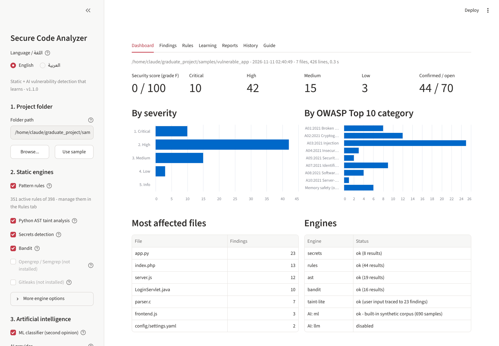

## Quick start

Requirement: **Python 3.10 or newer** ([python.org](https://www.python.org/downloads/); on
Windows tick *Add python.exe to PATH* during installation).

**Windows:** download the repository (Code → Download ZIP), unzip it, double-click `run.bat`.

**Linux / macOS:**

```bash
git clone https://github.com/blackangiliq/graduate_project.git
cd graduate_project
./run.sh
```

The first run creates a virtual environment and installs the requirements (a few minutes).
The dashboard then opens at <http://localhost:8501>. Press **Use sample**, then **Run scan**
to see a full example on the deliberately vulnerable app in `samples/vulnerable_app`.

While a scan runs, the dashboard shows what it is doing as it does it: each step as it
starts (collecting files, each engine, input tracing, merging, ML, AI, scoring), what the
step found and how long it took, and the file being read right now. The same steps stay
on the Dashboard tab under *What the scan did, step by step*, are printed by the command
line, and are saved in the JSON report (`steps`).

### Run on a server

Run `docker compose up -d --build --wait` from the project directory on a Linux host.
The hosted dashboard accepts browser uploads up to 50 MiB. Configure a read-only project
directory to enable server paths alongside uploads. Reports are downloadable in the current
browser session. The container includes JADX for Android bytecode analysis. Follow the
[Arabic deployment guide](docs/DEPLOY_AR.md) for access from another device and the optional mount.

## The dashboard

Opening the dashboard shows a short splash screen and then five introduction pages, in
English or Arabic: what the tool does (with live numbers: 22 languages, 70 file types, the
active rules and app checks), how a scan works step by step, a card for every language with its file
types, its rule count and how deep the analysis goes, how a finding is decided (source,
sink, confirmed or probable), and how to start, with a button that scans the sample or one
of the training labs. **Skip** goes straight to the dashboard, and **Show the
introduction** in **Scan settings** opens the pages again (`SCA_SKIP_INTRO=1` turns them off).

Switch between English and Arabic at the top of the dashboard. The **Scan workspace**
groups input selection, samples and scan settings into tabs. Each option has a tooltip, and **Guide** holds
the instructions, the meaning of every setting, the rule-writing guide, all diagrams with
their explanation, the command reference and the references.

**Apps.** In **Scan input**, select a file or directory, paste its path, or upload a
source ZIP or Android package (`.apk`, `.aab`, `.apks`, `.xapk`, `.apkm`). For a
split install, select the directory containing the exported APKs or upload the APKs
together. Selecting a local `base.apk` offers to include its adjacent parts and shows
the filenames. A source ZIP can contain project files at the root or under a single
wrapper directory. It is unpacked temporarily. **Flutter sample** in **Samples** selects the
deliberately vulnerable Flutter app in `samples/flutter_vulnerable_app`. For a Flutter or
Android target the Dashboard tab adds an app panel (package, versions, build mode, signing,
permissions, components, deep links, Dart packages), an **APIs and keys** panel (every server
address, API call, API path and key, with its places and alerts; full original values) and charts by
OWASP Mobile Top 10 (2024) and MASVS group.

**Training labs.** The folder [infected_project](infected_project/README.md) lists 19
deliberately vulnerable open-source applications from different sources (OWASP, security
companies, independent authors) in more than 10 languages, three of them Flutter apps,
with their links and licences.
`python infected_project/fetch_labs.py` downloads them at pinned commits, the **Samples** tab's
**Training lab** selector scans any of them, and `python infected_project/scan_labs.py`
scans all of them ([RESULTS.md](infected_project/RESULTS.md),
[REVIEW.md](infected_project/REVIEW.md)).

| | |
|---|---|
| **Dashboard** - score, severity, OWASP categories | **Findings** - code, evidence, fix, review buttons |
|  | 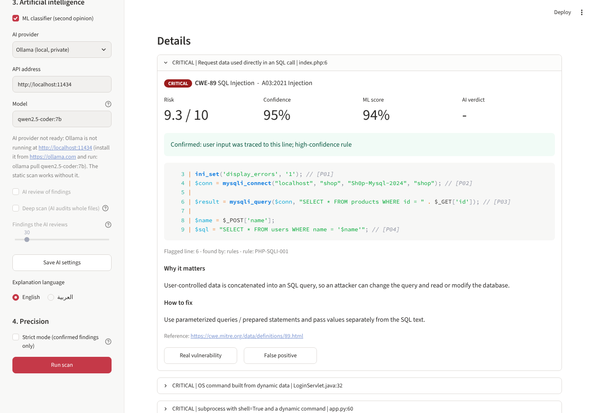 |
| **Rules** - every rule, with filters | **Rules** - read and edit any field, switch off, restore |
| 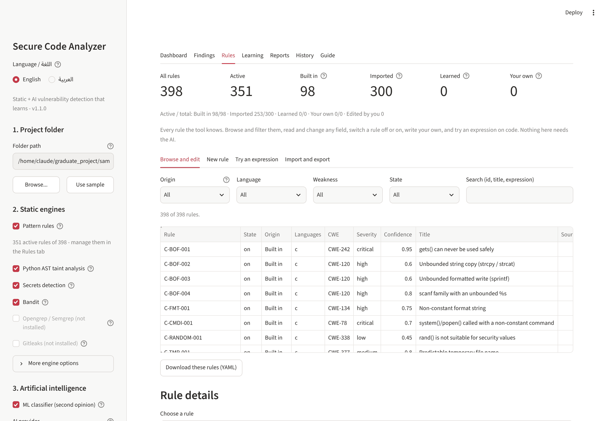 | 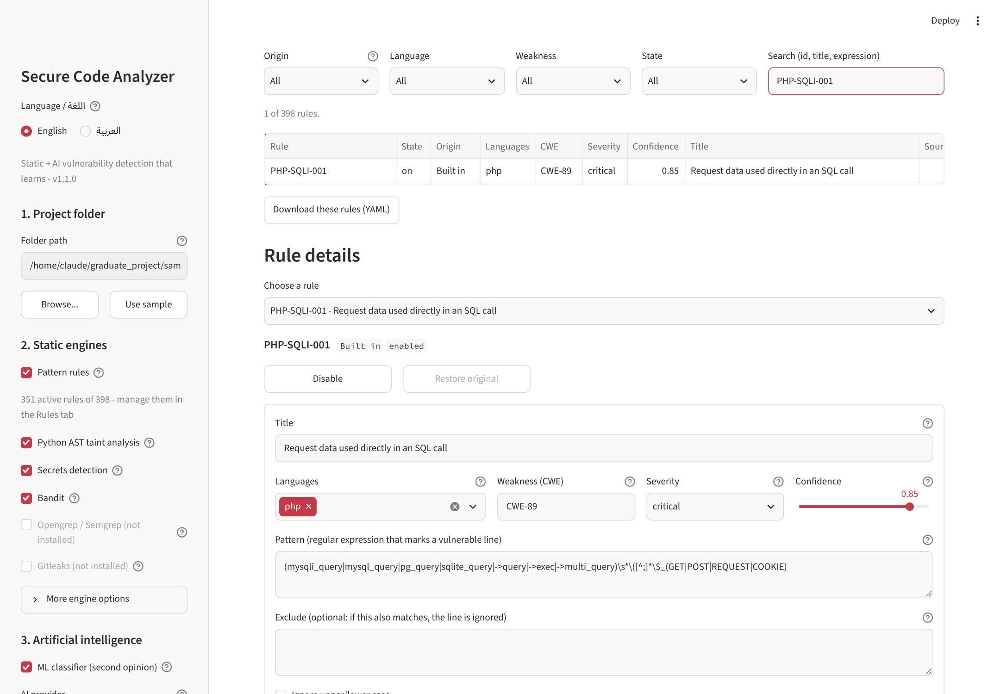 |
| **Rules** - write your own rule, checked before saving | **Rules** - try an expression on code |
| 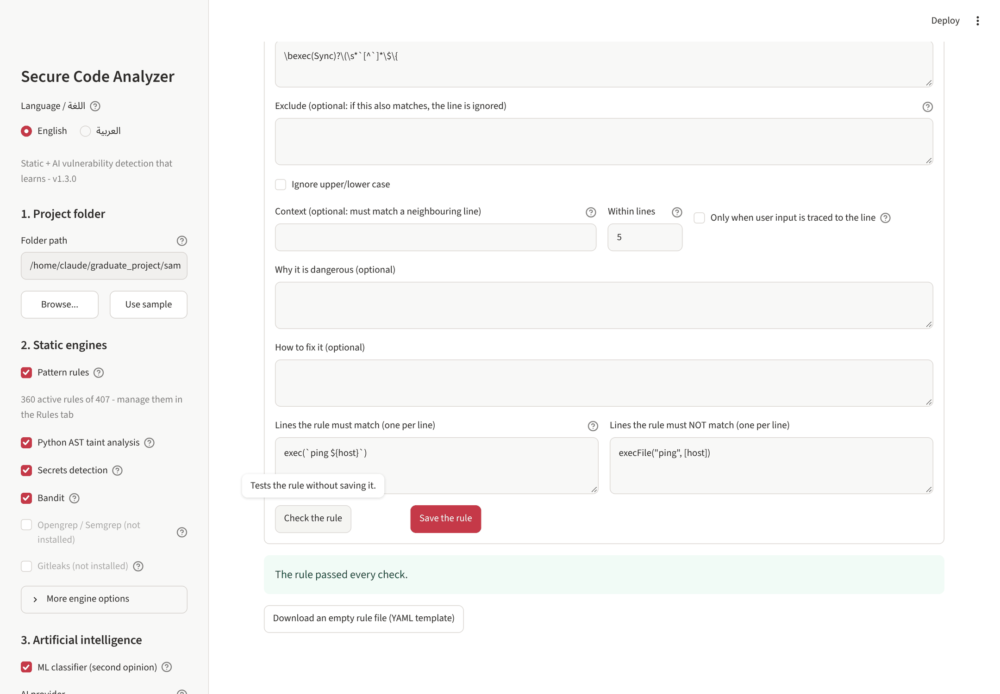 | 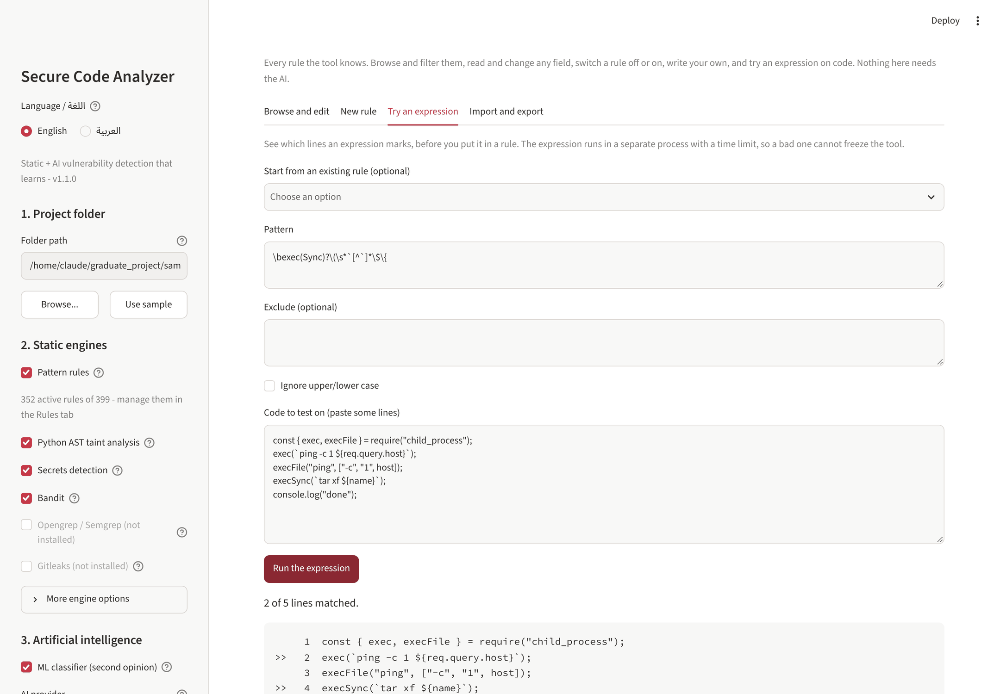 |
| **Learning** - proposed rules wait for approval | **Guide** - instructions and quick start |
| 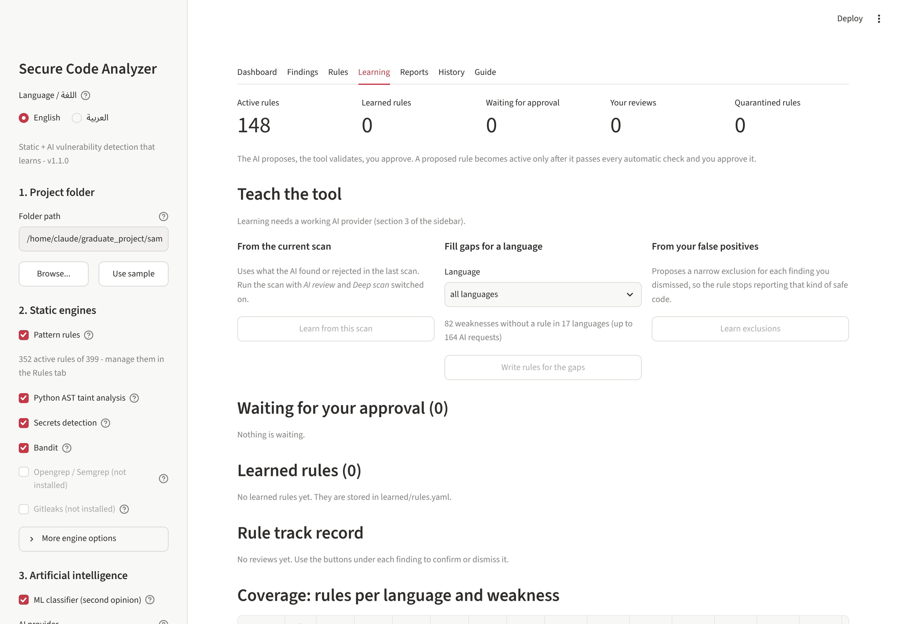 | 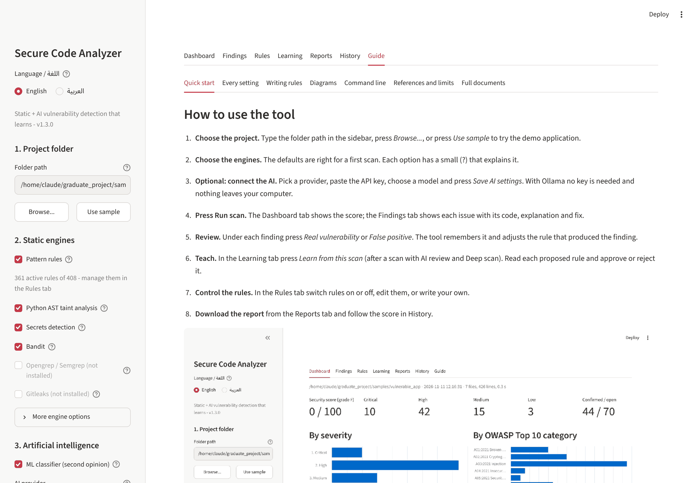 |
| **Guide** - what every setting does | **Guide** - the diagrams, each with its explanation |
| 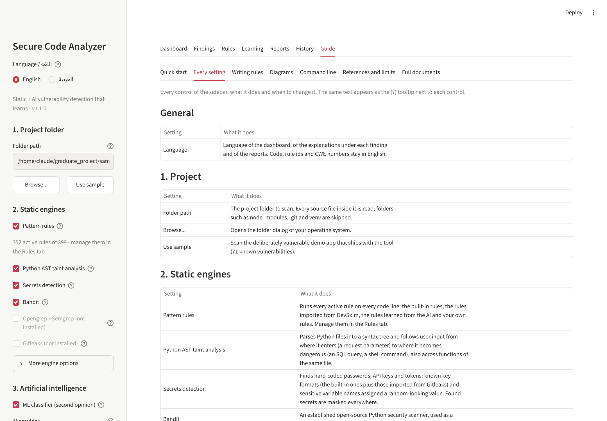 | 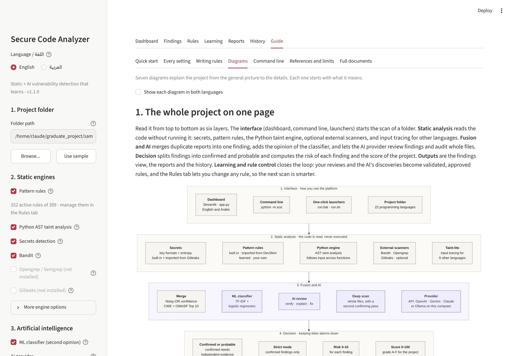 |
| **العربية** - اللوحة | **العربية** - تبويب القواعد |
| 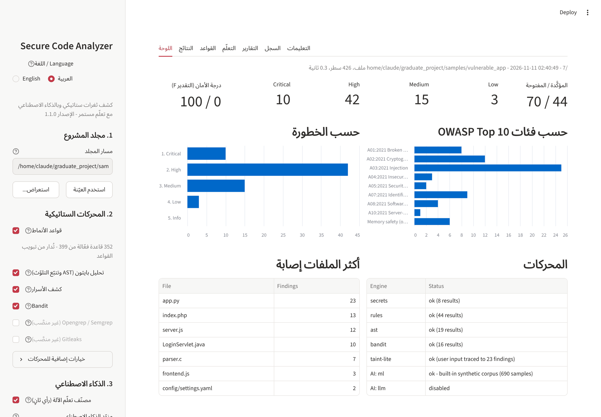 | 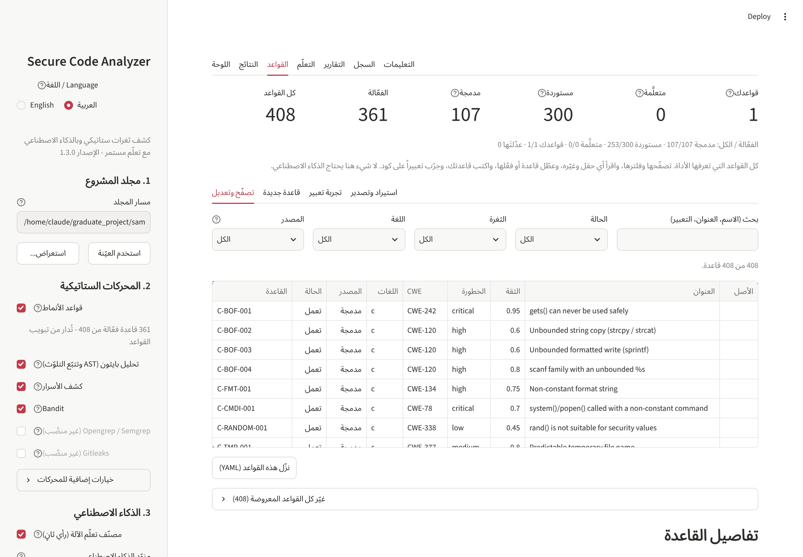 |
| **العربية** - التعليمات | **العربية** - المخططات مع شرحها |
| 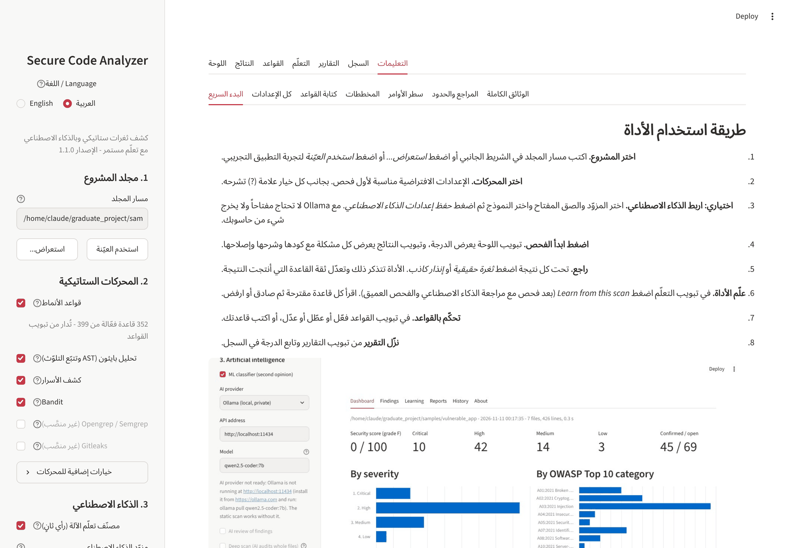 | 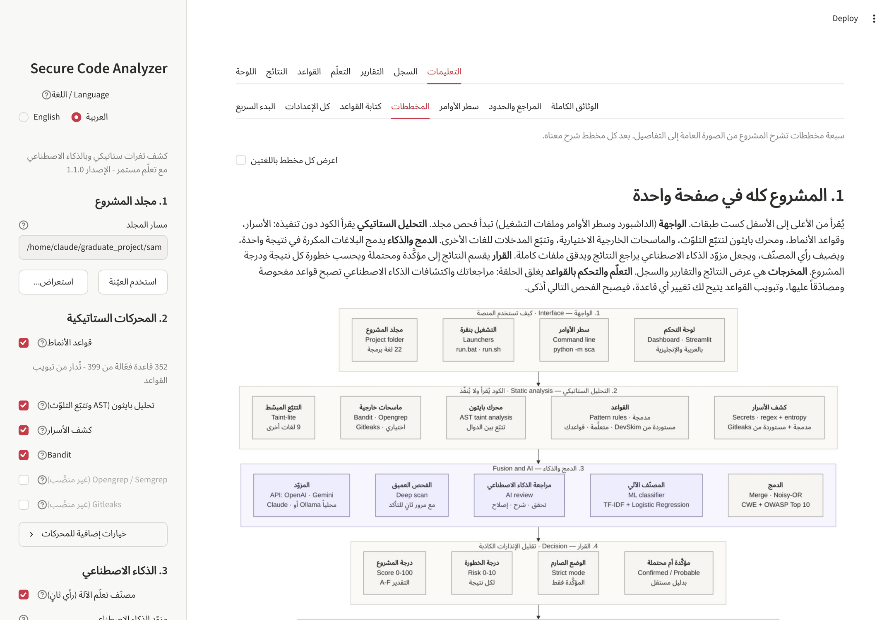 |

Command line:

```bash
python -m sca scan path/to/project --format html,json,sarif,pdf
python -m sca scan android-source.zip --lang ar
python -m sca scan path/to/project --llm --deep --strict --lang ar
python -m sca scan app-release.apk                   # an Android app package (APK, AAB, APK set)
python -m sca flutter info app-release.apk           # package, build mode, signing, components
python -m sca flutter apis app-release.apk           # server addresses, API calls and keys, with their places
python -m sca doctor       # which engines, AI parts and optional app tools are available
```

## Connecting an AI provider

The static scan and the ML classifier work with no setup. For AI review, deep scan and rule
learning, choose a provider in **Scan settings** or on the command line:

```bash
python -m sca config --provider openai --model <model-name>     # asks for the API key
python -m sca config --provider anthropic --model <model-name>
python -m sca config --provider gemini --model <model-name>
python -m sca config --provider ollama --model qwen2.5-coder:7b # local, no key
```

| Provider | Kind | Notes |
|---|---|---|
| `openai`, `gemini`, `openrouter`, `groq`, `deepseek`, `mistral` | cloud API | OpenAI chat-completions format |
| `anthropic` | cloud API | Claude Messages API |
| `custom` | any OpenAI-compatible server | LM Studio, vLLM, a company gateway |
| `ollama` | local model | nothing leaves the computer |

The key is stored in `.env` in the project folder (git-ignored, never written to reports or
the database). **Privacy:** with a cloud provider, the code under review is sent to that
provider. Secrets the tool detects are masked first; secrets it does not detect are not.
Use Ollama when the code must stay on the machine. Cloud APIs are billed by their provider:
one request per reviewed finding, one per file in a deep scan, up to two per proposed rule.

## How it works

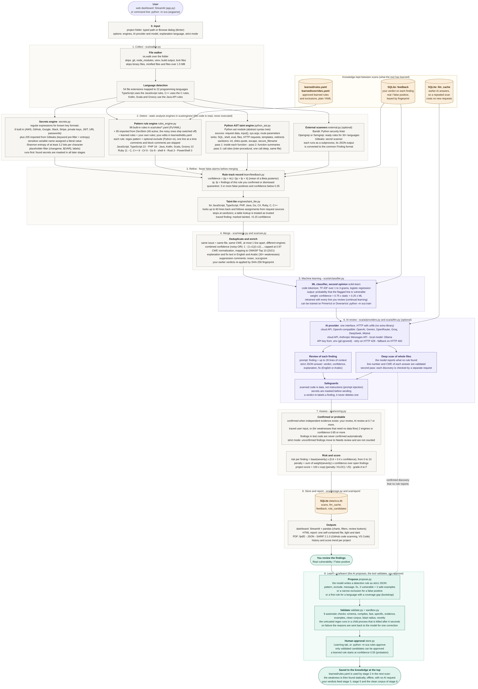

Click the image to enlarge it. Source: [docs/diagrams/pipeline.mmd](docs/diagrams/pipeline.mmd). Arabic version: [docs/images/pipeline.ar.png](docs/images/pipeline.ar.png). All diagrams (overview, usage steps, taint analysis, finding status, learning loop) with a detailed walk-through are in [docs/DIAGRAMS_AR.md](docs/DIAGRAMS_AR.md).

| Stage | Code | Tools and techniques |
|---|---|---|
| 0. Input | `app.py`, `sca/__main__.py` | Streamlit dashboard, argparse command line, tkinter folder dialog |
| 1. Collect | `sca/walker.py`, `sca/flutter/` | `os.walk`, extension-to-language map (70 extensions, 22 languages, including JSP, EJS and ASP.NET pages; a backup copy such as `config.php.dist` is read as the original), binary/minified/size filters. An app package is decoded instead (own readers for ZIP, binary and protobuf XML, `resources.arsc`, DEX, APK signatures, the Dart kernel and the AOT snapshot) into virtual files |
| 2. Detect | `sca/engines/`, `sca/rules/`, `sca/flutter/checks.py` | Secrets: regex key formats (11 in the engine, 2 Dart formats in `dart.yaml`, 205 imported from Gitleaks) + Shannon entropy. Pattern rules: 215 built-in YAML pattern rules (47 of them for Dart) + 95 imported from DevSkim + your own (PyYAML, Python `re`) + learned rules; pages and templates also get the JavaScript rules inside their `<script>` code. Python: `ast` module, taint analysis with function summaries. C/C++: per-function memory checks (`c_memory`): double free, use after free, leaks, allocation sizes that overflow, division by zero, out-of-bounds indexes, copies larger than the buffer. Flutter/Android: 52 structural checks of the manifest, network security config, Gradle, signing, Info.plist, build mode and Dart dependencies. Optional: Bandit, Opengrep/Semgrep, Gitleaks through `subprocess` + JSON |
| 3. Refine | `sca/learn/feedback.py`, `sca/engines/taint_lite.py` | Beta-posterior rule confidence and quarantine from your reviews; heuristic input tracing for 13 languages (Dart included) |
| 4. Merge | `sca/merge.py`, `sca/cwe.py` | Deduplication, noisy-OR confidence, CWE normalization, OWASP Top 10 (2021) mapping (plus OWASP Mobile Top 10 2024 and MASVS for apps), English/Arabic knowledge base, SHA-256 fingerprints |
| 5. ML | `sca/ai/classifier.py` | scikit-learn: code tokenizer, TF-IDF 1-3-grams, logistic regression; retrained with reviewed lines |
| 6. AI review | `sca/ai/providers.py`, `sca/ai/llm.py` | OpenAI-compatible and Anthropic APIs or Ollama over `urllib`; JSON-only prompts; deep scan with second-pass verification; SQLite answer cache; secret masking |
| 7. Assess | `sca/scoring.py`, `sca/flutter/inventory.py` | Confirmed/probable tier, strict mode, risk 0-10, exponential project score 0-100, grade A-F. The static inventory retains original server addresses, API calls, paths, keys and configuration for local previews; analysis/AI and CLI representations remain masked. Static inventory extraction contacts no services. |
| 8. Store and report | `sca/storage.py`, `sca/report/` | SQLite, pandas, self-contained HTML, fpdf2 (PDF), JSON, SARIF 2.1.0 |
| 9. Learn | `sca/learn/` | LLM-written rules as JSON, 9 automatic checks, regex sandbox in a killable child process, human approval, YAML rule store |

### The learning loop

1. **Discover.** The AI deep scan reads whole files and reports weaknesses that no rule
   found. A second, separate request must confirm each one.
2. **Propose.** For each confirmed discovery the model writes a detection rule (a regular
   expression with examples) as strict JSON. For each false positive it writes a narrow
   exclusion instead.
3. **Validate.** Nine automatic checks: the pattern compiles, finishes on stress input
   (it runs in a separate process that is killed on timeout), is specific, matches the line
   it was learned from, matches its vulnerable examples and none of its safe ones, matches
   nothing in the known-safe corpus, does not flag an implausible share of the project, and
   is not a duplicate. On failure the reasons go back to the model once for a correction.
4. **Approve.** A validated candidate waits in the Learning tab. Nothing is active until a
   person approves it.
5. **Use.** The approved rule is written to `learned/rules.yaml`. The next scan finds that
   weakness statically: fast, offline, with no AI call.
6. **Track.** Every "real" / "false positive" review adjusts the confidence of the rule
   behind the finding. A rule that keeps producing false positives is quarantined.

To keep learning until a round finds nothing new, and to fill the gaps of every language:

```bash
python -m sca learn path/to/project --rounds 5 --auto-approve
python -m sca learn --bootstrap all      # one candidate rule per missing (language, weakness)
python -m sca coverage                   # rules per language and weakness
```

`--auto-approve` activates only validated rules learned from real code; exclusions and
bootstrap rules always wait for a person. Without it the loop stops after one round and
waits for your approval.

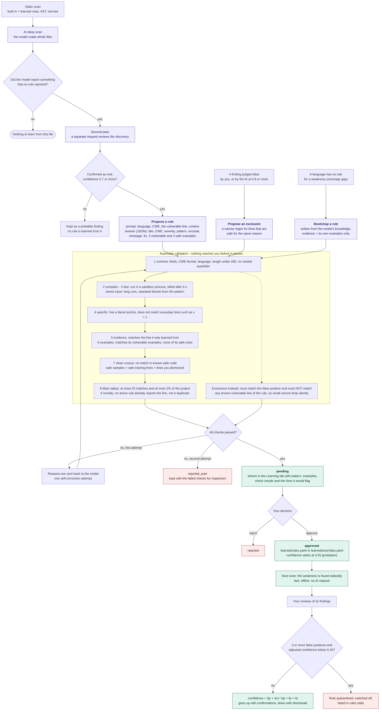

Diagram source: [docs/diagrams/learning-loop.mmd](docs/diagrams/learning-loop.mmd). The Learning tab of the dashboard:


(The candidates in this screenshot were produced by the scripted test model, not by a real
AI service.)

### The rule set: built in, imported, learned, your own

The shipped rule catalog and default activation counts are generated from the current
YAML files in [docs/RULES.md](docs/RULES.md), alongside 52 structural Flutter/Android checks.
The [2026-11-27 upstream review](docs/UPSTREAM_RULES_2026_11_27.md) records pinned GitHub
sources, licensed imports, validation, and rules deliberately not converted. Local rule
overrides can change activation counts; they are not the shipped defaults.

| Origin | Location |
|---|---|
| Project rules, including Android, Dart and client libraries | `sca/rules/*.yaml` |
| Microsoft DevSkim patterns | `sca/rules/imported/devskim.yaml` |
| Gitleaks credential formats and compatible boundary handling | `sca/rules/imported/gitleaks*.yaml` |
| Betterleaks provider formats and contextual credential patterns | `sca/rules/imported/betterleaks*.yaml` |
| Narrow adaptations of GitHub CodeQL Android checks | `sca/rules/imported/codeql_android*.yaml` |
| Approved learned rules and user rules | `learned/rules.yaml`, `learned/custom.yaml` |

**Historical DevSkim and Gitleaks import checks (2026-11-11).** `tools/import_rules.py` converts each rule and keeps
it only if it compiles in Python, finishes on stress input, passes its own examples and is
silent on the known-safe samples. 78 of the 378 source rules were left out (multi-line
conditions, unsupported languages, failed checks). The rest were run on 2.38 million code
lines of 21 well-known open-source projects; rules that DevSkim marks as "manual review",
that fired often, or whose matches were read by hand and found harmless ship **disabled**,
each with the reason. The full record is `evaluation/import_report.json`.

**Full control.** In the **Rules** tab, or with `python -m sca rules ...`:

```bash
python -m sca rules catalog --lang php          # every rule for a language
python -m sca rules show DEVSKIM-DS425070       # one rule, with its source and licence
python -m sca rules disable JS-EVAL-001         # switch off (enable = on again)
python -m sca rules enable --origin imported --lang java   # every rule matching the filters
python -m sca rules edit PHP-SQLI-001 --set severity=medium --set confidence=0.5
python -m sca rules reset PHP-SQLI-001          # undo your changes to a shipped rule
python -m sca rules template > my-rule.yaml     # an empty rule to fill in
python -m sca rules new my-rule.yaml            # add your own rule (checked first)
python -m sca rules test MY-RULE-001 path/      # which lines does it mark?
python -m sca rules export --origin custom -o my-rules.yaml
```

A rule can also carry a context condition (`near` / `within`: the pattern counts only if
another expression matches a neighbouring line) or be a sink rule (`requires_taint`: it
stays silent unless user input is traced to the line). Both keep rules that name a common
function from flooding a report.

A rule that ships with the tool is never rewritten: your change goes to
`learned/edits.yaml`, survives an update, and can be undone. A new rule is refused if a
field is invalid, the expression does not compile or is dangerously slow, or the rule fails
one of its own examples; it only gets a warning if it matches everyday or known-safe code.

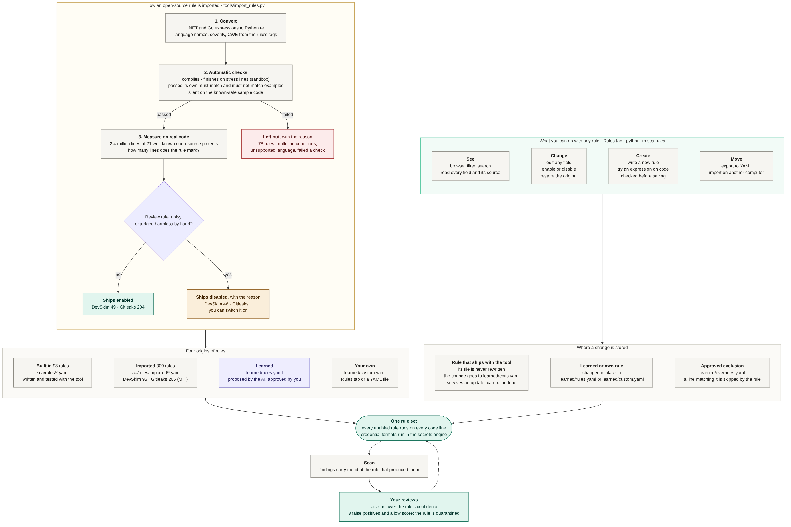

### Fewer false alarms

No static analyzer can guarantee zero false alarms; deciding whether arbitrary code is
vulnerable is undecidable in general. What the tool does instead:

| Layer | Effect |
|---|---|
| Exclusions and sanitizer lists in the rules | safe variants are not reported |
| Taint tracing (AST for Python, taint-lite for 8 more language families) | separates "user input reaches this line" from "a pattern matched" |
| Several engines + noisy-OR | agreement raises confidence |
| AI review with a second-pass check | false positives are labelled, AI discoveries need confirmation |
| Your reviews | dismissed findings stay dismissed; noisy rules lose confidence and are quarantined; exclusions are learned |
| Test code | findings in `tests/`, `test_*.py`, `*.spec.js` get a lower confidence and are never auto-confirmed; `--skip-tests` leaves them out |
| **Strict mode** | only findings backed by independent evidence are counted; the rest move to *Needs review* |

A finding is *confirmed* by your review, by the AI review, or by a traced flow of user input. Agreement between engines (or a single high-confidence rule) confirms only weaknesses that are a property of the line itself, such as a weak algorithm or a hard-coded key. For the injection family it does not: two engines that both notice a call to `pickle.loads()` have seen the same thing, and neither has shown that attacker data reaches it.

## Flutter and Android apps

The same scan works on a Flutter, Java or Kotlin Android **source project** and on a
**built Android package** (`.apk`, `.aab`, `.apks`, `.xapk`, `.apkm`). Full description:
[docs/FLUTTER.md](docs/FLUTTER.md).

- **Source project.** 47 Dart pattern rules (TLS, cleartext traffic, WebView settings, plain
  and world-readable storage, SQL built from strings, weak cryptography and seeded random
  numbers, logging of secrets, deep links, commands, reflection, paths) and 2 Dart credential
  formats, input tracing for Dart, 5 rules for CI scripts, Firebase rules and the web page,
  and 52 structural checks that parse `AndroidManifest.xml`, the network security config,
  FileProvider paths, the Gradle release build, `key.properties`, keystores, `Info.plist`,
  `pubspec.yaml` and `pubspec.lock` (25 curated advisories for 23 Pub packages, 16
  discontinued packages). An Android library module gets only its component, permission and
  link checks, product-flavor source sets count as release, and the platform folders of a
  Flutter plugin are not audited as an app.
- **Java and Kotlin.** Rules cover unsafe WebView settings, mutable pending intents, broad
  file access, sensitive logging and storage, weak cryptography, and credentials in
  Android resources and Gradle configuration. Typed and multiline literal assignments and
  unquoted YAML/properties/INI credentials are also checked. Dashboard previews and downloads
  retain original evidence; detected credentials are masked in AI inputs and the CLI.
- **App package.** Decoded in pure Python, with no Android SDK: the binary manifest and
  resources, the DEX strings, the signing certificates, and the Flutter parts. A debug build
  ships its Dart source in `kernel_blob.bin`, which is recovered and scanned like source code;
  a release build ships an AOT snapshot in `libapp.so`, whose strings, build mode, Dart
  version, obfuscation and package names are read. Findings point at a line of a decoded
  file (the manifest is written one attribute per line), and app facts go into every report.
  JADX can recover Java-like code from both Java and Kotlin bytecode. Optimized builds,
  obfuscation and Flutter AOT compilation affect how much code and metadata are recoverable.
- **API and key inventory.** After each scan of an app or project, the tool lists every
  server address (with its service: Firebase, Supabase, AWS, Stripe ... or the app's own
  server), the HTTP, WebSocket and GraphQL calls in code, the API paths kept as texts, the
  keys and tokens (full values in the dashboard, with review guidance), service identifiers such as the
  Firebase project, and `.env` entries, each with all its places. Alerts point out secret
  keys in the package, `http://` addresses, test servers and tunnels, keys in addresses,
  webhooks and bot tokens. Addresses are only read, never contacted. It is in the dashboard
  (*APIs and keys*), in the reports, and in `python -m sca flutter apis`. Details:
  [docs/FLUTTER.md](docs/FLUTTER.md#7-api-and-key-inventory).
- **Optional tools.** With `--apk-tools`, jadx decompiles the app's own classes and
  apksigner verifies the signature, when they are installed.
- **Decoded files.** After a local package scan, filter the recovered files by name and browse
  their numbered lines. In **APIs and keys**, **Open decoded location** opens the selected key
  location. Previews hide text literals and detected credentials and are kept in the current
  session.
- **Mobile taxonomy.** Findings of a mobile target also carry an OWASP Mobile Top 10 (2024)
  risk and a MASVS group, mapped from the CWE (the project's own mapping).

```bash
python -m sca flutter info app-release.apk                  # the facts of a package or project
python -m sca flutter deps path/to/flutter_app              # Dart packages and known advisories
python -m sca flutter apis app-release.apk                  # server addresses, API calls, keys, alerts
python -m sca flutter decode app-release.apk --out decoded  # every decoded file + facts.json
python -m sca flutter tools                                 # which optional tools are installed
python -m sca scan app-release.apk --apk-tools              # also jadx and apksigner
python -m sca scan path/to/project --no-flutter             # without the Flutter/Android checks, app facts and inventory
```

## Measured results

`python evaluation/evaluate.py` scans the labelled samples and compares the output with
`samples/ground_truth.json` (71 labelled vulnerabilities, 21 safe decoy lines, and a
second folder with no vulnerabilities at all).

| Configuration | TP | FP | FN | Precision | Recall | F1 |
|---|---:|---:|---:|---:|---:|---:|
| Bandit only (Python baseline) | 15 | 3 | 56 | 0.833 | 0.211 | 0.337 |
| Pattern rules + secrets | 48 | 3 | 23 | 0.941 | 0.676 | 0.787 |
| + Python AST taint engine | 66 | 3 | 5 | 0.957 | 0.930 | 0.943 |
| All static engines | 68 | 6 | 3 | 0.919 | 0.958 | 0.938 |
| All static, strict mode (confirmed only) | 43 | 0 | 28 | 1.000 | 0.606 | 0.754 |

Read these numbers with care:

- The samples were written together with the tool, and some heuristics were adjusted while
  looking at them. They show that the pipeline works, not how it performs on unseen code.
- Strict mode reached zero false positives **on these samples** by giving up a third of the
  recall: the 25 real findings it set aside are in *Needs review*, not lost. An AI review is
  what moves them back; that experiment needs your API key and is described in the guide.
- The three misses of the normal mode are a missing access check, prototype pollution and
  a password passed as a positional argument. The first two are what the AI deep scan and
  the learning loop are for. (The unchecked `memcpy` length and the integer overflow in an
  allocation size, missed by earlier versions, are now found by the C/C++ memory checks.)
- Bandit's hard-coded password test reports placeholders such as 'Enter your password';
  the tool now drops those as its own secrets engine does, which also changes the Bandit
  baseline row.

### Flutter and Android apps

`python evaluation/flutter_eval.py` (full output in
[evaluation/flutter_results.md](evaluation/flutter_results.md)); static engines only.

| Measurement | Result |
|---|---|
| Flutter samples, all static engines (60 labelled weaknesses, 5 decoys, plus a safe app) | precision 1.000, recall 0.983, F1 0.992 (59 TP, 0 FP, 1 FN) |
| Same, pattern rules and secrets without the Flutter checks | precision 1.000, recall 0.550 |
| Same, strict mode | precision 1.000, recall 0.233 |
| [DVMA](https://github.com/cpeoples/dvma), 218 modules, module-level recall | 26 (11.9%); code-level categories 26.2%, authorization/IPC 10.0%, AI and runtime 4.3% |
| [Ostorlab Insecure Flutter](https://github.com/Ostorlab/ostorlab_insecure_ios_app), 16 files | 15 found (93.8%) |
| [DVFA](https://github.com/Schmiemandev/dvfa), 10 challenges | 5 found (50%), 5 of the 7 not marked hard |
| Probe app built with Flutter 3.44.8: planted weaknesses still found | source 16/16, debug APK 16/16, release APK 14/16, obfuscated 14/16, AAB 14/16 |
| API probe app (`samples/flutter_api_probe`, 25 items): items the API and key inventory lists | source 21/21, debug APK 22/22, release APK 24/24, obfuscated 24/24 |

Read these numbers with care: the samples and the probe apps were written with the tool.
The labs were not, but their truth files (`evaluation/flutter_truth/`) were written for this
evaluation from each lab's documentation. Ostorlab rose from 10 to 15 of 16 with four Dart
rules written after its misses were known, so for those five files it is no longer an
unseen test. Most DVMA modules are authorization, IPC, AI-agent or runtime-defence
weaknesses that no static pattern can see. The two weaknesses lost in release builds (a TLS
callback that accepts every certificate, a token written to the log) are code structure,
which survives only as machine code; strings, the manifest, resources, assets and the
signature survive every build mode.

The one sample weakness still missed is an access token in the query of a URL (CWE-598);
the inventory raises an alert for it, but no rule reports it as a finding. A secret in a
`.env` file, missed before, is now found because the secrets engine reads unquoted
`NAME=value` lines. The release builds of the API probe list more keys than its source (10
against 5), because the compiler joins the keys written there in parts; obfuscation changes
nothing in the inventory.

### On the OWASP Benchmark (test cases not written with the tool)

The [OWASP Benchmark](https://owasp.org/www-project-benchmark/) is a public set of small
programs, each with one planted weakness; about half are real and half only look alike.
`score = TPR - FPR`: 0 is no better than guessing, 1 is perfect. Static engines only, no AI.
Reproduce with `python evaluation/owasp_benchmark.py BenchmarkJava BenchmarkPython`;
full per-category tables are in [evaluation/owasp_benchmark.md](evaluation/owasp_benchmark.md).

| Benchmark | Version of the tool | Found (TPR) | False alarms (FPR) | Score | Strict mode score |
|---|---|---:|---:|---:|---:|
| Java, 2,740 cases | 1.2.0, first run | 24% | 8% | +0.16 | +0.02 |
| Java, 2,740 cases | 1.3.0 | 84% | 40% | **+0.44** | +0.22 |
| Java, the 1,370 cases never looked at | 1.3.0 | 86% | 40% | +0.46 | +0.24 |
| Python, 1,230 cases | 1.2.0, first run | 53% | 31% | +0.22 | +0.25 |
| Python, 1,230 cases | 1.3.0 | 80% | 37% | **+0.43** | +0.33 |
| Python, the 615 cases never looked at | 1.3.0 | 80% | 38% | +0.42 | +0.28 |

How to read it:

- The first run is the honest starting point: the tool had never seen these programs, and
  it scored far below its result on its own samples. Whole weakness types were missing
  (Java: weak randomness, insecure cookies, LDAP, XPath, and every injection whose input is
  read on an earlier line; Python: LDAP, XPath, XXE, cookies, session data).
- Version 1.3 added them, looking only at the odd-numbered cases. The even-numbered cases
  were never looked at and score the same, but the cases of one category are generated from
  shared templates, so that half is a weaker check than a different benchmark would be.
- Weaknesses that are visible on one line score high (weak cipher, weak random, insecure
  cookie: +1.00 in Java). Injection categories stay low (Java SQL injection +0.01, path
  traversal +0.06): there the safe cases differ from the real ones only in how data flows
  through maps, lists, helper classes and reflection, which line rules with simple input
  tracing cannot follow. A real data-flow engine for Java is the main missing piece.
- A false-alarm rate of 37-40% on this benchmark is high. The benchmark is built to
  provoke exactly that; on mature real code the tool is much quieter (next table).

### On deliberately vulnerable projects written by others

Eight public training applications, one per language family, were scanned with the static
engines and then audited by hand: every intended vulnerability of each project was looked
up in its own documentation and code, and marked found or missed. The misses were used to
improve the tool (version 1.4): JSP, EJS and ASP.NET pages are now scanned, the JavaScript
rules also run inside the `<script>` code of pages, 26 rules were added (Go, Ruby, PHP,
JavaScript, Java/JSP, C#, Web.config, Jinja templates), new sink rules fire when input
reaches a redirect, file, URL or page through a variable, and C/C++ code gets the new
memory checks.

| Project (language) | Intended vulnerabilities found, 1.3 | 1.4 |
|---|---:|---:|
| Damn Vulnerable C Program (C) | 0 / 11 | **11 / 11** |
| govwa (Go) | 4 / 9 | **6 / 9** |
| railsgoat (Ruby on Rails) | 9 / 31 | **19 / 31** |
| DVWA (PHP) | 5 / 19 | **9 / 19** |
| dvna (Node.js) | 4 / 19 | **9 / 19** |
| JavaVulnerableLab (Java, JSP) | 4 / 51 | **18 / 51** |
| pygoat (Python, Django) | 20 / 48 | **22 / 48** |
| WebGoat.NET (C#, ASP.NET) | 2 / 39 | **8 / 39** |
| **All** | **48 / 227 (21%)** | **102 / 227 (45%)** |

Read these numbers with care:

- The improvements were made while looking at these projects, so they are not an unseen
  test any more. They show what the tool can now recognise, not how it performs on code
  it has never seen.
- About half of the remaining misses cannot be found by static rules at all: missing
  access checks (IDOR), CSRF, brute force, business logic, trusting values that a client
  can change, and outdated libraries (log4j, mathjs versions). They need the AI deep scan,
  a dependency scanner or a person.
- Most of the rest are flows across functions or files, for example WebForms code-behind
  that passes a text box value through a data-access class.
- The C/C++ memory checks reported nothing on 42,627 lines of mature C (cJSON, sds, kilo,
  libyaml); the sample programs' memcpy and allocation-size weaknesses are now found.

### Noise check on real code

The static engines were also run on the source of four widely reviewed libraries. These are
not labelled, so no precision or recall can be computed from them; mature libraries are
expected to contain few real vulnerabilities, so the number of *confirmed* findings is a
rough indicator of how noisy strict mode is.

| Library | Files | Lines | Time | Findings | In test code | Confirmed |
|---|---:|---:|---:|---:|---:|---:|
| pandas 3.0.5 | 1,422 | 636,043 | 92 s | 110 | 79 | 0 |
| scikit-learn 1.9.1 | 688 | 389,923 | 47 s | 70 | 54 | 1 |
| streamlit 1.67.0 | 735 | 149,134 | 16 s | 11 | 0 | 0 |
| bandit 1.9.4 | 70 | 11,235 | 2 s | 13 | 0 | 0 |

Measured with version 1.3.0, all rules included. One confirmed finding in 1.19 million
lines (MD5 used for a dataset checksum). An earlier version of this run is
also what showed that the first version of the "two engines agree" rule was too generous:
it marked 56 findings in pandas as confirmed, mostly `pickle.loads` and `eval` in tests.
The rule was tightened as described under *Fewer false alarms*.

The effect of the 253 imported active rules alone was measured on three large projects,
before and after the import (static engines without Bandit):

| Project | Code lines | Findings before → after | Confirmed before → after | Time before → after |
|---|---:|---:|---:|---:|
| redis | 346,353 | 199 → 216 | 2 → 2 | 15 s → 22 s |
| laravel/framework | 373,034 | 394 → 398 | 0 → 0 | 15 s → 22 s |
| django | 449,759 | 496 → 496 | 5 → 5 | 27 s → 36 s |

The import added 21 probable findings in 1.17 million lines, no confirmed ones, and made a
scan about 40% slower. On the labelled samples the precision and recall above did not change.

## What was and was not tested

- Tested (Linux and Windows through GitHub Actions, Python 3.10 and 3.12; locally 3.13):
  1,394 automated tests covering every engine, the pipeline, reports, the dashboard
  (including the learn-and-approve flow, the Rules tab and the Guide tab in both
  languages), the provider clients, the configuration command, the learning loop, feedback,
  quarantine, strict mode, the imported rules, rule management, the evaluation scripts, and
  every decoder of the app module against synthetic and deliberately malformed packages.
  The last full run on Windows (Python 3.12), with the real APKs, the probe builds and
  jadx available: all 1,394 passed. Without them pytest skips the tests that need them
  (next point).
  The dashboard was also driven through every tab in a real browser, in both languages.
- App packages: the decoders were checked against real APKs and app bundles built with
  Flutter 3.44.8 (debug, release, obfuscated release, AAB) and compared with the output of
  `aapt2` and `apksigner`. Tests that need these packages, or jadx, run only when
  `SCA_FLUTTER_APK_DIR`, `SCA_FLUTTER_PROBE_DIR`, `SCA_FLUTTER_API_DIR` or `SCA_JADX` is set. The built packages
  were only decoded, never installed or run. iOS packages (`.ipa`) are not supported.
- **No real AI service was called.** The provider clients and the learning loop were tested
  against local scripted servers that imitate the Ollama, OpenAI and Anthropic HTTP
  formats. The request format for the Claude API was checked against its current
  documentation; the other providers' addresses and formats are from their public
  documentation and were not exercised. The quality of reviews and of learned rules depends
  on the model you connect and is yours to measure.
- Gitleaks 8.30.1 and Opengrep 2.1.0 were run on Windows against retained decoded text
  from all twelve supplied applications and source samples. See the pinned tools,
  actual differences and partial parse diagnostics in [external validation](docs/EXTERNAL_ENGINES.md).
- Imported rules: each one passed the automatic checks and the noise measurement, but they
  were not each proven against real vulnerabilities or real leaked keys.
- The built-in engines do not depend on optional external executables. Semgrep itself
  was not run in this Windows experiment; Opengrep used the compatible adapter.
- "Download and run" was checked from a fresh clone of the repository in a new virtual
  environment on Linux: installation, a scan with all four report formats, the command
  line and the dashboard in a browser. Version 1.4 was checked the same way on Windows 11
  (Python 3.12), including the live scan log in both languages.
- Version 1.4 was measured on eight vulnerable projects written by others (table above,
  audited by hand) and, for noise, on four mature C libraries (cJSON, sds, kilo, libyaml:
  42,627 lines) where the new C/C++ memory checks reported nothing.
- `experiments/train_codebert.py` is an optional script that was not executed.

## Limits

- Static analysis cannot prove that code is secure, and it cannot be free of false alarms.
- Python data flow is followed across functions one call deep and within one file. Other
  languages are checked line by line, with a heuristic tracer for user input. The C/C++
  memory checks read one function at a time, top to bottom, without following paths.
- Access control (IDOR), CSRF, business logic and outdated dependencies are not found by
  the static engines; they need the AI deep scan, a dependency scanner or a person. The
  exception is Dart: `pubspec.lock` is checked against a curated, offline list of Pub
  advisories.
- A release app is read through its strings, not its machine code, so weaknesses that are
  code structure (a certificate callback, data flowing into a log) are found only in the
  source or in a debug build. There is no Dart data-flow engine and no analysis across Dart
  and Kotlin/Java platform channels. The score of an app package counts only its decoded,
  recovered and decompiled lines (not the strings dumps), so release APKs often score low
  from a few findings; compare them by their findings. The API and key inventory only reads
  addresses: it does not test whether a database or a storage bucket is really public or
  whether a key still works. More limits of the app module are in
  [docs/FLUTTER.md](docs/FLUTTER.md#10-limits).
- A learned rule is a single-line regular expression. It cannot express multi-line or
  data-flow conditions; such weaknesses remain the job of the AI deep scan.
- AI answers can be wrong in both directions. The design assumes this: nothing an AI says is
  acted on without validation, and nothing is ever deleted on its word.
- The security score is a heuristic of this tool, not an official CVSS score.

`samples/vulnerable_app`, `samples/flutter_vulnerable_app`, `samples/flutter_apk_probe` and
`samples/flutter_api_probe` are intentionally insecure and exist only as test input. Never
deploy them, and never install or publish packages built from them.

## Project layout

```
app.py                 Streamlit dashboard (English and Arabic)
run.bat / run.sh       one-click launchers
sca/
  __main__.py          command line: scan, config, learn, rules, feedback, coverage, flutter, ...
  pipeline.py          runs every stage in order
  walker.py            file discovery, language detection, secret masking
  engines/             rules_engine, python_ast, taint_lite, c_memory, secrets, external
  rules/               built-in YAML rules: javascript, php, java, c_cpp, ruby, shell, dart,
                       flutter, other
  rules/imported/      rules converted from DevSkim and Gitleaks, with source and licence
  flutter/             app packages and Flutter/Android projects: decoders (zipread, axml,
                       aabproto, arsc, dex, signing, kernel, snapshot), pubspec audit and
                       advisories, loaders (apk, project), checks, inventory (API and key
                       inventory), optional tools
  rulebook.py          rule management: list, check, create, edit, enable, reset, export
  ui/                  splash and introduction pages, Rules tab, Guide tab, app panel,
                       texts (EN + AR)
  merge.py             deduplication and noisy-OR confidence
  cwe.py               CWE + OWASP knowledge base (English and Arabic), OWASP Mobile and MASVS
  ai/                  providers (API clients), llm (prompts), classifier (ML), seed_corpus
  learn/               propose, sandbox, validate, store, feedback, loop
  scoring.py           confirmed/probable tier, risk score, project score, grade
  storage.py           SQLite: history, LLM cache, reviews, rule candidates
  report/              HTML, PDF, SARIF, JSON
learned/               learned rules, your own rules, your edits and exclusions (YAML)
tools/                 import_rules.py (import and vet open-source rules), build_docs.py,
                       build_flutter_apks.py (builds the probe apps into APKs and an AAB),
                       build_pdf.py (renders docs/SUPERVISOR_AR.md as the PDF; needs
                       Playwright, rerun it after every change to the .md)
samples/               vulnerable_app, safe_app, ground_truth.json; flutter_vulnerable_app,
                       flutter_safe_app, flutter_ground_truth.json, flutter_apk_probe,
                       flutter_api_probe
infected_project/      19 training labs: sources and licences, fetch_labs.py, scan_labs.py,
                       RESULTS.md, REVIEW.md (the labs themselves are downloaded, not stored)
evaluation/            evaluate.py, results.md, owasp_benchmark.py and .md, import_report.json,
                       flutter_eval.py, flutter_results.md, flutter_truth/ (truth files of
                       the labs and the probe apps)
tests/                 regression tests for scanners, loaders, evidence, archives and UI
docs/                  supervisor document, Arabic guide, rules guide, Flutter guide (EN + AR),
                       illustrated walk-through, thesis outline, architecture,
                       diagrams/ (Mermaid sources) and images/
experiments/           optional CodeBERT fine-tuning script (not executed)
```

## Android runtime analysis

The Runtime analysis tab records real URLs, credential candidates and key material from a connected Android lab, with full values, event evidence, source correlation and archived sessions. See [setup, coverage and Windows instructions](docs/DYNAMIC_ANALYSIS.md). Docker is optional. Runtime observations are separate from static vulnerability findings.

## Evidence and validation update — 2026-11-27

See [the reproducible corpus review](docs/VALIDATION_2026_11_27.md) for independent
APK inspection, pipeline comparisons, regression fixes and measured limits. Literal URLs,
URL templates and runtime observations are distinct evidence types. Values resolved from
Android resources link to their definition; configuration and `.env` rows also open the
side preview. An SDK identifier or credential-shaped value is not proof of exploitability.

Raw APKs, decompiled application contents, original credentials and local capture archives
remain in the local `data/` directory. The repository contains implementation, reproducible
audit tools, isolated regression fixtures and aggregate validation results.

## License

MIT. See [LICENSE](LICENSE). The imported rules come from DevSkim and Gitleaks, both MIT;
their notices are in [THIRD_PARTY_NOTICES.md](THIRD_PARTY_NOTICES.md).
