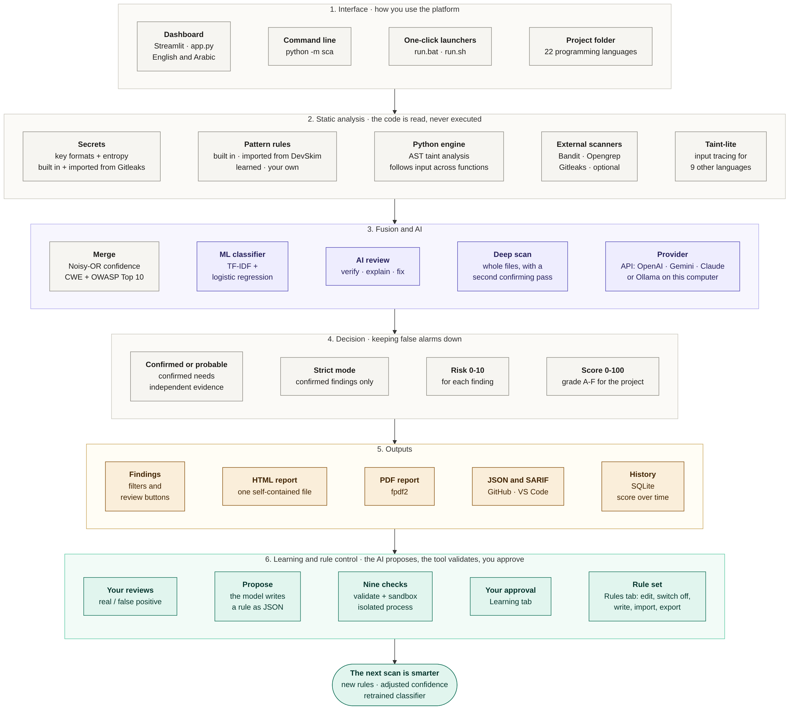
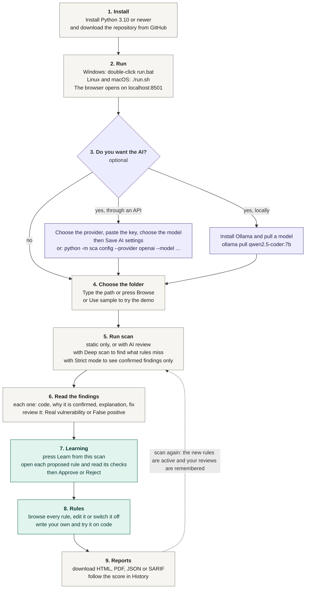
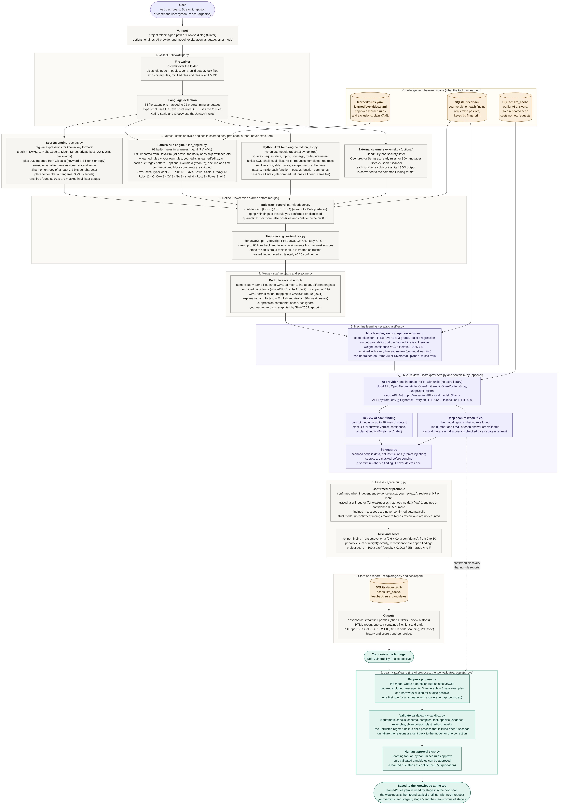
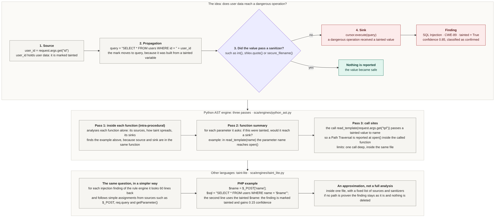
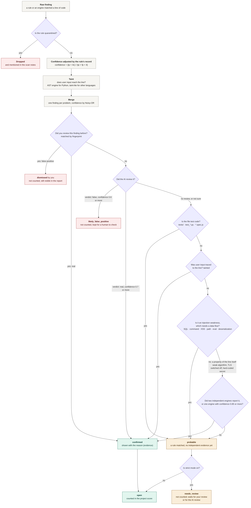
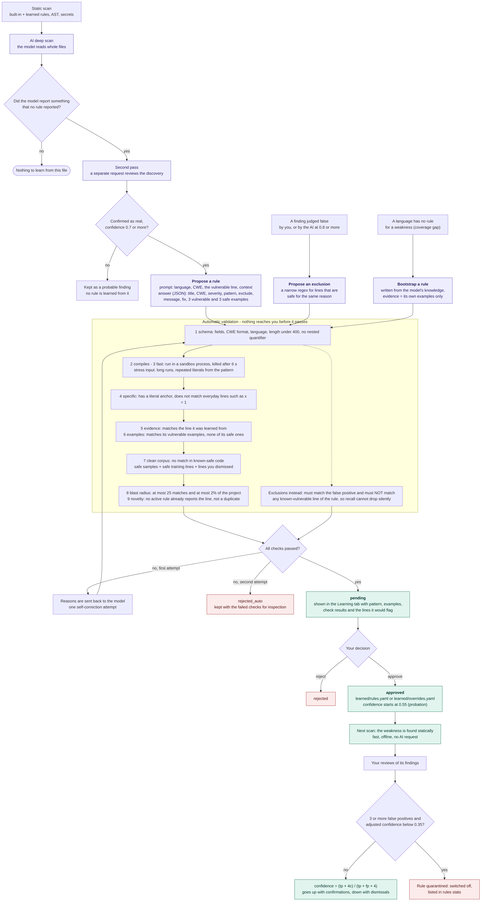
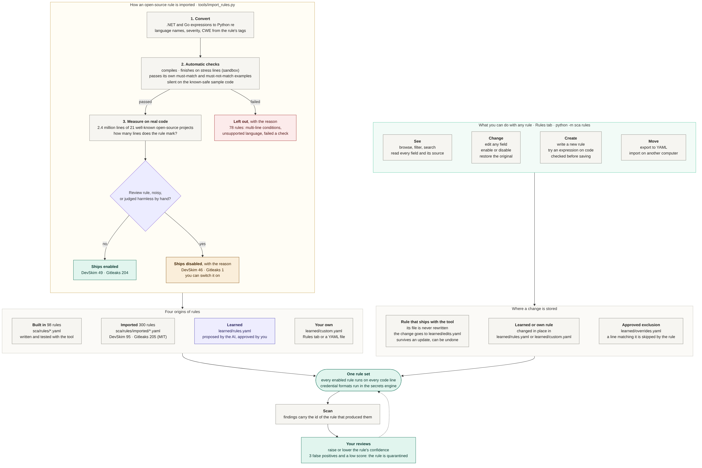

# The diagrams, explained

Seven diagrams explain the project from the general picture to the details. Each has an English and an Arabic version (`docs/images/<name>.png` and `<name>.ar.png`), rendered from the Mermaid sources in `docs/diagrams/`. The same explanations are shown in the Guide tab of the dashboard. The Arabic walk-through with a worked numeric example is in [DIAGRAMS_AR.md](DIAGRAMS_AR.md).

## 1. The whole project on one page

Read it from top to bottom as six layers. The **interface** (dashboard, command line, launchers) starts the scan of a folder. **Static analysis** reads the code without running it: secrets, pattern rules, the Python taint engine, optional external scanners, and input tracing for other languages. **Fusion and AI** merges duplicate reports into one finding, adds the opinion of the classifier, and lets the AI provider review findings and audit whole files. **Decision** splits findings into confirmed and probable and computes the risk of each finding and the score of the project. **Outputs** are the findings view, the reports and the history. **Learning and rule control** closes the loop: your reviews and the AI's discoveries become validated, approved rules, and the Rules tab lets you change any rule, so the next scan is smarter.

Arabic version: [images/overview.ar.png](images/overview.ar.png) · source: [diagrams/overview.mmd](diagrams/overview.mmd)

## 2. How to use it, step by step

The practical path of a user: install, run, optionally connect the AI (through an API key or a local Ollama model), choose the folder, scan, read and review the findings, let the tool learn, download the report. The dashed arrow at the end is the point of the whole design: the next scan is better than the previous one, because the approved rules are active and your reviews are remembered.

Arabic version: [images/usage.ar.png](images/usage.ar.png) · source: [diagrams/usage.mmd](diagrams/usage.mmd)

## 3. Every stage, with its tools and techniques

The detailed version of diagram 1. Each box names the stage, the source file that implements it, and the technique or library it uses: os.walk to collect files, YAML rules and regular expressions, Python's ast module for taint analysis, Shannon entropy for secrets, noisy-OR to combine confidence, TF-IDF with logistic regression for the classifier, the provider APIs for the language model, an exponential formula for the score, and SQLite for storage. Use it to answer 'how exactly is this step done?'.

Arabic version: [images/pipeline.ar.png](images/pipeline.ar.png) · source: [diagrams/pipeline.mmd](diagrams/pipeline.mmd)

## 4. Taint analysis: following user input

A value that comes from the user (a **source**, such as a request parameter) is marked as tainted. The mark **propagates** through assignments, string building and function calls. A **sanitizer** (a parameterized query, an escaping function, a type conversion) removes it. If a tainted value reaches a **sink** (an SQL query, a shell command, a file path), that is a vulnerability with evidence, not a guess. The diagram shows the three passes of the Python engine: inside a function, function summaries, and call sites.

Arabic version: [images/taint.ar.png](images/taint.ar.png) · source: [diagrams/taint.mmd](diagrams/taint.mmd)

## 5. What happens to one finding

This is how false alarms are kept down. A raw match first meets your earlier verdicts and the track record of its rule, then input tracing, merging, the classifier and the AI review. A finding becomes **confirmed** only with independent evidence (you, the AI with high confidence, traced input, or two engines for weaknesses that need no data flow). Otherwise it is **probable**; in strict mode a probable finding moves to *Needs review* and does not count in the score.

Arabic version: [images/finding-status.ar.png](images/finding-status.ar.png) · source: [diagrams/finding-status.mmd](diagrams/finding-status.mmd)

## 6. The learning loop

How a discovery of the AI becomes a permanent rule. The model proposes a rule as JSON; nine automatic checks test it (valid, fast, specific, matches the evidence and its own examples, silent on safe code, not too broad, new); a failed rule is sent back once for correction; a rule that passes waits for your approval; an approved rule starts on probation with a modest confidence, and your later reviews raise it or quarantine it.

Arabic version: [images/learning-loop.ar.png](images/learning-loop.ar.png) · source: [diagrams/learning-loop.mmd](diagrams/learning-loop.mmd)

## 7. Where rules come from and how you control them

Four origins feed one rule set: **built-in** rules written with the tool, **imported** rules converted from DevSkim and Gitleaks (each one checked and measured on real code before it was allowed in), **learned** rules approved in the Learning tab, and **your own** rules. Your changes to a shipped rule are kept in a separate small file, so they survive an update and can be undone. From the Rules tab or the command line you can browse, edit, switch off, test and export any rule.

Arabic version: [images/rules.ar.png](images/rules.ar.png) · source: [diagrams/rules.mmd](diagrams/rules.mmd)
