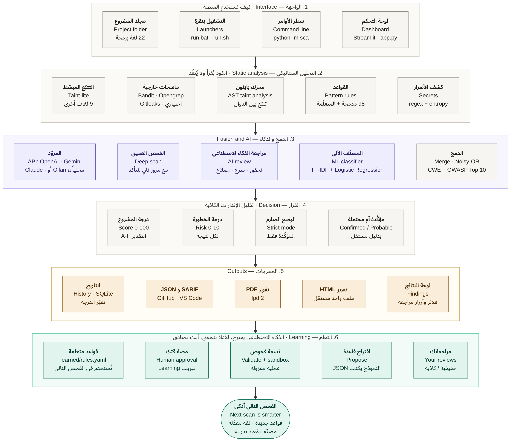
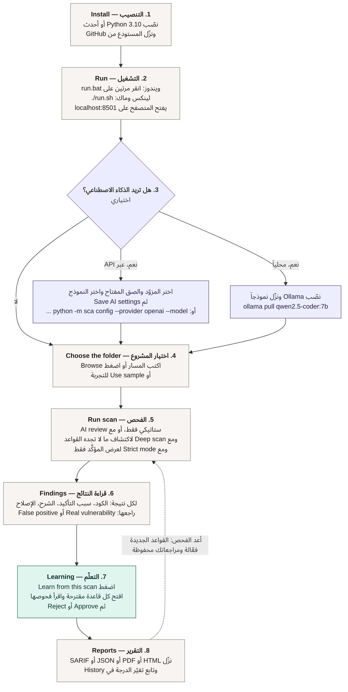
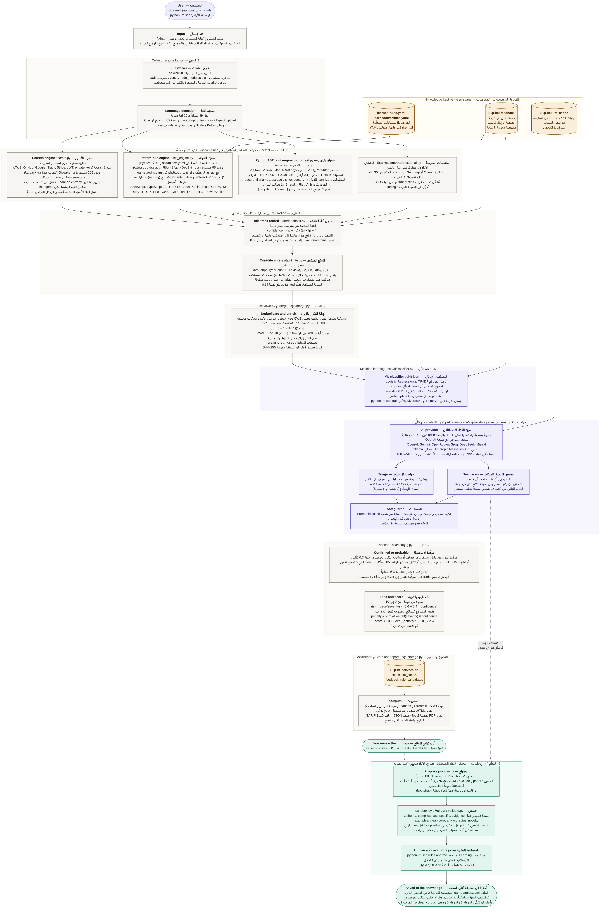
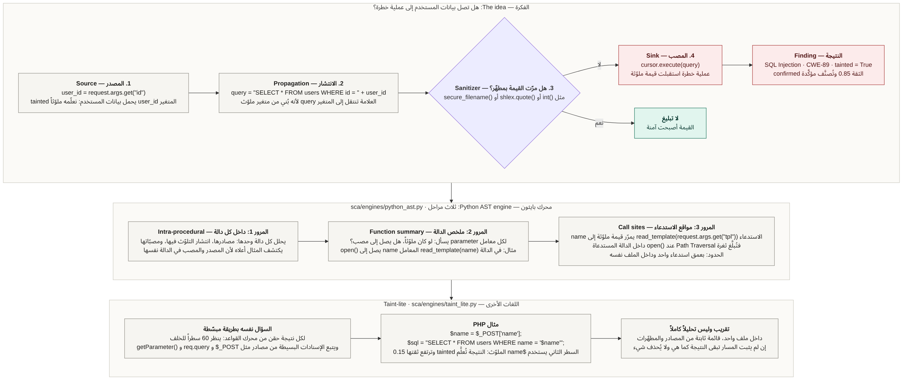
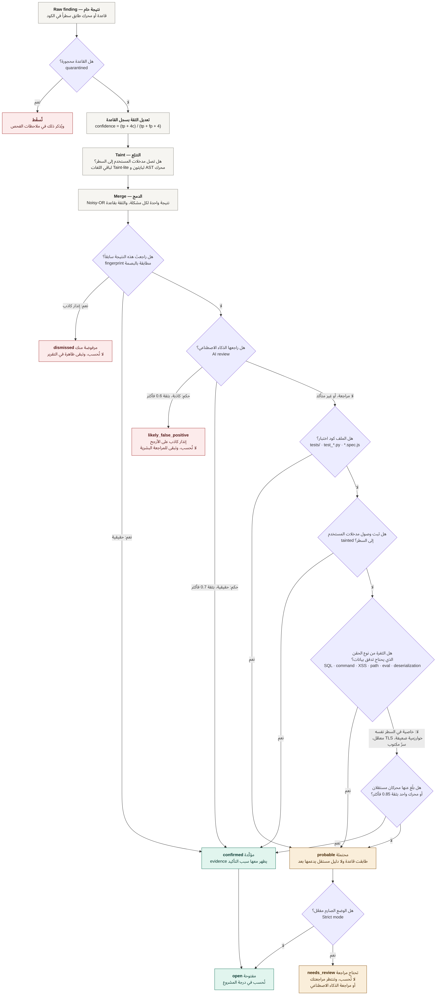
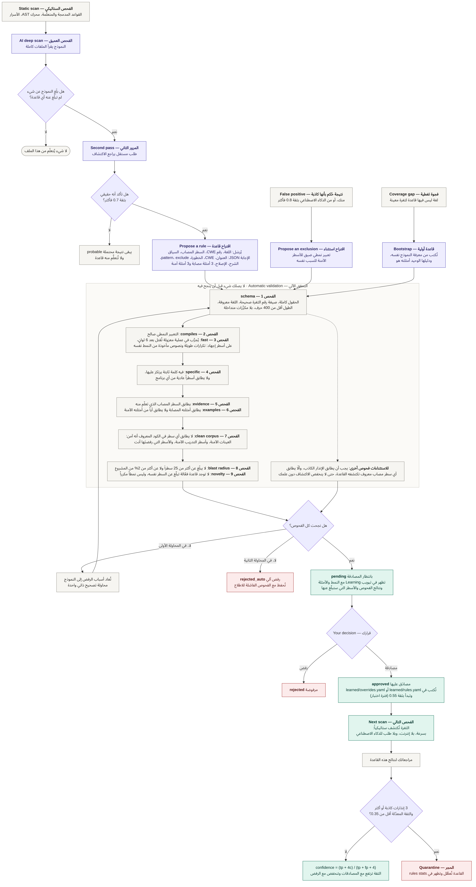

# الشرح المصوَّر التفصيلي — Secure Code Analyzer

هذا الملف يشرح المشروع كله بالمخططات، من الصورة العامة إلى أدق التفاصيل، بترتيب منطقي:
كل مخطط يتبعه شرح مكتوب لما فيه. المخططات بالعربية مع المصطلحات الإنجليزية، ولكل مخطط مصدر
قابل للتعديل في `docs/diagrams/`. اضغط على أي صورة لتكبيرها.

| # | المخطط | يجيب عن السؤال | الصورة | المصدر |
|---|---|---|---|---|
| 1 | الصورة الشاملة | ما مكونات المشروع؟ | `images/overview.ar.png` | `diagrams/overview.ar.mmd` |
| 2 | خطوات الاستخدام | كيف أستخدمه عملياً؟ | `images/usage.ar.png` | `diagrams/usage.ar.mmd` |
| 3 | المخطط الكامل | ماذا يحدث في كل مرحلة وبأي أدوات؟ | `images/pipeline.ar.png` | `diagrams/pipeline.ar.mmd` |
| 4 | تحليل التلوّث | كيف يعرف أن بيانات المستخدم تصل إلى عملية خطرة؟ | `images/taint.ar.png` | `diagrams/taint.ar.mmd` |
| 5 | رحلة النتيجة | كيف يقرر أن النتيجة مؤكَّدة أو محتملة أو كاذبة؟ | `images/finding-status.ar.png` | `diagrams/finding-status.ar.mmd` |
| 6 | حلقة التعلّم | كيف يتعلّم قاعدة جديدة؟ | `images/learning-loop.ar.png` | `diagrams/learning-loop.ar.mmd` |

النسختان الإنجليزيتان للمخططين 3 و 6: `images/pipeline.png` و `images/learning-loop.png`.

**دلالة الألوان في كل المخططات:** الرمادي للتحليل الستاتيكي، البنفسجي للذكاء الاصطناعي،
الأخضر للتعلّم وللنتيجة الجيدة، البرتقالي للبيانات المحفوظة والمخرجات، والأحمر للرفض.

---

## 1. الصورة الشاملة: المشروع في صفحة واحدة



المشروع ست طبقات، تُقرأ من الأعلى إلى الأسفل، وكل صف يُقرأ من اليمين إلى اليسار:

1. **الواجهة (Interface):** طريقتان للاستخدام: لوحة التحكم في المتصفح (مكتبة Streamlit، الملف
   `app.py`) أو سطر الأوامر (`python -m sca`). الملفان `run.bat` و `run.sh` ينصّبان المتطلبات
   ويفتحان اللوحة بنقرة. المدخل الوحيد هو مجلد المشروع، والأداة تتعرف على 22 لغة برمجة.
2. **التحليل الستاتيكي (Static analysis):** خمسة مكونات تقرأ الكود دون تنفيذه: كاشف الأسرار،
   محرك القواعد (98 قاعدة مدمجة مع ما تتعلّمه الأداة)، محرك بايثون الذي يتتبع البيانات بين
   الدوال، ماسحات خارجية اختيارية، والتتبّع المبسّط لتسع لغات أخرى.
3. **الدمج والذكاء (Fusion and AI):** النتائج المكررة تصبح نتيجة واحدة بثقة مشتركة، ثم يعطي
   المصنّف الآلي رأياً ثانياً، ثم يراجع النموذج اللغوي كل نتيجة ويشرحها، ويفحص الملفات كاملة
   بحثاً عمّا فات القواعد. النموذج يأتي من API سحابي أو من Ollama محلياً.
4. **القرار (Decision):** كل نتيجة تُصنَّف مؤكَّدة أو محتملة حسب وجود دليل مستقل. الوضع الصارم
   يعرض المؤكَّد فقط. ثم تُحسب خطورة كل نتيجة ودرجة المشروع وتقديره.
5. **المخرجات (Outputs):** لوحة النتائج مع أزرار المراجعة، تقرير HTML، تقرير PDF، ملفا JSON
   و SARIF، وتاريخ الفحوصات.
6. **التعلّم (Learning):** مراجعاتك واكتشافات الذكاء الاصطناعي تتحول إلى قواعد مقترحة، تمر
   بتسعة فحوص آلية، ثم تنتظر مصادقتك، ثم تُحفظ في `learned/rules.yaml`.

السهم الأخير هو فكرة المشروع الأساسية: **الفحص التالي أذكى من السابق**، لأن فيه قواعد جديدة،
وثقة القواعد معدّلة بمراجعاتك، والمصنّف أُعيد تدريبه.

---

## 2. خطوات الاستخدام العملية



| الخطوة | ماذا تفعل | ملاحظات |
|---|---|---|
| 1. التنصيب | نصّب Python 3.10 أو أحدث، ونزّل المستودع (Code ثم Download ZIP) | في ويندوز فعّل خيار Add python.exe to PATH |
| 2. التشغيل | انقر مرتين على `run.bat` (أو `./run.sh`) | أول مرة تأخذ بضع دقائق لتنصيب المكتبات |
| 3. الذكاء الاصطناعي | اختياري: اختر المزوّد والصق مفتاح الـ API واختر النموذج، ثم Save AI settings | بدون هذه الخطوة يعمل الفحص الستاتيكي والمصنّف فقط |
| 4. اختيار المشروع | اكتب المسار أو اضغط Browse | زر Use sample يختار التطبيق التجريبي المصاب عمداً |
| 5. الفحص | اضغط Run scan | فعّل Deep scan إذا أردت أن تتعلّم الأداة قواعد جديدة |
| 6. قراءة النتائج | تبويب Findings | راجع كل نتيجة: Real vulnerability أو False positive |
| 7. التعلّم | تبويب Learning ثم Learn from this scan | افتح كل قاعدة مقترحة، اقرأ فحوصها، ثم Approve أو Reject |
| 8. التقرير | تبويب Reports | HTML فيه كل شيء، و SARIF يُرفع إلى GitHub |

بعد الخطوة 8 أعد الفحص: القواعد التي صادقتَ عليها أصبحت فعّالة، والنتائج التي رفضتَها تبقى
مرفوضة.

---

## 3. المخطط الكامل: كل مرحلة وأدواتها



المسار كله تنفذه الدالة `scan_project` في الملف `sca/pipeline.py`. فيما يلي كل مرحلة: ما يدخلها،
ما يخرج منها، وكيف تعمل.

### المرحلة 0: الإدخال

- **المدخل:** مسار المجلد، وخياراتك (المحركات المفعّلة، المزوّد والنموذج، لغة الشرح، الوضع الصارم).
- **الأدوات:** واجهة Streamlit أو محلل الأوامر argparse. نافذة اختيار المجلد تستخدم tkinter
  وتُفتح في عملية منفصلة حتى لا تعطّل خادم الواجهة.

### المعرفة المحفوظة بين الفحوصات (الصندوق البرتقالي)

ثلاثة مخازن تبقى بعد انتهاء الفحص وتُستخدم في الفحص التالي:

| المخزن | ما فيه | من يستخدمه |
|---|---|---|
| `learned/rules.yaml` و `learned/overrides.yaml` | القواعد والاستثناءات التي صادقتَ عليها | محرك القواعد (المرحلة 2) |
| جدول `feedback` في SQLite | حكمك على كل نتيجة راجعتها | سجل القاعدة (3)، المصنّف (5)، فحص القواعد الجديدة (9) |
| جدول `llm_cache` في SQLite | إجابات الذكاء الاصطناعي السابقة | مراجعة الذكاء الاصطناعي (6): لا يتكرر الطلب نفسه |

### المرحلة 1: الجمع — `sca/walker.py`

- **المدخل:** المجلد. **المخرج:** قائمة ملفات، لكل ملف نصه ولغته.
- **قارئ الملفات:** يمر على المجلد بـ `os.walk`، ويتجاهل ما ليس كود المشروع: `.git` و
  `node_modules` و `venv` ومخرجات البناء وملفات القفل، والملفات الثنائية، والمصغّرة (`.min.js`)،
  وما يزيد على 1.5 ميغابايت.
- **تحديد اللغة:** جدول يربط 54 امتداداً بـ 22 لغة برمجة (مع ملفات الإعدادات و HTML). بعض اللغات
  تشترك في القواعد: TypeScript مع JavaScript، و C++ مع C، و Kotlin و Scala و Groovy مع قواعد
  واجهات Java.

### المرحلة 2: الكشف — `sca/engines/`

أربعة محركات تعمل على الملفات نفسها، وكل واحد يُخرج قائمة نتائج بالصيغة الموحدة `Finding`
(الملف، السطر، القاعدة، رقم CWE، الخطورة، الثقة).

**محرك الأسرار (`secrets.py`).** يعمل أولاً. يبحث عن:
صيغ المفاتيح المعروفة بتعابير نمطية (AWS و GitHub و Google و Slack و Stripe والمفاتيح الخاصة و JWT
وكلمات المرور داخل روابط الاتصال)، وعن متغير اسمه حساس (`password` أو `api_key` أو `token`)
أُسند له نص ثابت. إنتروبيا شانون تميّز المفتاح العشوائي عن الكلمة العادية: المفاتيح يجب أن
تكون 12 حرفاً على الأقل وإنتروبيتها 3.2 بت للحرف على الأقل. القيم الوهمية مثل `changeme` و
`${API_KEY}` تُتجاهل. كل سرّ يُكتشف يُخفى بعدها في كل مقطع كود وتقرير وطلب للذكاء الاصطناعي.

**محرك القواعد (`rules_engine.py`).** يحمّل القواعد من ثلاثة مصادر: المدمجة في
`sca/rules/*.yaml` (98 قاعدة)، والمتعلَّمة في `learned/rules.yaml`، والاستثناءات في
`learned/overrides.yaml`. كل قاعدة تعبير نمطي `pattern` يصف سطراً مصاباً، مع `exclude` اختياري
يلغي المطابقة إذا ظهر في السطر مطهّر أو صيغة آمنة. يُطبَّق على كل سطر، مع تجاهل التعليقات.

**محرك بايثون (`python_ast.py`).** يحوّل الملف إلى شجرة بنية مجردة بالوحدة `ast` ثم يتتبع
بيانات المستخدم بثلاث مراحل (المخطط 4 يشرحها).

**الماسحات الخارجية (`external.py`).** إذا كانت منصّبة: Bandit و Opengrep أو Semgrep و Gitleaks.
تُشغَّل كل واحدة كعملية فرعية، ومخرجاتها بصيغة JSON تُحوَّل إلى الصيغة الموحدة. إذا لم تكن
منصّبة يُكتب ذلك في ملاحظات الفحص ويستمر الباقي.

### المرحلة 3: التنقيح

هدفها تعديل ثقة كل نتيجة خام قبل الدمج:

- **سجل أداء القاعدة:** إذا راجعتَ سابقاً نتائج هذه القاعدة، تُحسب ثقتها من جديد:
  `confidence = (tp + 4c) / (tp + fp + 4)` حيث `c` الثقة المكتوبة في القاعدة و `tp` عدد ما صادقتَ
  عليه و `fp` عدد ما رفضتَه. قاعدة لها 3 إنذارات كاذبة أو أكثر ونزلت ثقتها تحت 0.35 تُحجر:
  نتائجها تُسقَط ويُذكر ذلك في ملاحظات الفحص.
- **التتبّع المبسّط (Taint-lite):** لنتائج الحقن في اللغات التي ليس لها محرك AST، يتحقق هل متغير
  في السطر جاء من مدخلات المستخدم. إذا ثبت ذلك تُعلَّم النتيجة `tainted` وترتفع ثقتها 0.15.

### المرحلة 4: الدمج — `sca/merge.py` و `sca/cwe.py`

- **إزالة التكرار:** نتيجتان هما المشكلة نفسها إذا كانتا في الملف نفسه، بالثغرة نفسها (CWE)،
  وبفرق سطر واحد على الأكثر، ومن محركين مختلفين.
- **الثقة المشتركة:** بقاعدة Noisy-OR: `c = 1 - (1-c1)(1-c2)...` بحد أقصى 0.97. مثال: 0.85 و 0.80
  تعطيان `1 - 0.15 × 0.20 = 0.97`.
- **الإثراء:** توحيد أرقام CWE، ربط كل ثغرة بفئتها في OWASP Top 10 (2021)، وإضافة نص الشرح
  والإصلاح بالعربية أو الإنجليزية من قاعدة المعرفة.
- **أحكامك السابقة:** لكل نتيجة بصمة SHA-256 من الملف والثغرة ونص السطر (دون رقم السطر). إذا
  طابقت بصمةً راجعتَها سابقاً يُعاد تطبيق حكمك.
- **كود الاختبار:** النتائج في ملفات الاختبار (`tests/` و `test_*.py` و `*.spec.js`) تبقى، لكن
  ثقتها تُضرب في 0.6 ولا تُؤكَّد تلقائياً، لأن مدخلات الاختبار يكتبها المبرمج.

### المرحلة 5: التعلم الآلي — `sca/ai/classifier.py`

المصنّف يحوّل السطر إلى رموز، ثم إلى متجه TF-IDF، ثم يعطي Logistic Regression احتمال أنه مصاب.
هذا رأي ثانٍ وزنه 25%: `الثقة = 0.75 × الستاتيكي + 0.25 × المصنّف`. يُعاد تدريبه في بداية كل فحص
إذا أضفتَ مراجعات جديدة.

### المرحلة 6: مراجعة الذكاء الاصطناعي — `sca/ai/` (اختيارية)

- **المزوّد:** واجهة برمجية واحدة لثلاثة أنواع: API متوافق مع OpenAI (ومعه Gemini و OpenRouter
  و Groq و DeepSeek و Mistral)، و Anthropic Messages API، و Ollama المحلي. الاتصال بالوحدة
  `urllib` من مكتبة بايثون القياسية. المفتاح يُقرأ من الملف `.env`.
- **مراجعة كل نتيجة:** يُرسَل عنوان النتيجة مع 28 سطراً من السياق على الأكثر، والإجابة JSON فيها
  الحكم والثقة والشرح والإصلاح.
- **الفحص العميق:** يُرسَل الملف كاملاً مع قائمة ما اكتُشف فيه، ويُطلب ما لم يُكتشف. كل اكتشاف
  يُراجَع بطلب ثانٍ مستقل قبل اعتباره مؤكَّداً.
- **الضمانات:** الكود المفحوص يُعامَل كبيانات، تُقبل إجابات JSON فقط ويُتحقق من كل حقل، الأسرار
  تُخفى قبل الإرسال، والحكم يغيّر تصنيف النتيجة ولا يحذفها.

### المرحلة 7: التقييم — `sca/scoring.py`

- **مؤكَّدة أم محتملة:** المخطط 5 يشرح القرار كاملاً.
- **خطورة كل نتيجة:** `risk = base(severity) × (0.6 + 0.4 × confidence)` من 0 إلى 10، حيث base:
  حرجة 9.5، عالية 8.0، متوسطة 5.5، منخفضة 3.0.
- **درجة المشروع:** `penalty` مجموع `weight(severity) × confidence` للنتائج المفتوحة (الأوزان:
  10 و 5 و 2 و 0.5)، ثم `score = 100 × exp(-(penalty / KLOC) / 25)`، ثم التقدير من A إلى F.

### المرحلة 8: التخزين والتقارير

قاعدة SQLite واحدة (`data/sca.db`) فيها أربعة جداول: `scans` و `llm_cache` و `feedback` و
`rule_candidates`. المخرجات: لوحة التحكم، تقرير HTML في ملف واحد، PDF بمكتبة fpdf2، JSON،
و SARIF 2.1.0.

### المرحلة 9: التعلّم — `sca/learn/`

المخطط 6 يشرحها كاملة.

---

## 4. تحليل التلوّث: من المصدر إلى المصب



**الفكرة.** معظم الثغرات الخطرة (الحقن) لها الشكل نفسه: بيانات يتحكم بها المستخدم تصل إلى عملية
خطرة دون تنظيف. فالسؤال الصحيح عن سطر مثل `cursor.execute(query)` هو: من أين جاء `query`؟

| المصطلح | المعنى | أمثلة |
|---|---|---|
| المصدر Source | مكان تدخل منه بيانات المستخدم | `request.args` و `input()` و `sys.argv` و `$_POST` و `req.query` |
| الانتشار Propagation | انتقال العلامة من متغير إلى آخر | الإسناد، دمج النصوص، f-string، تمرير المتغير لدالة |
| المطهّر Sanitizer | دالة تجعل القيمة آمنة | `int()` و `shlex.quote()` و `secure_filename()` و `htmlspecialchars()` |
| المصب Sink | عملية خطرة | تنفيذ SQL، أمر نظام، `eval`، فتح ملف، إعادة توجيه |

**الصف الأول من المخطط** يتتبع مثالاً: المتغير `user_id` يأتي من الطلب فيُعلَّم ملوّثاً، ثم يدخل في
بناء `query` فتنتقل العلامة، ولا يمر بمطهّر، ثم يصل إلى `cursor.execute`. النتيجة: SQL Injection
بثقة 0.85 ومعلَّمة `tainted`. لو مرّ بـ `int()` لما بُلّغ عنه.

**الصف الثاني: المراحل الثلاث لمحرك بايثون.**

1. **داخل كل دالة:** يكتشف الحالة التي يكون فيها المصدر والمصب في الدالة نفسها.
2. **ملخص الدالة:** لكل معامل في كل دالة يسأل: لو كان هذا المعامل ملوّثاً، هل يصل إلى مصب؟
   النتيجة جدول: الدالة `read_template`، المعامل `name`، يصل إلى `open()`.
3. **مواقع الاستدعاء:** عند كل استدعاء لدالة لها ملخص، إذا كانت القيمة الممرَّرة ملوّثة، يُبلَّغ عن
   المصب داخل الدالة المستدعاة. هكذا تُكتشف الثغرة حين يكون المصدر في دالة والمصب في أخرى.

الحدود: بعمق استدعاء واحد، وداخل الملف نفسه.

**الصف الثالث: اللغات الأخرى.** ليس لها محرك AST في المشروع، فيُستخدم تقريب: لكل نتيجة حقن من
محرك القواعد يُنظر 60 سطراً للخلف، وتُتبَع الإسنادات البسيطة. هو تقريب: قد يفوته مسار معقد، لذلك
لا يحذف شيئاً، وإنما يرفع ثقة ما ثبت مساره.

---

## 5. رحلة النتيجة: مؤكَّدة، محتملة، أم كاذبة؟



هذا المخطط هو آلية تقليل الإنذارات الكاذبة. كل نتيجة تمر بسلسلة أسئلة وتنتهي بحالة واحدة:

| الحالة | معناها | هل تُحسب في الدرجة؟ |
|---|---|---|
| `open` + confirmed | لها دليل مستقل | نعم |
| `open` + probable | طابقت قاعدة بلا دليل مستقل (في الوضع العادي) | نعم |
| `needs_review` | محتملة، والوضع الصارم مفعّل | لا |
| `likely_false_positive` | الذكاء الاصطناعي حكم أنها كاذبة بثقة 0.6 فأكثر | لا |
| `dismissed` | أنت رفضتَها | لا |

لا تُحذف نتيجة من التقرير في أي حالة. الاستثناء الوحيد نتائج القاعدة المحجورة، ويُذكر ذلك في
ملاحظات الفحص.

**ما الذي يؤكّد النتيجة؟**

1. مصادقتك عليها.
2. حكم الذكاء الاصطناعي بأنها حقيقية بثقة 0.7 فأكثر.
3. ثبوت وصول مدخلات المستخدم إلى السطر (خارج كود الاختبار).
4. للثغرات التي هي خاصية في السطر نفسه (خوارزمية ضعيفة، تعطيل التحقق من TLS، سرّ مكتوب،
   الدالة `gets`): اتفاق محركين مستقلين، أو محرك واحد بثقة 0.85 فأكثر.

**لماذا لا يكفي اتفاق محركين في ثغرات الحقن؟** لأن محركين يلاحظان كلاهما استدعاء `pickle.loads`
أو `eval` قد رأيا الشيء نفسه، ولم يُثبت أيٌّ منهما أن بيانات المهاجم تصل إليه. هذه القاعدة
وقاعدة كود الاختبار أُضيفتا بعد تجربة الأداة على كود مكتبة pandas: قبلهما اعتُبرت 56 نتيجة
«مؤكَّدة» أغلبها استدعاءات `pickle` و `eval` في ملفات الاختبار، وبعدهما أصبح العدد صفراً.

---

## 6. حلقة التعلّم: كيف تصبح اكتشافات الذكاء الاصطناعي قواعد



**ثلاثة مداخل للتعلّم** (أعلى المخطط):

1. **اكتشاف جديد:** الفحص العميق بلّغ عن ثغرة لم تبلّغ عنها أي قاعدة، والمرور الثاني أكدها.
   يُطلب من النموذج كتابة قاعدة تكشفها وتكشف ما يشبهها.
2. **إنذار كاذب:** نتيجة رفضتَها أنت، أو حكم الذكاء الاصطناعي بأنها كاذبة بثقة 0.8 فأكثر.
   يُطلب استثناء ضيق للقاعدة التي أنتجتها.
3. **فجوة تغطية:** لغة ليس فيها قاعدة لثغرة معينة. يُطلب من النموذج قاعدة أولى من معرفته.
   دليل هذه القواعد أضعف، فتُعلَّم بوضوح ولا تُصادَق تلقائياً أبداً.

**التحقق الآلي** (الصندوق الأوسط). النموذج قد يخطئ بثلاث طرق، ولكل طريقة فحوص تصطادها:

| خطأ النموذج | الفحوص التي تصطاده |
|---|---|
| قاعدة خاطئة: لا تكشف الثغرة | 1 schema و 2 compiles و 5 evidence و 6 examples |
| قاعدة واسعة: تغرقك بالإنذارات | 4 specific و 7 clean corpus و 8 blast radius |
| قاعدة بطيئة: تعلّق الفحص (ReDoS) | 1 schema (المكرِّرات المتداخلة) و 3 fast (العملية المعزولة) |
| قاعدة مكررة | 9 novelty |

**العملية المعزولة (sandbox).** بايثون لا يستطيع إيقاف تعبير نمطي أثناء تنفيذه، وتعبير مثل
`(x|xx)+y` قد يحتاج زمناً أسّياً. لذلك يُجرَّب كل نمط مقترح في عملية منفصلة على أسطر إجهاد، وتُقتل
العملية بعد 6 ثوانٍ. إذا قُتلت تُرفض القاعدة.

**التصحيح الذاتي.** عند فشل أي فحص تُعاد أسباب الفشل إلى النموذج ليكتب قاعدة مصحّحة، مرة واحدة.
إذا فشلت الثانية تُحفظ القاعدة بحالة `rejected_auto` مع أسباب رفضها.

**المصادقة.** القاعدة الناجحة تنتظر بحالة `pending` في تبويب Learning. ترى نمطها، أمثلتها، نتيجة
كل فحص، والأسطر التي ستبلّغ عنها في مشروعك. لا تصبح فعّالة إلا بضغطك Approve.

**بعد المصادقة.** القاعدة تبدأ بثقة 0.55 (فترة اختبار). مراجعاتك لنتائجها ترفع ثقتها أو تخفضها،
وإذا كثرت إنذاراتها الكاذبة تُحجر.

---

## 7. مثال متتبَّع بالأرقام: سطر واحد من البداية إلى النهاية

الأرقام التالية من تشغيل فعلي على `samples/vulnerable_app`.

**السطر** (الملف `index.php`، السطر 6):

```php
$result = mysqli_query($conn, "SELECT * FROM products WHERE id = " . $_GET['id']);
```

| المرحلة | ما حدث | القيمة |
|---|---|---|
| 1. الجمع | الامتداد `.php` فاللغة PHP | |
| 2. الكشف | القاعدة `PHP-SQLI-001` طابقت: استدعاء `mysqli_query` وفيه `$_GET` | الثقة 0.85، الخطورة critical، الثغرة CWE-89 |
| 3. التنقيح | لا مراجعات سابقة لهذه القاعدة فالثقة كما هي. Taint-lite وجد المصدر `$_GET` في السطر نفسه | tainted، الثقة 0.85 + 0.15 = 0.95 بعد تطبيق الحد الأقصى |
| 4. الدمج | لم يبلّغ محرك آخر عن السطر. أُضيفت الفئة A03:2021 Injection والشرح والإصلاح | الثقة 0.95 |
| 5. المصنّف | احتمال أن السطر مصاب | 0.938، فالثقة = 0.75 × 0.95 + 0.25 × 0.938 = 0.947 |
| 6. الذكاء الاصطناعي | غير مفعّل في هذا التشغيل | |
| 7. التقييم | الدليل: وصول مدخلات المستخدم إلى السطر | confirmed، الخطورة = 9.5 × (0.6 + 0.4 × 0.947) = 9.3 من 10 |
| 8. المخرجات | تظهر أول نتيجة في القائمة | الحالة open |

**مثال ثانٍ باتفاق محركين** (الملف `app.py`، السطر 60):

```python
subprocess.run(f"convert {filename} out.png", shell=True)
```

محرك AST بلّغ بثقة 0.85 لأن `filename` يأتي من `request.form`، و Bandit بلّغ بثقة 0.80. الدمج:
`1 - 0.15 × 0.20 = 0.97`. المصنّف أعطى 0.815، فالثقة النهائية `0.75 × 0.97 + 0.25 × 0.815 = 0.931`،
والخطورة 9.2.

**مثال ثالث يبقى محتملاً** (الملف `LoginServlet.java`، السطر 38):

```java
MessageDigest md = MessageDigest.getInstance("MD5");
```

قاعدة واحدة بثقة 0.80، ولا محرك ثانٍ ولا تتبّع (الثغرة ليست حقناً). الثقة النهائية 0.783، أقل من
0.85، فالتصنيف probable. في الوضع العادي تبقى مفتوحة وتُحسب، وفي الوضع الصارم تنتقل إلى
«تحتاج مراجعة» حتى تؤكدها أنت أو الذكاء الاصطناعي. وهي ثغرة حقيقية، وهذا هو ثمن الوضع الصارم.

**المشروع كله:** 69 نتيجة مفتوحة، 44 منها مؤكَّدة. العقوبة 275 على 0.5 ألف سطر (الحد الأدنى)،
فالدرجة `100 × exp(-(275 / 0.5) / 25)` تساوي صفراً تقريباً، والتقدير F. وهذا متوقع لتطبيق كُتب
مصاباً عمداً.

---

## 8. جدول التقنيات المستخدمة

| التقنية | أين تُستخدم | لماذا |
|---|---|---|
| Python 3.10+ | كل المشروع | لغة واحدة للتحليل والواجهة والتعلم الآلي |
| الوحدة `ast` | محرك بايثون | تحليل البنية بدل النص |
| الوحدة `re` | القواعد والأسرار والتتبّع المبسّط | مطابقة الأنماط |
| PyYAML | ملفات القواعد | قواعد يقرؤها ويعدّلها الإنسان |
| الوحدة `subprocess` | الماسحات الخارجية والعملية المعزولة | تشغيل أدوات أخرى، وقتل التعبير النمطي البطيء |
| scikit-learn | المصنّف | TF-IDF و Logistic Regression |
| الوحدة `urllib` | عملاء الـ API | اتصال HTTP بلا مكتبات إضافية |
| SQLite (الوحدة `sqlite3`) | التاريخ، المراجعات، القواعد المقترحة، ذاكرة الإجابات | قاعدة بيانات في ملف واحد بلا خادم |
| Streamlit و pandas | لوحة التحكم | واجهة ويب بكود بايثون فقط |
| fpdf2 | تقرير PDF | توليد PDF ببايثون خالص |
| SARIF 2.1.0 | التصدير | صيغة معيارية يقرؤها GitHub و VS Code |
| Bandit و Opengrep/Semgrep و Gitleaks | محركات اختيارية | الاستفادة من قواعد جاهزة |
| pytest و GitHub Actions | الاختبارات | 238 اختباراً على لينكس وويندوز |
| Mermaid | هذه المخططات | مخططات نصية قابلة للتعديل |

---

## 9. تعديل المخططات

المصادر في `docs/diagrams/*.mmd` بصيغة Mermaid. لتوليد الصور من جديد بعد التعديل:

```bash
npm install -g @mermaid-js/mermaid-cli
mmdc -i docs/diagrams/pipeline.ar.mmd -o docs/images/pipeline.ar.png -w 2000 -s 2 -b white
```

المخططات العربية تحتاج خطاً عربياً منصّباً على الجهاز (مثل Noto Sans Arabic). يمكن أيضاً لصق محتوى
أي ملف `.mmd` في المحرر <https://mermaid.live> لرؤيته وتعديله مباشرة.
