# الدليل الكامل: Secure Code Analyzer

**منصة ذكية لاكتشاف ثغرات الكود المصدري وتقييم الأمان، تتعلّم قواعد جديدة**

هذا الدليل يشرح المشروع من الصفر: ما هو، كيف تشغّله، كيف يعمل من الداخل، كيف يتعلّم، وكيف تدافع عنه في مناقشة التخرج.

**للشرح المصوَّر التفصيلي بكل المخططات افتح [DIAGRAMS_AR.md](DIAGRAMS_AR.md)**، ولدليل القواعد الكامل افتح [RULES.md](RULES.md)، ولوثيقة المشرف افتح [SUPERVISOR_AR.md](SUPERVISOR_AR.md). كل هذه الوثائق تُقرأ أيضاً من داخل الواجهة في تبويب **التعليمات**.

**المحتويات:** 1 ما هو المشروع · 2 المتطلبات · 3 التشغيل · 4 الواجهة · 5 ربط الذكاء الاصطناعي (API أو Ollama) · 6 سطر الأوامر · 7 كيف يعمل من الداخل · 8 آلية التعلّم · 9 تقليل الإنذارات الكاذبة · 10 اللغات وكيف نشمل الجميع · 11 النتائج المقاسة · 12 تجارب البحث · 13 القواعد: المستوردة، والكتابة اليدوية، والتعديل، والتحكم · 14 الحدود · 15 أسئلة المناقشة · 16 ما اختُبر وما لم يُختبر

---

## 1. ما هو المشروع؟

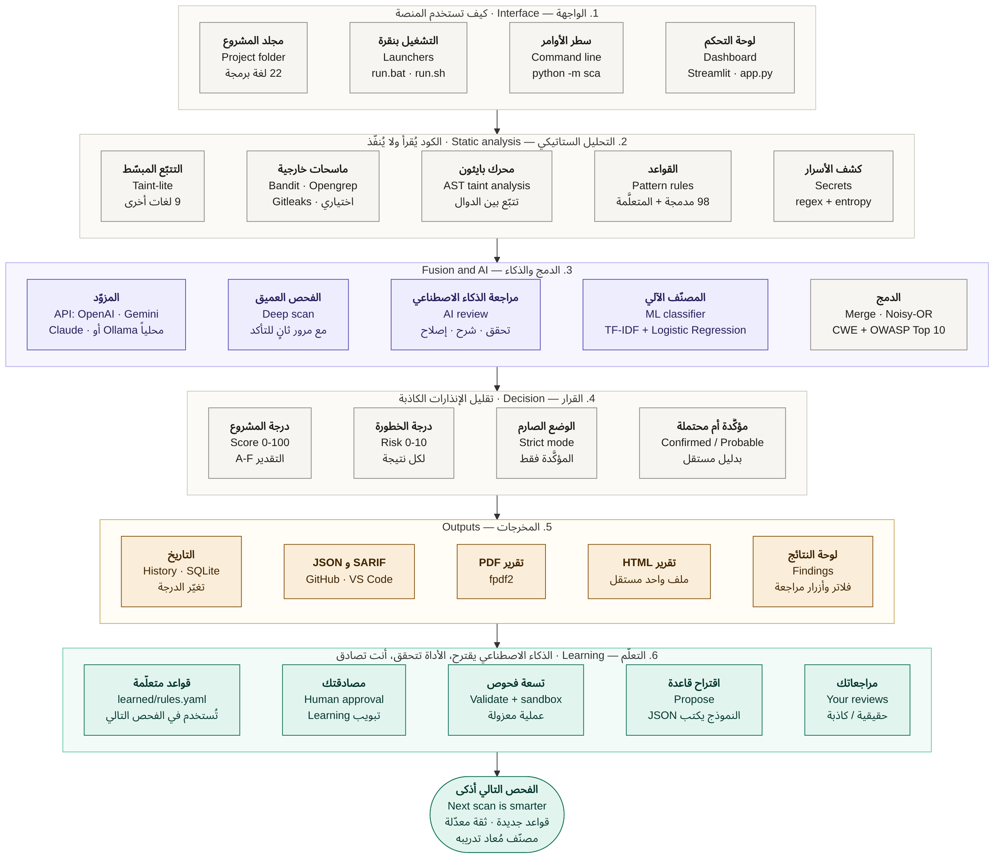

تختار مجلد أي مشروع برمجي، فيقوم البرنامج بستة أشياء:

1. **يقرأ** ملفات الكود ويتعرف على لغة كل ملف (22 لغة برمجة)، أو يفكّ حزمة تطبيق Android (APK أو AAB) ويقرأ ما فيها دون تشغيلها (القسم 7.8).
2. **يفحص** الكود ستاتيكياً (دون تشغيله) بعدة محركات.
3. **يدمج** النتائج المكررة ويحسب درجة ثقة لكل نتيجة.
4. **يراجع** النتائج بالذكاء الاصطناعي: مصنّف تعلم آلي، ونموذج لغوي (عبر API سحابي أو محلي) يتحقق ويشرح ويقترح الإصلاح.
5. **يقيّم**: يفصل النتائج المؤكَّدة عن المحتملة، ويعطي المشروع درجة من 100.
6. **يتعلّم**: ما يكتشفه الذكاء الاصطناعي يتحول إلى قاعدة مقترحة، تُفحص آلياً، ثم تنتظر مصادقتك. ومراجعاتك للنتائج تعلّم الأداة أي القواعد تستحق الثقة.

---

## 2. المتطلبات

| المطلوب | ملاحظة |
|---|---|
| Python 3.10 أو أحدث | إلزامي. نزّله من python.org وفعّل خيار Add python.exe to PATH |
| اتصال إنترنت | للتنصيب أول مرة، ولاستخدام API سحابي |
| مفتاح API لمزوّد ذكاء اصطناعي | اختياري. لازم للمراجعة الذكية والفحص العميق والتعلّم |
| Ollama | اختياري. بديل محلي عن الـ API |
| Opengrep أو Semgrep، و Gitleaks | اختياري. محركات إضافية |
| jadx (مع Java 11 أو أحدث) و apksigner من Android SDK | اختياري. لفكّ ترجمة أصناف تطبيقات Android والتحقق من توقيعها (القسم 7.8). فكّ الحزمة نفسه لا يحتاجهما |

المكتبات تُنصَّب تلقائياً من `requirements.txt`: `streamlit` للواجهة، `pyyaml` للقواعد، `bandit` لفحص بايثون، `scikit-learn` و `joblib` للتعلم الآلي، `fpdf2` لتقرير PDF، `pandas` للجداول. الاتصال بمزوّدي الذكاء الاصطناعي يتم بمكتبة بايثون القياسية، فلا حاجة لمكتبات إضافية.

---

## 3. التنصيب والتشغيل

**ويندوز:** من صفحة المستودع اضغط Code ثم Download ZIP، فك الضغط، وانقر مرتين على `run.bat`. بعد التنصيب يفتح المتصفح على `http://localhost:8501`.

**لينكس أو ماك:**

```bash
git clone https://github.com/blackangiliq/graduate_project.git
cd graduate_project
./run.sh
```

**يدوياً:**

```bash
python -m venv .venv
.venv\Scripts\activate          # ويندوز. في لينكس: source .venv/bin/activate
pip install -r requirements.txt
python -m sca ui
```

الأمر `python -m sca doctor` يعرض المحركات المتوفرة وحالة مزوّد الذكاء الاصطناعي.

---

## 4. استخدام الواجهة

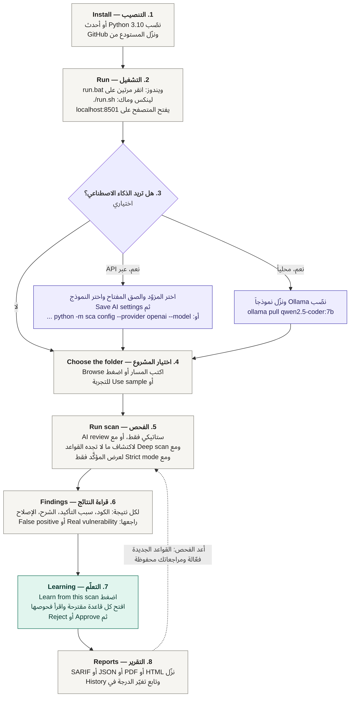

الواجهة تعمل بالعربية أو الإنجليزية. اختر اللغة من أعلى الشريط الجانبي (**Language / اللغة**)، فتتغيّر كل العناوين والأزرار والشروحات والتقارير. بجانب كل خيار علامة **(?)** تشرح ماذا يفعل.

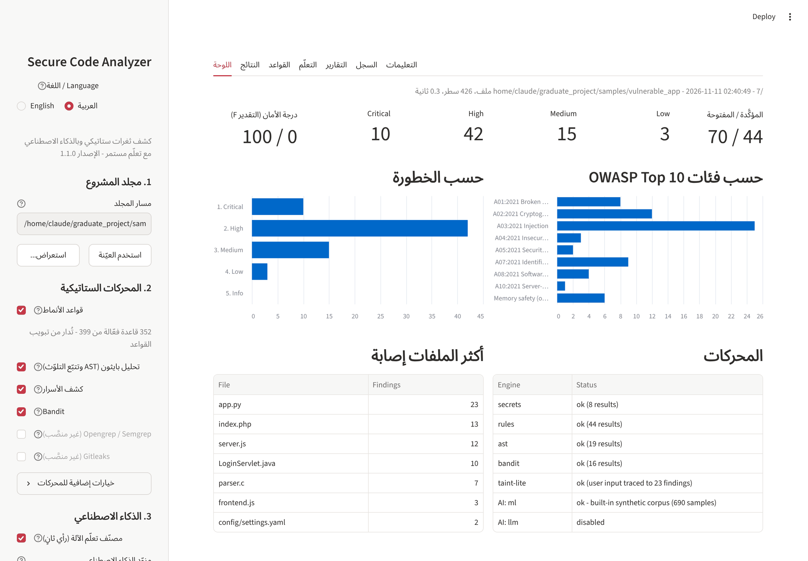

**الشريط الجانبي** (كل الخواص التي تتحكم بالفحص):

| القسم | الخيارات | ماذا تفعل |
|---|---|---|
| 1. المشروع أو التطبيق | المجلد أو ملف التطبيق، استعراض، استعراض تطبيق، رفع ملف تطبيق، استخدم العيّنة، عيّنة Flutter | تحديد ما يُفحص: مجلد مشروع أو حزمة تطبيق Android. العيّنتان تطبيقان مصابان عمداً للتجربة |
| 2. المحركات الستاتيكية | قواعد الأنماط، تحليل بايثون، كشف الأسرار، فحوص Flutter و Android، Bandit، Opengrep/Semgrep، Gitleaks | تفعيل وتعطيل كل محرك |
| 2. خيارات إضافية | تتبّع المدخلات للغات الأخرى، فك ترجمة ملفات التطبيق والتحقق منها (jadx و apksigner)، مجلدات تُتجاوز | ضبط أدق للفحص |
| 3. الذكاء الاصطناعي | مصنّف تعلّم الآلة، المزوّد، عنوان الـ API، المفتاح، النموذج، مراجعة النتائج، الفحص العميق، عدد النتائج المراجَعة | ربط النموذج واختيار ما يفعله |
| 3. خيارات إضافية | عدد ملفات الفحص العميق، ثواني انتظار الجواب | التحكم بالكلفة والوقت |
| 4. الدقة | الوضع الصارم، تجاوز كود الاختبارات، طبّق مراجعاتي السابقة | تقليل الإنذارات الكاذبة (القسم 9) |
| 5. المخرجات | احفظ هذا الفحص في السجل، ابدأ الفحص | الحفظ والتشغيل |

شرح كل خيار بالتفصيل موجود داخل الواجهة: تبويب **التعليمات** ← **كل الإعدادات**.

**التبويبات:**

- **اللوحة (Dashboard)**: الدرجة، الأعداد حسب الخطورة، عدد المؤكَّد من المفتوح، توزيع OWASP، أكثر الملفات إصابة، حالة المحركات. وفي مشروع Flutter أو Android أو حزمة تطبيق تُضاف لوحة التطبيق وقسم **واجهات API والمفاتيح** (القسم 7.8) ورسمان حسب OWASP Mobile Top 10 ومجموعات MASVS.
- **النتائج (Findings)**: النتائج مع فلاتر. لكل نتيجة: الكود، سبب التأكيد، الشرح، الإصلاح، رأي الذكاء الاصطناعي، وزرّان: **ثغرة حقيقية** و **إنذار كاذب**.
- **القواعد (Rules)**: التحكم الكامل بالقواعد: تصفّح وفلترة، قراءة وتعديل أي حقل، تفعيل وتعطيل، استرجاع الأصل، كتابة قاعدة جديدة، تجربة تعبير على كود، استيراد وتصدير (القسم 13).
- **التعلّم (Learning)**: القواعد المقترحة وفحوصها والمصادقة عليها، القواعد المتعلَّمة، سجل أداء القواعد، ومصفوفة التغطية.
- **التقارير (Reports)**: تنزيل HTML و PDF و JSON و SARIF.
- **السجل (History)**: الفحوصات السابقة وتغيّر الدرجة.
- **التعليمات (Guide)**: البدء السريع، وظيفة كل إعداد، كتابة القواعد، المخططات السبعة مع شرح كل مخطط (بالعربية أو الإنجليزية أو كليهما)، سطر الأوامر، المراجع والحدود، والوثائق الكاملة مع صورها.

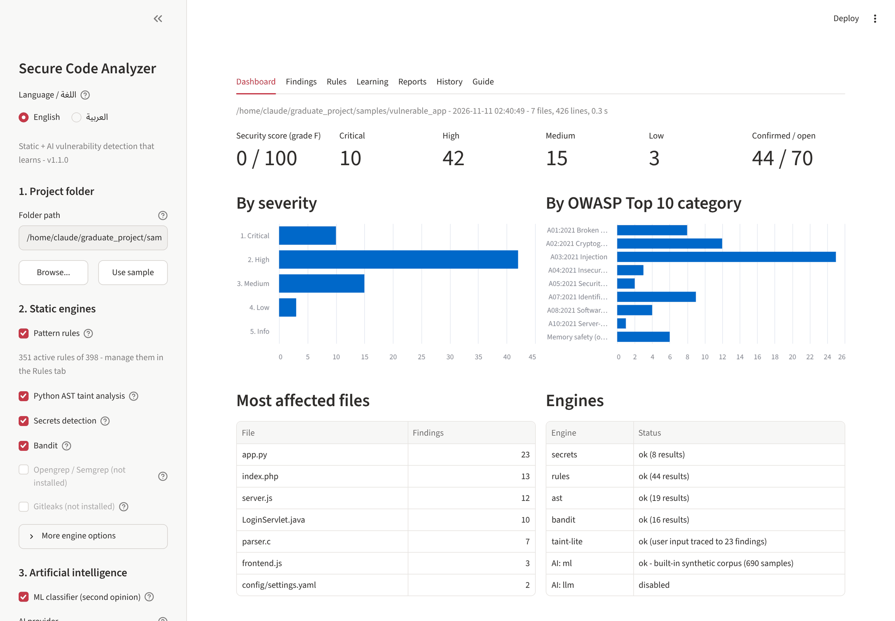

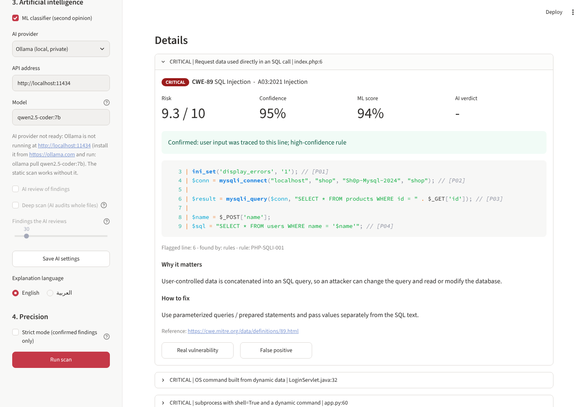

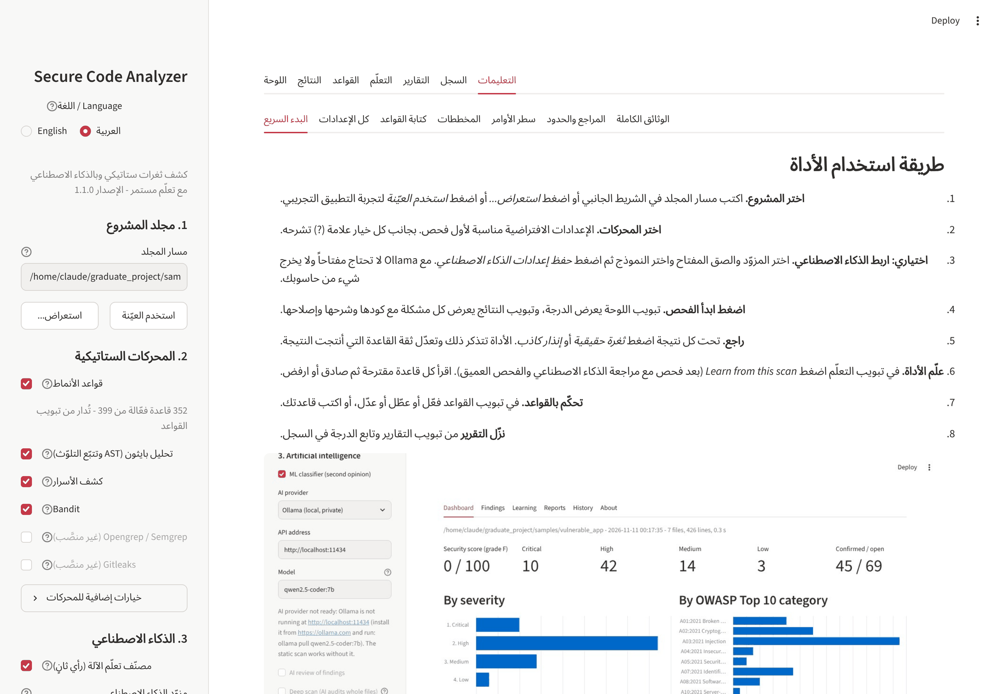

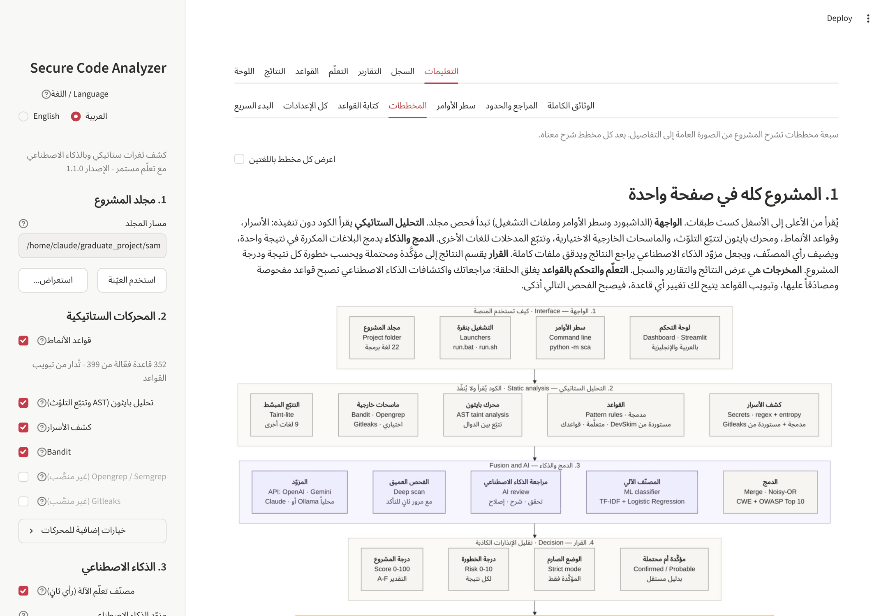

---

## 5. ربط الذكاء الاصطناعي

### 5.1 عبر API (بدون Ollama)

من الواجهة: القسم 3 في الشريط الجانبي. اختر المزوّد، الصق المفتاح، اختر النموذج من القائمة (تُجلب من المزوّد تلقائياً)، ثم اضغط **Save AI settings**.

من سطر الأوامر:

```bash
python -m sca config --provider openai --model <اسم-النموذج>
```

سيطلب المفتاح بإدخال مخفي ثم يختبر الاتصال ويعرض النماذج المتاحة.

| المزوّد | الاسم في الأمر | الصيغة |
|---|---|---|
| OpenAI | `openai` | OpenAI chat-completions |
| Google Gemini | `gemini` | متوافق مع OpenAI |
| Anthropic (Claude) | `anthropic` | Messages API |
| OpenRouter, Groq, DeepSeek, Mistral | `openrouter` `groq` `deepseek` `mistral` | متوافق مع OpenAI |
| أي خادم متوافق مع OpenAI | `custom` مع `--base-url` | LM Studio و vLLM وغيرها |
| Ollama (محلي) | `ollama` | بدون مفتاح |

اسم النموذج تكتبه كما يسمّيه المزوّد. الأداة لا تفترض أسماء نماذج لأنها تتغير باستمرار.

**أين يُحفظ المفتاح؟** في ملف `.env` داخل مجلد المشروع. هذا الملف مستثنى من git، ولا يُكتب المفتاح في قاعدة البيانات ولا في التقارير ولا في رسائل الخطأ. لا ترفع هذا الملف ولا تشاركه.

**الخصوصية.** مع مزوّد سحابي تُرسَل مقاطع الكود المفحوصة إلى ذلك المزوّد. الأسرار التي تكتشفها الأداة تُخفى قبل الإرسال، أما سرّ لم تكتشفه الأداة فسيُرسَل كما هو. إذا كان الكود سرياً استخدم Ollama. الواجهة تعرض تحذيراً بهذا عند اختيار مزوّد سحابي.

**الكلفة.** المزوّد السحابي يحاسبك على الطلبات: طلب واحد لكل نتيجة تُراجَع، طلب لكل ملف في الفحص العميق مع طلب تحقق لكل اكتشاف، وطلبان على الأكثر لكل قاعدة مقترحة. الإجابات تُحفظ في ذاكرة مؤقتة فلا تتكرر عند إعادة الفحص. تحكّم بالعدد من خيار *Findings the AI reviews* أو `--llm-max` و `--deep-max-files` مع الأمر `scan` (أو `--max-files` مع الأمر `learn`).

### 5.2 عبر Ollama (محلي)

1. نصّب Ollama من ollama.com.
2. `ollama pull qwen2.5-coder:7b` (حوالي 5 جيجابايت، يحتاج 8 جيجابايت رام تقريباً).
3. `python -m sca config --provider ollama --model qwen2.5-coder:7b`

النموذج المحلي أضعف من النماذج السحابية الكبيرة، فتوقّع قواعد مقترحة أقل جودة ورفضاً آلياً أكثر.

---

## 6. سطر الأوامر

```bash
# الفحص
python -m sca scan my-app                                   # ستاتيكي فقط
python -m sca scan my-app --llm --lang ar                   # مع مراجعة الذكاء الاصطناعي وشرح عربي
python -m sca scan my-app --deep                            # الذكاء الاصطناعي يقرأ الملفات كاملة
python -m sca scan my-app --strict                          # النتائج المؤكَّدة فقط
python -m sca scan my-app --skip-tests                      # تجاهل ملفات الاختبار
python -m sca scan my-app --format html,json,sarif,pdf --fail-on high

# تطبيقات Flutter و Android (القسم 7.8)
python -m sca scan app-release.apk                          # حزمة تطبيق: .apk أو .aab أو .apks أو .xapk أو .apkm
python -m sca scan app-release.apk --apk-tools              # ومعها jadx و apksigner إن كانا مثبّتين
python -m sca scan my-flutter-app --no-flutter              # دون فحوص Flutter و Android البنيوية، ودون حقائق التطبيق وجرد API في المشروع المصدري
python -m sca flutter info app-release.apk                  # الحزمة والإصدار ونوع البناء والتوقيع والمكوّنات
python -m sca flutter deps my-flutter-app                   # حزم Dart وثغراتها المعروفة
python -m sca flutter apis app-release.apk                  # عناوين الخوادم واستدعاءات API والمفاتيح والتنبيهات، مع مواضعها
python -m sca flutter decode app-release.apk --out decoded  # كتابة الملفات المفكوكة و facts.json في مجلد فارغ
python -m sca flutter tools                                 # الأدوات الاختيارية المثبّتة

# المراجعة (تعليم الأداة)
python -m sca feedback fp <id>          # هذه النتيجة إنذار كاذب (المعرّف يظهر في مخرجات scan)
python -m sca feedback tp <id>          # هذه ثغرة حقيقية
python -m sca feedback list

# التعلّم
python -m sca learn my-app              # فحص عميق ثم اقتراح قواعد
python -m sca learn my-app --rounds 5 --auto-approve   # يكرر التعلّم حتى لا يجد جديداً
python -m sca learn --bootstrap ruby    # قواعد للثغرات التي لا قاعدة لها في هذه اللغة
python -m sca learn --bootstrap all     # يملأ فجوات كل اللغات دفعة واحدة
python -m sca learn --from-feedback     # استثناءات من الإنذارات الكاذبة التي رفضتها
python -m sca rules list                # القواعد المنتظرة
python -m sca rules show <id>           # تفاصيل قاعدة وتقرير فحصها
python -m sca rules approve <id>        # مصادقة (أو: approve all)
python -m sca rules reject <id>
python -m sca rules remove <id>         # حذف قاعدة متعلَّمة
python -m sca rules stats               # سجل أداء القواعد والمحجورة منها
python -m sca coverage                  # القواعد لكل لغة وثغرة

# أخرى
python -m sca config --show
python -m sca doctor
python -m sca history
python -m sca train --show-features
```

---

## 7. كيف يعمل المشروع من الداخل

المسار الكامل في `sca/pipeline.py`. المخطط التالي يوضح كل مرحلة وما تستخدمه من أدوات وتقنيات (اضغط على الصورة لتكبيرها، ومصدرها القابل للتعديل في `docs/diagrams/pipeline.ar.mmd`):

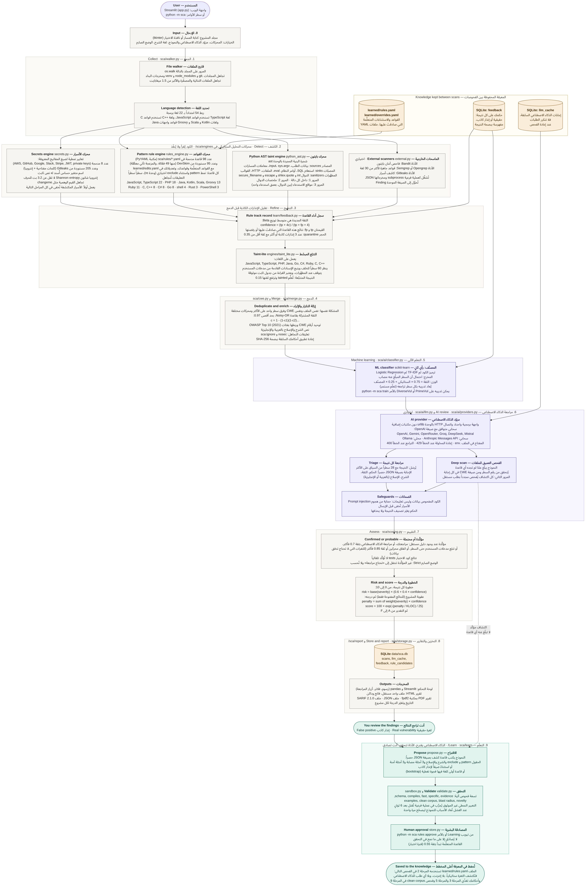

النسخة الإنجليزية: `docs/images/pipeline.png`. وكل المخططات مع شرح تفصيلي لكل واحد في **[DIAGRAMS_AR.md](DIAGRAMS_AR.md)**.

**الألوان:** الرمادي للتحليل الستاتيكي، البنفسجي للذكاء الاصطناعي، الأخضر للتعلّم، والبرتقالي للمعرفة المحفوظة بين الفحوصات.

| المرحلة | ماذا يحدث | الأدوات والتقنيات | الملفات |
|---|---|---|---|
| 0. الإدخال | اختيار المجلد والخيارات | واجهة Streamlit، سطر أوامر argparse، نافذة اختيار المجلد tkinter | `app.py`، `sca/__main__.py` |
| 1. الجمع | قراءة الملفات وتحديد لغتها، أو فكّ حزمة التطبيق | `os.walk`، جدول 70 امتداداً إلى 22 لغة، تجاهل الملفات الثنائية والمصغّرة والأكبر من 1.5 ميغابايت. حزمة التطبيق تُفكّ إلى ملفات افتراضية بقرّاء مكتوبين بالمشروع (القسم 7.8) | `sca/walker.py`، `sca/flutter/` |
| 2. الكشف | محركات ستاتيكية تعمل على الملفات | الأسرار: تعابير نمطية + إنتروبيا شانون. القواعد: 215 قاعدة أنماط YAML مدمجة (مكتبة PyYAML ووحدة `re`) + المستوردة + المتعلَّمة. بايثون: وحدة `ast` وتتبّع التلوّث بملخصات الدوال. C/C++: فحوص الذاكرة. Flutter و Android: 49 فحصاً بنيوياً. اختياري: Bandit و Opengrep/Semgrep و Gitleaks عبر `subprocess` ومخرجات JSON | `sca/engines/`، `sca/rules/`، `sca/flutter/checks.py` |
| 3. التنقيح | تعديل الثقة قبل الدمج | سجل أداء القاعدة (توزيع Beta) والحجر، taint-lite لتتبّع مدخلات المستخدم | `sca/learn/feedback.py`، `sca/engines/taint_lite.py` |
| 4. الدمج | نتيجة واحدة لكل مشكلة | إزالة التكرار، Noisy-OR، توحيد CWE، ربط OWASP Top 10، قاعدة معرفة عربية وإنجليزية، بصمة SHA-256 | `sca/merge.py`، `sca/cwe.py` |
| 5. التعلم الآلي | رأي ثانٍ لكل نتيجة | scikit-learn: ترميز الكود، TF-IDF، Logistic Regression، إعادة تدريب بمراجعاتك | `sca/ai/classifier.py` |
| 6. مراجعة الذكاء الاصطناعي | تحقق وشرح وإصلاح وفحص عميق | API متوافق مع OpenAI أو Anthropic أو Ollama عبر `urllib`، إجابات JSON فقط، تحقق ثانٍ من كل اكتشاف، ذاكرة مؤقتة في SQLite، إخفاء الأسرار | `sca/ai/providers.py`، `sca/ai/llm.py` |
| 7. التقييم | مؤكَّد أم محتمل، والدرجات | أدلة التأكيد الخمسة، الوضع الصارم، معادلة الخطورة، الدرجة الأسّية للمشروع. ولهدف الجوال يليها جرد واجهات API والمفاتيح (العناوين والاستدعاءات والمفاتيح مخفيّة جزئياً والتنبيهات) | `sca/scoring.py`، `sca/flutter/inventory.py` |
| 8. التخزين والتقارير | حفظ وعرض | SQLite، pandas، تقرير HTML مستقل، fpdf2 لـ PDF، JSON، SARIF 2.1.0 | `sca/storage.py`، `sca/report/` |
| 9. التعلّم | قواعد جديدة واستثناءات | قاعدة يكتبها النموذج بصيغة JSON، تسعة فحوص آلية، عملية معزولة لتجربة التعبير النمطي، مصادقة بشرية، حفظ في YAML | `sca/learn/` |

شرح كل ملف:

| الملف | وظيفته |
|---|---|
| `app.py` | واجهة Streamlit |
| `sca/__main__.py` | سطر الأوامر |
| `sca/pipeline.py` | يشغّل المراحل بالترتيب |
| `sca/walker.py` | يجد الملفات، يحدد اللغة، يخفي الأسرار |
| `sca/models.py` | `Finding` (نتيجة) و `ScanResult` (نتيجة الفحص) |
| `sca/engines/rules_engine.py` | محرك القواعد: المدمجة والمتعلَّمة والاستثناءات |
| `sca/rules/*.yaml` | 217 قاعدة مدمجة، منها 49 للغة Dart في `dart.yaml` (47 قاعدة أنماط وصيغتا مفاتيح) |
| `sca/flutter/` | تطبيقات Flutter و Android: قرّاء الصيغ، ومحمّلا الحزمة والمشروع، والفحوص البنيوية، وتدقيق الاعتماديات، وجرد واجهات API والمفاتيح (`inventory.py`) (القسم 7.8) |
| `sca/engines/python_ast.py` | محرك بايثون: AST وتتبّع التلوّث بين الدوال |
| `sca/engines/taint_lite.py` | تتبّع مبسّط لمدخلات المستخدم في اللغات الأخرى |
| `sca/engines/secrets.py` | كشف كلمات المرور والمفاتيح |
| `sca/engines/external.py` | ربط Bandit و Opengrep/Semgrep و Gitleaks |
| `sca/merge.py` | دمج المكرر وحساب الثقة المشتركة |
| `sca/cwe.py` | قاعدة معرفة CWE و OWASP بالعربية والإنجليزية |
| `sca/ai/providers.py` | عملاء الـ API: OpenAI-compatible و Anthropic، والإعدادات |
| `sca/ai/llm.py` | نصوص التعليمات، التحقق من الإجابات، عميل Ollama |
| `sca/ai/classifier.py` | مصنّف التعلم الآلي |
| `sca/learn/propose.py` | يطلب من النموذج كتابة قاعدة أو استثناء |
| `sca/learn/sandbox.py` | يشغّل التعبير النمطي غير الموثوق في عملية معزولة بمهلة زمنية |
| `sca/learn/validate.py` | الفحوص الآلية للقاعدة المقترحة |
| `sca/learn/store.py` | ملفات القواعد المتعلَّمة والمصادقة |
| `sca/learn/feedback.py` | مراجعاتك: تعديل الثقة والحجر |
| `sca/learn/loop.py` | حلقة التعلّم |
| `sca/scoring.py` | مؤكَّد أم محتمل، درجة الخطورة، درجة المشروع |
| `sca/storage.py` | قاعدة SQLite: التاريخ، ذاكرة الإجابات، المراجعات، القواعد المقترحة |
| `sca/report/` | تقارير HTML و PDF و SARIF و JSON |

### 7.1 محرك القواعد

كل قاعدة تعبير نمطي يصف سطراً مصاباً، مع `exclude` اختياري يلغي المطابقة:

```yaml
- id: PHP-XSS-001
  title: Request data echoed without encoding
  languages: [php]
  cwe: CWE-79
  severity: high
  confidence: 0.8
  pattern: '(\b(echo|print)\b|<\?=)[^;]*\$_(GET|POST|REQUEST|COOKIE|SERVER)'
  exclude: 'htmlspecialchars\(|htmlentities\(|intval\('
```

`echo $_GET['q'];` يطابق. `echo htmlspecialchars($_GET['q']);` يُستثنى. التعليقات تُتجاهل.

القواعد تأتي من أربعة مصادر تصبّ في مجموعة واحدة: **مدمجة** (217 قاعدة في `sca/rules/`)، و**مستوردة** من DevSkim و Gitleaks (300 قاعدة في `sca/rules/imported/`، منها 253 فعّالة)، و**متعلَّمة** من الذكاء الاصطناعي بعد مصادقتك (`learned/rules.yaml`)، و**قواعدك** التي تكتبها (`learned/custom.yaml`). القسم 13 يشرح الاستيراد والكتابة اليدوية والتعديل.

### 7.2 محرك بايثون: AST وتتبّع التلوّث بين الدوال

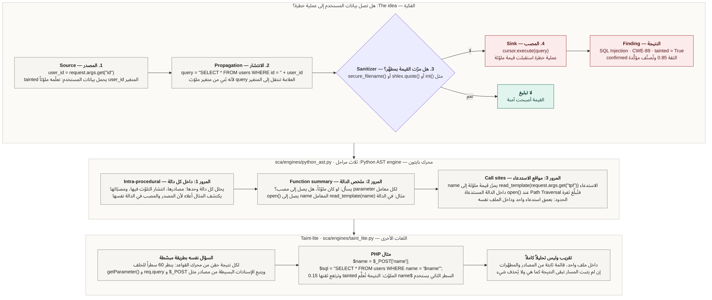

- **Source (مصدر)**: مدخل بيانات المستخدم مثل `request.args` و `input()`.
- **Sink (مصب)**: عملية خطرة مثل `cursor.execute` و `os.system` و `eval` و `open`.
- **Sanitizer (مطهّر)**: دالة تجعل البيانات آمنة مثل `int()` و `secure_filename()`.

التحليل يجري بثلاث مراحل:

1. **داخل كل دالة**: نعلّم المتغيرات القادمة من المصادر، ننشر العلامة عبر الإسنادات، ونفحص كل مصب.
2. **ملخص لكل دالة**: نسأل عن كل معامل (parameter): لو كان يحمل بيانات المستخدم، هل يصل إلى مصب داخل الدالة؟
3. **مواقع الاستدعاء**: إذا مُرّرت بيانات المستخدم إلى معامل له ملخص، نبلّغ عن المصب داخل الدالة المستدعاة.

مثال يكتشفه التحليل بين الدوال فقط:

```python
def read_template(name):
    with open("templates/" + name) as handle:      # المصب هنا
        return handle.read()

@app.route("/preview")
def preview():
    return read_template(request.args.get("tpl"))  # المصدر هنا، في دالة أخرى
```

الحدود: عمق استدعاء واحد، وداخل الملف نفسه.

### 7.3 Taint-lite للغات الأخرى

القواعد تنظر إلى سطر واحد. هذا المحرك يضيف السياق: لكل نتيجة من نوع الحقن ينظر إلى 60 سطراً قبلها ويسأل: هل متغيرٌ مستخدم في السطر أُسند من مدخلات المستخدم؟

```php
$name = $_POST['name'];                              // $name أصبح ملوثاً
$sql  = "SELECT * FROM users WHERE name = '$name'";  // السطر المبلَّغ عنه يستخدم $name
```

إذا ثبت المسار تُعلَّم النتيجة `tainted` وترتفع ثقتها 0.15 وتصبح «مؤكَّدة». إذا لم يثبت تبقى النتيجة كما هي ولا يُحذف شيء. يدعم JavaScript/TypeScript و PHP و Java (ومعها Kotlin و Scala و Groovy) و Go و C# و Ruby و C/C++ و Dart، أي 13 لغة. ومصادر Dart مثل `TextEditingController.text` ومعاملات الروابط العميقة و `Uri.base`، ويفهم المحرك أن النص في Dart يُدرج فيه المتغير بالصيغة `$name` أو `${expr}`.

هو تقريب وليس تحليل تدفق حقيقياً: داخل ملف واحد، إسنادات بسيطة، قائمة ثابتة من المصادر والمطهّرات. ويعامل القراءة من جدول ثابت (`$pages[$_GET['page']]`) كقيمة موثوقة لأن المستخدم يختار منها ولا يكتبها.

### 7.4 كشف الأسرار

صيغ معروفة (AWS و GitHub و Google وغيرها)، أو اسم متغير حساس أُسند له نص. في المحرك نفسه 11 صيغة، منها عناوين Webhook في Slack و Discord ورموز بوتات Telegram (ولا يُخفى منها إلا جزء الرمز، فيبقى العنوان مقروءاً حتى لو أُسند إلى متغير اسمه مثل `slackToken`؛ وكذلك عنوان Webhook في Microsoft Teams عبر قاعدة Gitleaks المستوردة). وفي ملفات `.env` (و `.env.<name>` و `<name>.env`، دون القوالب مثل `.env.example`) يقرأ المحرك أيضاً أسطر `NAME=value` (وقد تكون القيمة بين علامتي تنصيص، ويُقبل تعليق بعدها) إذا كان الاسم هو أو يحوي password أو passphrase أو secret أو token أو credential أو hmac أو auth أو salt أو private أو signature، أو ينتهي بـ `KEY` (مثل `MAPS_KEY` و `STRIPE_KEY`)، أو فيه جزء مستقل `PASS` (مثل `SMTP_PASS`). ويتجاوز أسماء الإعدادات مثل `API_KEY_HEADER_NAME` و `TOKEN_PREFIX` (الأسماء المنتهية بـ `_NAME` و `_HEADER` و `_PREFIX` و `_ID` و `_URL` و `_PATH` و `_DOMAIN` و `_HOST` و `_SCOPE` ونحوها) و `KEY_ID` و `PUBLIC_KEY`، ويتجاوز القيم الوهمية والعناوين التي لا بيانات اعتماد فيها ومسارات الملفات والقيم العلنية بطبيعتها (مثل `pk_test_` و `pk.eyJ...`) وأسماء الخوادم وحدها (مثل `shop.eu.auth0.com`)، وفي المفاتيح والرموز أيضاً الكلمات الموصولة مثل `homepage_products_v2`. إنتروبيا شانون تميّز المفتاح العشوائي عن الكلمة العادية:

`H = -Σ p(c) × log2 p(c)`

الأسرار المكتشفة تُخفى في كل المخرجات وقبل الإرسال لأي نموذج: `Pr0d-DB-pass!2024` تصبح `Pr0d***********24`. والإخفاء يشمل الفحص كله: بعد عمل المحركات يُخفي كل ملف كل أسرار الفحص (قائمة واحدة مشتركة)، فالسرّ الذي يُكتشف في ملف يُخفى في مقاطع الكود وسياقها والحقائق والجرد وطلبات الذكاء الاصطناعي ومتعلّم القواعد. وفي القائمة قيم محرك الأسرار (وفي ملف `.env` ما يبلّغ عنه هو بالضبط)، وقيم نتائج بيانات الاعتماد الأخرى (تؤخذ من موضع تطابق القاعدة مثل `SecretKey('...')`، أو من إعداد التوقيع `keyPassword` و `storePassword`، أو من `defaultValue: '...'` و `--dart-define=NAME=value`)، وما تحمله العناوين ظاهراً (معاملات المفاتيح والرموز، وكلمة المرور في `user:password@`، ورموز Webhook والبوتات). وكل قيمة تُخفى في ملفها، ولا تُشارَك مع بقية الملفات إلا إذا كانت قوية: 8 أحرف أو أكثر، وليست كلمة واحدة، وليست أرقاماً فقط، وإنتروبيا شانون 2.5 أو أكثر؛ فلا تُخفي `android` أو `admin` الكلمة نفسها في ملف آخر.

### 7.5 الدمج

نفس الملف ونفس CWE وسطر متجاور من محركين مختلفين تُدمج في نتيجة واحدة، والثقة بقاعدة **Noisy-OR**:

`c = 1 − (1 − c1)(1 − c2)…`

مثال: 0.85 من محرك AST و 0.60 من Bandit تعطي `1 − 0.15 × 0.40 = 0.94`.

### 7.6 الذكاء الاصطناعي

**المصنّف (ML):** رموز الكود ثم TF-IDF ثم Logistic Regression. يعطي احتمالاً يساهم بـ 25% من الثقة. يُعاد تدريبه تلقائياً مع كل مراجعة تسجّلها (كل مراجعة تُحسب بوزن ثلاث عينات). بياناته الأساسية اصطناعية، فلا تذكر دقته كنتيجة بحثية قبل تدريبه على بيانات حقيقية.

**مراجعة النتائج (triage):** لكل نتيجة يُرسَل العنوان والكود المحيط، ويُطلب JSON فيه الحكم (حقيقية، إنذار كاذب، غير متأكد) والثقة والشرح والإصلاح.

**الفحص العميق (deep scan):** النموذج يقرأ الملف كاملاً ويبلّغ عمّا لم تجده المحركات. كل اكتشاف يُتحقق منه **بطلب ثانٍ مستقل**، وبدون هذا التأكيد يبقى «محتملاً».

**الحماية من حقن التعليمات:** الكود المفحوص قد يحتوي نصاً يحاول خداع النموذج. لذلك: نخبر النموذج أن الكود بيانات، نقبل JSON فقط ونتحقق من كل حقل (رقم السطر يجب أن يكون داخل الملف، و CWE بصيغة صحيحة)، ولا تُحذف نتيجة ولا تُفعَّل قاعدة بكلام النموذج وحده.

### 7.7 التقييم

**لكل ثغرة:** `risk = base(severity) × (0.6 + 0.4 × confidence)` حيث base: حرجة 9.5، عالية 8.0، متوسطة 5.5، منخفضة 3.0.

**للمشروع:**

```
penalty = Σ weight(severity) × confidence     الأوزان: حرجة 10، عالية 5، متوسطة 2، منخفضة 0.5
density = penalty ÷ max(KLOC, 0.5)
score   = 100 × e^(−density ÷ 25)
```

التقدير: A من 90، B من 75، C من 60، D من 40، وأقل F. تُحسب النتائج المفتوحة فقط.

### 7.8 تطبيقات Flutter و Android

الشرح الكامل مع جدول الفحوص كله في **[FLUTTER_AR.md](FLUTTER_AR.md)**. هنا الخلاصة.

تفحص الأداة تطبيق Flutter أو Android بصورتين: **المشروع المصدري** (مجلد فيه `pubspec.yaml`
و `android/` و `ios/`)، و**حزمة التطبيق المبنية** (`.apk` أو `.aab` أو `.apks` أو `.xapk` أو
`.apkm`). والحزمة تُفكّ وتُقرأ ببايثون فقط، دون Android SDK، ولا تُثبَّت على جهاز ولا تُشغَّل.

**في المشروع المصدري:**

- **كود Dart:** 47 قاعدة أنماط `DART-*` (إلغاء التحقق من شهادة TLS، والاتصال غير المشفّر،
  وإعدادات WebView، والتخزين غير المشفّر أو المفتوح لكل التطبيقات، وبناء SQL من النصوص، والتشفير
  الضعيف والأرقام العشوائية ذات البذرة الثابتة، وكتابة الأسرار في السجل، والروابط العميقة،
  والأوامر، واستدعاء الدوال بأسمائها وقت التشغيل، والمسارات)، ومعها كشف الأسرار (وفيه صيغتا
  مفاتيح خاصتان بـ Dart) وتتبّع المدخلات (القسم 7.3).
- **ملفات البناء و Firebase والويب:** 5 قواعد `FLUTTER-*` لملفات CI وقواعد Firestore و Storage
  والصفحة `web/index.html`.
- **49 فحصاً بنيوياً** (المحرك `flutter`) تحلّل الملفات ولا تطابقها سطراً سطراً: ملف
  `AndroidManifest.xml` (قابلية التصحيح، والنسخ الاحتياطي، والاتصال غير المشفّر، والمكوّنات
  المُصدَّرة، والروابط العميقة، والصلاحيات الخطرة، واختطاف المهام، وإيقاف التصفح الآمن في
  WebView)، وإعدادات أمان الشبكة، ومسارات FileProvider، ونسخة الإصدار في Gradle (التوقيع بمفتاح
  التصحيح، وتصغير الكود، وكلمات المرور المكتوبة)، و `key.properties` ومخازن المفاتيح، و
  `Info.plist` في iOS (إعدادات App Transport Security ومخططات URL ومشاركة الملفات)،
  والاعتماديات في `pubspec.lock` (25 تنبيهاً أمنياً منتقى لـ 23 حزمة، و 16 حزمة متوقفة،
  والاعتماديات من git أو http، والتجاوزات). وحين يُبطل النظام أثر إعداد أو يحدّ منه تُخفَّض
  النتيجة أو لا يُبلَّغ عنها (القائمة في القسم 3 من [FLUTTER_AR.md](FLUTTER_AR.md))؛ مثلاً
  `usesCleartextTraffic` بجانب إعدادات أمان الشبكة في تطبيق قيمة minSdk فيه 24 أو أكثر، ومخزن
  مفاتيح يُبقيه `.gitignore` خارج git، وأهداف المشاركة وأدوات الشاشة الرئيسية المُصدَّرة بحكم
  وظيفتها. ووحدة المكتبة في Android لا يُفحص منها إلا مكوّناتها وصلاحياتها وروابطها، ونكهات
  المنتج تُعدّ من الإصدار، ومجلدات إضافات Flutter (plugins) لا تُفحص كتطبيق.

**في حزمة التطبيق** تتحوّل الأجزاء النصية إلى **ملفات افتراضية** في الذاكرة، فتعمل عليها
المحركات كما تعمل على ملفات المصدر:

| الملف الافتراضي | مصدره |
|---|---|
| `AndroidManifest.xml` و `res/xml/*.xml` | XML ثنائي (أو protobuf في AAB) تُكتب كلُّ خاصيةٍ منه في سطر، فتشير النتيجة إلى الخاصية نفسها |
| `res/values/strings.xml` و `assets/...` | نصوص التطبيق وأصوله النصية مثل `.env` |
| `dart/lib/...` | كود Dart المصدري المستعاد من `kernel_blob.bin` في نسخ التصحيح |
| `lib/<abi>/libapp.so` | النصوص المستخرجة من لقطة Dart المترجمة؛ يقرؤها كشف الأسرار، ولا يقرؤها من الفحوص البنيوية إلا FLUTTER-APP-007 و FLUTTER-APP-008 |
| `classes.dex` و `lib/<abi>/<other>.so` | النصوص المستخرجة من DEX ومن المكتبات الأصلية الأخرى، لا يقرؤها إلا كشف الأسرار |
| `_sca/build.txt` و `_sca/signing.txt` و `_sca/packages.txt` | حقائق تكتبها الأداة: نوع البناء، والتمويه، والتوقيع والشهادة، والحزم |

ومن هذه الأجزاء تُعرف حقائق التطبيق: اسم الحزمة، والإصدار، ومستويات SDK، و**نوع البناء**
(debug إذا وُجد `kernel_blob.bin`، وإلا فمن خصائص لقطة Dart: `product` تعني release)، وإصدار
Dart، وهل الكود مموَّه، والتوقيع وشهادته (وهل هي شهادة التصحيح)، والصلاحيات والمكوّنات
والروابط العميقة وعناوين الخوادم. تظهر هذه الحقائق في لوحة التطبيق في تبويب اللوحة (وعناوين
الخوادم في قسم واجهات API والمفاتيح، كما يلي)، وفي كل التقارير.

**درجة حزمة التطبيق:** ملفات النصوص المستخرجة (من `libapp.so` و DEX) لا تُحسب أسطراً من الكود،
فلا تدخل في الدرجة إلا الأسطر المفكوكة أو المستعادة أو المفكوكة ترجمتها بـ jadx. ونسخة الإصدار
لا كود مستعاداً فيها، فأسطرها قليلة وتُقسَم العقوبة على الحد الأدنى (نصف ألف سطر)، لذلك تأتي
درجتها منخفضة غالباً بسبب نتائج قليلة. قارن بين الحزم بنتائجها لا بدرجتها.

**واجهات API والمفاتيح:** بعد حساب الدرجة يحصر الفحص (`sca/flutter/inventory.py`) الخوادم التي
يتصل بها التطبيق والمفاتيح التي يحملها، في حزم التطبيقات وفي المشاريع المصدرية. ويظهر هذا الجرد
في تبويب اللوحة تحت لوحة التطبيق، في قسم عنوانه **واجهات API والمفاتيح: N عنوان خادم، N مفتاح، N
تنبيه خطير**. في أعلاه الأعداد، ثم التنبيهات في مربعات ملوّنة، الأخطر أولاً: المفاتيح السرية داخل
الحزمة، والعناوين غير المشفّرة `http://`، وخوادم الاختبار والأنفاق (staging و ngrok)، وعناوين IP
الخاصة، والمفاتيح داخل العناوين، وعناوين Webhook ورموز البوتات، وملف `.env` المضمَّن، وتذكيرات
بفحص قواعد الوصول في Firebase و Supabase و S3. ثم التبويبات:

| التبويب | ماذا يعرض |
|---|---|
| المفاتيح | النوع والخدمة والقيمة مخفيّةً جزئياً والخطورة والمواضع، وهل المفتاح علني بطبيعته، وما العمل |
| عناوين الخوادم، والخوادم | كل عنوان وخادم، وخدمته (Firebase و Supabase و AWS و Stripe ... أو خادم التطبيق نفسه)، وتنبيهاته |
| استدعاءات API | استدعاءات HTTP و WebSocket و GraphQL مع الطريقة والهدف (في المصدر ونسخ debug ومخرجات jadx فقط) |
| مسارات API | مسارات مثل `/api/v1/login` يحتفظ بها الكود المترجم كنصوص |
| معرّفات الخدمات | مشروع Firebase ومعرّف التطبيق ومعرّف عميل OAuth و AdMob و Sentry ... |
| قيم ملفات env. | قيم ملفات `.env`، والأسرار منها مخفيّة جزئياً |

والزر **نزّل الجرد (JSON)** يحفظ الجرد كله. والمفتاح الذي ترفض نتيجته في المراجعة يُستبعد من
قائمة المفاتيح والأعداد والتنبيهات، ويُحدَّث الجرد بعد المراجعة. ولا يُتصل بأي عنوان: العناوين تُقرأ فقط. والجرد نفسه
في التقارير (قسم *APIs and keys* في HTML و PDF مع ملاحظة إذا اختُصرت قائمة، والملخص والتنبيهات
وأعداد `truncated` في SARIF، والجرد كاملاً في JSON) وفي الأمر `python -m sca flutter apis`. ونسخة الإصدار تحتفظ بكل نصوص الكود، فتبقى عناوينها
ومفاتيحها مقروءة حتى مع `--obfuscate`. التفاصيل في القسم 7 من [FLUTTER_AR.md](FLUTTER_AR.md).

**تصنيف الجوال:** كل نتيجة في هدف جوال تأخذ أيضاً فئة من OWASP Mobile Top 10 (2024)، مثل M5
«اتصال غير آمن»، ومجموعة من MASVS، مثل MASVS-NETWORK، تُستنتج من رقم CWE. وهذا الربط من وضع
المشروع وليس قائمة رسمية من OWASP.

**الأدوات الاختيارية:** مع الخيار `--apk-tools` (أو مربع «فك ترجمة ملفات التطبيق والتحقق منها»
في الواجهة) يفكّ jadx ترجمة أصناف التطبيق نفسه إلى Java فتعمل عليها القواعد، ويتحقق apksigner
من التوقيع. والفحص يعمل كاملاً بدونهما.

**ماذا يخفي بناء الإصدار؟** قسنا ذلك ببناء تطبيق تجريبي فيه 16 ثغرة مزروعة
(`samples/flutter_apk_probe`) بأربعة أنواع بناء:

| نوع البناء | الثغرات المكتشَفة |
|---|---:|
| المصدر | 16 من 16 |
| debug (APK) | 16 من 16 |
| release (APK) | 14 من 16 |
| release مموَّه (APK) | 14 من 16 |
| release (AAB) | 14 من 16 |

الثغرتان اللتان تختفيان في الإصدار هما إلغاء التحقق من شهادة TLS وكتابة رمز الدخول في السجل:
كلتاهما بنية في الكود لا تبقى إلا تعليمات آلة. أما النصوص الثابتة (المفاتيح والعناوين ونصوص
SQL)، وملف manifest، والموارد، والأصول، والتوقيع، فتبقى في كل أنواع البناء، والتمويه لا يخفي
النصوص.

**القياس:** الأمر `python evaluation/flutter_eval.py` يكتب `evaluation/flutter_results.md`:

| القياس | النتيجة |
|---|---|
| عيّنات Flutter (60 ثغرة موسومة)، كل المحركات الستاتيكية | Precision 1.000 و Recall 0.983 و F1 0.992 |
| العيّنات نفسها دون فحوص Flutter البنيوية | Precision 1.000 و Recall 0.550 |
| مختبر DVMA، 218 وحدة | 26 وحدة (11.9%) |
| مختبر Ostorlab، 16 ملفاً | 15 ملفاً (93.8%) |
| مختبر DVFA، 10 تحدّيات | 5 تحدّيات (50%) |
| تطبيق API التجريبي `samples/flutter_api_probe` (25 بنداً)، بنود الجرد المذكورة | المصدر 21 من 21، و debug 22 من 22، و release 24 من 24، والمموَّه 24 من 24 |

الثغرة الوحيدة التي ما زالت تفوت الأداة في عيّنات Flutter رمز دخول في معاملات عنوان URL
(CWE-598): لا قاعدة تبلّغ عنها، والجرد يرفع لها تنبيهاً فقط. وفي تطبيق API التجريبي تذكر نسخة
الإصدار مفاتيح أكثر من المصدر (10 مقابل 5)، لأن المترجم يدمج المفاتيح المكتوبة في المصدر على
أجزاء، والتمويه لا يغيّر شيئاً في الجرد.

رقم DVMA منخفض لسبب معروف: أغلب وحداته ثغرات تفويض واتصال بين التطبيقات، أو سلوك وكلاء ذكاء
اصطناعي، أو غياب دفاعات وقت التشغيل، وهذه لا يراها تحليل ستاتيكي. وفي فئاته التي تظهر في الكود
والإعدادات (الشبكة، والتشفير، والتخزين، وجودة الكود والبناء، والتحقق من المدخلات) يرتفع
الاسترجاع إلى 26.2%. وارتفع Ostorlab من 10 إلى 15 ملفاً بأربع قواعد Dart كُتبت بعد معرفة الثغرات
التي فاتت الأداة فيه، فلم يعد في هذه الملفات الخمسة اختباراً على كود لم تره الأداة.

---

## 8. آلية التعلّم

هذا هو الجزء الذي يجعل المنصة «تتعلّم». الفكرة: **الذكاء الاصطناعي يقترح، الأداة تتحقق، أنت تصادق.**

```
        فحص ستاتيكي
             |
   الفحص العميق بالذكاء الاصطناعي يجد ثغرة لم تبلّغ عنها أي قاعدة  ──►  اقتراح قاعدة جديدة
   الذكاء الاصطناعي أو أنت تحكم على نتيجة بأنها إنذار كاذب         ──►  اقتراح استثناء
             |
   تحقق آلي (9 فحوص). عند الفشل تُعاد الأسباب للنموذج مرة واحدة ليصحّح
             |
   القاعدة تنتظر بحالة pending  ──►  أنت تصادق  ──►  learned/rules.yaml
             |
   الفحص التالي يكتشف الثغرة نفسها ستاتيكياً: بسرعة، بلا إنترنت، وبلا كلفة API
```

المخطط التفصيلي للحلقة بكل قراراتها (مصدره `docs/diagrams/learning-loop.ar.mmd`):

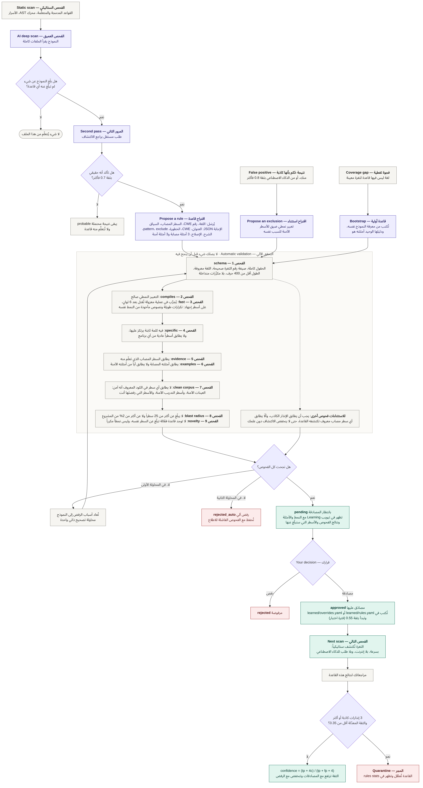

### 8.1 الخطوات العملية

1. شغّل فحصاً مع **AI review** و **Deep scan** (أو `python -m sca learn my-app`).
2. افتح تبويب **Learning** واضغط **Learn from this scan**.
3. تظهر القواعد المقترحة تحت *Waiting for your approval*. افتح كل واحدة: النمط، الاستثناء، السطر الذي تعلّمت منه، أمثلتها، نتيجة كل فحص آلي، والأسطر التي ستبلّغ عنها في مشروعك.
4. اضغط **Approve** أو **Reject**.
5. أعد الفحص: القاعدة الآن فعّالة ومحرّكها يظهر باسم `learned`.

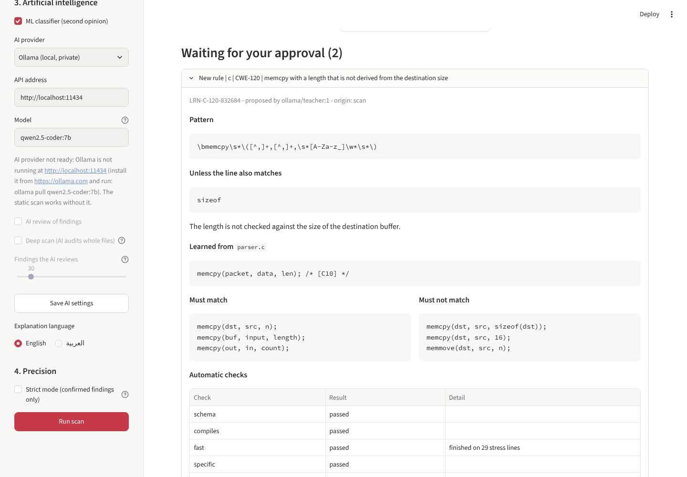

(القاعدة في الصورة أنتجها النموذج الوهمي المستخدم في الاختبارات، وليست من خدمة ذكاء اصطناعي حقيقية.)

### 8.2 مثال كامل

في العينة `parser.c`:

```c
void copy_packet(const char *data, size_t len) {
    char packet[256];
    memcpy(packet, data, len);     // لا توجد قاعدة مدمجة لهذا
}
```

1. الفحص الستاتيكي لا يبلّغ عنه.
2. الفحص العميق يبلّغ: `CWE-120` في السطر 36، والطلب الثاني يؤكد.
3. النموذج يكتب قاعدة. في الاختبار كتب أولاً نمطاً خاطئاً (`memmove`) فرُفض لأنه لا يطابق السطر الأصلي، وأُعيدت له الأسباب، فكتب:

   ```
   pattern: \bmemcpy\s*\([^,]+,[^,]+,\s*[A-Za-z_]\w*\s*\)
   exclude: sizeof
   ```

4. الفحوص التسعة تنجح، والقاعدة تنتظر.
5. بعد المصادقة: الفحص الستاتيكي وحده يبلّغ عن السطر، دون أي اتصال بالنموذج.

هذا السيناريو بالذات هو اختبار آلي في `tests/test_learning.py` (الدالة `test_learning_loop_end_to_end`).

### 8.3 الفحوص الآلية التسعة

| الفحص | ما يتحقق منه | لماذا |
|---|---|---|
| schema | الحقول موجودة، CWE بصيغة صحيحة، لغة معروفة، طول النمط أقل من 400 | رفض الإجابات الناقصة |
| compiles | التعبير النمطي صالح | النموذج قد يكتب نمطاً مكسوراً |
| fast | ينتهي على أسطر طويلة ومتكررة خلال مهلة | الحماية من Catastrophic Backtracking |
| specific | فيه كلمة ثابتة، ولا يطابق أسطراً عادية مثل `x = 1` | رفض الأنماط العامة مثل `.*` |
| evidence | يطابق السطر المصاب الذي تعلّم منه | القاعدة مرتبطة بدليل حقيقي |
| examples | يطابق أمثلته المصابة ولا يطابق أمثلته الآمنة | اتساق النموذج مع نفسه |
| clean corpus | لا يطابق أي سطر في الكود المعروف أنه آمن | منع الإنذارات الكاذبة قبل حدوثها |
| blast radius | لا يبلّغ عن أكثر من 25 سطراً أو 2% من المشروع | رفض القواعد الواسعة |
| novelty | لا توجد قاعدة تبلّغ عن السطر نفسه، وليس نمطاً مكرراً | منع التكرار |

**الكود المعروف أنه آمن (clean corpus)** يتكون من: عينات `safe_app`، الأسطر الآمنة في بيانات التدريب، وكل سطر رفضتَه أنت كإنذار كاذب. أي أن مراجعاتك تجعل الفحص أشدّ مع الوقت.

**العملية المعزولة (sandbox):** بايثون لا يستطيع إيقاف تعبير نمطي أثناء تنفيذه. لذلك يُجرَّب النمط المقترح في عملية منفصلة تُقتل بعد 6 ثوانٍ. إذا قُتلت تُرفض القاعدة.

### 8.4 الاستثناءات (التعلّم من الإنذارات الكاذبة)

عندما ترفض نتيجة كإنذار كاذب، يستطيع النموذج اقتراح استثناء ضيق للقاعدة التي أنتجتها. فحوصه: صالح وسريع، يطابق السطر الكاذب، **ولا يطابق أي سطر مصاب معروف تكتشفه القاعدة**. الشرط الأخير يمنع أن يُسكت الاستثناء ثغرات حقيقية. بعد المصادقة يُكتب في `learned/overrides.yaml`.

### 8.5 ملء الفجوات (bootstrap)

`python -m sca learn --bootstrap ruby` يسأل النموذج عن قاعدة لكل ثغرة ليس لها قاعدة في تلك اللغة. و `python -m sca learn --bootstrap all` يفعل ذلك لكل اللغات التي فيها فجوات دفعة واحدة، ويطبع قبل البدء عدد الفجوات والحد الأعلى لعدد الطلبات (طلبان لكل فجوة). في الواجهة: اختر *all languages* في تبويب Learning. هذه القواعد دليلها أضعف (أمثلة من النموذج نفسه بلا كود حقيقي)، فتُعلَّم بوضوح في الواجهة، ولا تُصادَق تلقائياً أبداً.

### 8.6 الاستمرار في التعلّم حتى الاكتمال، والمصادقة التلقائية

جولة التعلّم الواحدة هي: فحص عميق، ثم اقتراح قواعد لما اكتشفه النموذج ولم تجده القواعد. لتكرارها حتى لا يبقى جديد:

```bash
python -m sca learn my-app --rounds 5 --auto-approve
```

في كل جولة تُفعَّل القواعد الناجحة، ثم يُعاد الفحص العميق. القواعد الجديدة تكتشف الآن ما تعلّمته، فيبحث النموذج عن غيره. تتوقف الحلقة عند أول جولة لا تضيف قاعدة فعّالة، أو عند بلوغ عدد الجولات.

الخيار `--auto-approve` يفعّل مباشرة القواعد التي نجحت في كل الفحوص **وتعلّمت من كود حقيقي فقط**. الاستثناءات وقواعد bootstrap تبقى بانتظارك دائماً. بدون هذا الخيار تتوقف الحلقة بعد الجولة الأولى وتنتظر مصادقتك، ثم تشغّل الأمر مرة أخرى للجولة التالية. الافتراضي هو المصادقة البشرية، وهو الأسلم.

**ما معنى «اكتمال القواعد»؟** لا توجد مجموعة قواعد كاملة، لأن الثغرات لا تُحصى. المعنى العملي هنا: القواعد تغطي كل ما استطاع النموذج اكتشافه في مشاريعك، ولكل لغة قاعدة لكل ثغرة شائعة. كل مشروع جديد تفحصه قد يضيف قواعد جديدة، ولهذا يستمر التعلّم مع الاستخدام.

### 8.7 أين تُحفظ القواعد المتعلَّمة؟

`learned/rules.yaml` و `learned/overrides.yaml`: ملفات نصية تستطيع قراءتها وتعديلها وحذف أي مدخل منها ورفعها إلى git لمشاركتها. القاعدة المتعلَّمة تبدأ بثقة 0.55 (فترة اختبار) ثم تتحرك ثقتها مع مراجعاتك.

### 8.8 حدود التعلّم

القاعدة المتعلَّمة تعبير نمطي على سطر واحد. الثغرات المنطقية (فحص صلاحيات مفقود) أو التي تحتاج عدة أسطر لا يمكن التعبير عنها بقاعدة، فتبقى مهمة الفحص العميق في كل مرة. توقّع أن يُرفض جزء من اقتراحات النموذج آلياً، وهذا هو المطلوب من الفحوص.

---

## 9. تقليل الإنذارات الكاذبة

**حقيقة يجب قولها في البحث:** لا توجد أداة تحليل ستاتيكي بلا إنذارات كاذبة وبلا ثغرات فائتة معاً. السؤال «هل هذا البرنامج مصاب؟» غير قابل للحسم خوارزمياً في الحالة العامة (مبرهنة Rice). كل أداة تختار نقطة على المقايضة بين Precision و Recall. ما تفعله هذه المنصة هو خمس طبقات تقلّل الكاذب، ووضع صارم تختار به أنت النقطة.

| الطبقة | ماذا تفعل |
|---|---|
| 1. استثناءات القواعد | الصيغة الآمنة (مطهّر، قيمة ثابتة) لا تُبلَّغ |
| 2. تتبّع البيانات | يفرّق بين «وصلت بيانات المستخدم إلى هنا» و «تطابق نمط فقط» |
| 3. تعدد المحركات | اتفاق محركين مستقلين يرفع الثقة |
| 4. مراجعة الذكاء الاصطناعي | تعلّم النتيجة الكاذبة `likely false positive` وتؤكد الحقيقية |
| 5. مراجعاتك | الكاذب يبقى مرفوضاً، والقاعدة المزعجة تفقد ثقتها وتُحجر |

### 9.1 مؤكَّد أم محتمل

المخطط التالي يبيّن القرار كاملاً، وشرحه المفصّل في القسم 5 من [DIAGRAMS_AR.md](DIAGRAMS_AR.md):

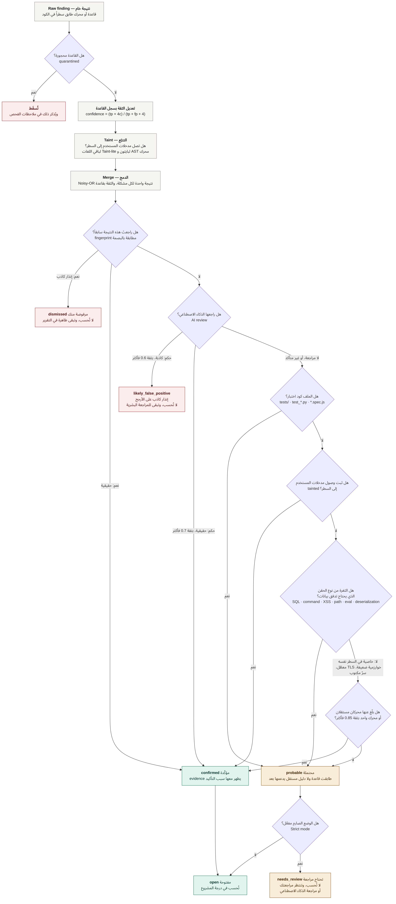

كل نتيجة تُصنَّف **confirmed** إذا دعمها دليل مستقل واحد على الأقل:

- أنت صادقت عليها.
- مراجعة الذكاء الاصطناعي حكمت أنها حقيقية بثقة 0.7 أو أكثر.
- ثبت وصول بيانات المستخدم إلى السطر (خارج كود الاختبار).
- للثغرات التي هي خاصية في السطر نفسه فقط (خوارزمية ضعيفة، تعطيل التحقق من TLS، سرّ مكتوب، الدالة `gets`)، وخارج كود الاختبار: محركان ستاتيكيان مستقلان بلّغا عنها، أو محرك واحد بثقة 0.85 أو أكثر. القواعد المدمجة والمتعلَّمة تُحسب عائلة واحدة.

وإلا فهي **probable**. نتيجة حكم الذكاء الاصطناعي بأنها كاذبة لا تكون مؤكَّدة إلا إذا صادقتَ أنت. السبب يظهر مع كل نتيجة في الواجهة والتقرير.

**لماذا لا يكفي اتفاق محركين في ثغرات الحقن؟** ثغرات الحقن (SQL، أوامر النظام، XSS، المسارات، `eval`، فك التسلسل) لا تكون حقيقية إلا إذا وصلت بيانات المهاجم إلى السطر. محركان يلاحظان كلاهما استدعاء `pickle.loads` رأيا الشيء نفسه، ولم يُثبت أيٌّ منهما المسار. لذلك تأكيدها يحتاج تتبّعاً أو مراجعة.

**كود الاختبار.** النتائج في `tests/` و `test_*.py` و `*.spec.js` وما يشبهها تبقى في التقرير، لكن ثقتها تُضرب في 0.6 ولا تُؤكَّد تلقائياً، لأن مدخلات الاختبار يكتبها المبرمج لا المهاجم. الخيار **Skip test code** في الواجهة (أو `--skip-tests`) يتجاوز هذه الملفات كلياً.

### 9.2 الوضع الصارم (Strict mode)

يُبقي النتائج المؤكَّدة فقط «مفتوحة» ومحسوبة في الدرجة، وينقل الباقي إلى *Needs review*. لا يُحذف شيء.

النتيجة المقاسة على العينات: 0 إنذار كاذب (Precision = 1.000) مقابل Recall = 0.606. أي أن الصفر تحقق **على هذه العينات** بثمن واضح: 25 ثغرة حقيقية انتقلت إلى «تحتاج مراجعة» لأنها لم تجد دليلاً ثانياً (مثل استخدام MD5 في Java، أو سرّ مكتوب في ملف إعدادات، أو `strcpy` في C). وعلى 1.19 مليون سطر من كود مكتبات حقيقية بقيت نتيجة واحدة مؤكَّدة من 204 (القسم 11.2). مراجعة الذكاء الاصطناعي هي ما يؤكد هذه النتائج ويعيدها، وهذه تجربتك في القسم 12.

### 9.3 مراجعاتك تغيّر الفحوصات القادمة

1. **النتيجة نفسها**: ما ترفضه يبقى مرفوضاً في الفحوصات التالية (المطابقة ببصمة من الملف والثغرة ونص السطر، فلا تتأثر بتغيّر رقم السطر).
2. **القاعدة**: لكل قاعدة عدّادان: مؤكَّد (tp) ومرفوض (fp). ثقتها تصبح:

   `confidence' = (tp + K × confidence) ÷ (tp + fp + K)` حيث `K = 4`

   هذه هي القيمة المتوقعة لتوزيع Beta، والثقة المكتوبة في القاعدة تعمل كأنها 4 مراجعات سابقة. مثال: قاعدة ثقتها 0.4 رُفضت نتائجها 3 مرات: `(0 + 1.6) ÷ 7 = 0.23`.

3. **الحجر**: قاعدة لها 3 إنذارات كاذبة أو أكثر ونزلت ثقتها المعدّلة تحت 0.35 تُعطَّل تلقائياً، وتظهر في `python -m sca rules stats`. تعود بمسح مراجعاتها.
4. **المصنّف**: يُعاد تدريبه بالأسطر التي راجعتها.
5. **فحص القواعد الجديدة**: الأسطر التي رفضتها تدخل «الكود المعروف أنه آمن»، فتُرفض أي قاعدة مقترحة تطابقها.

---

## 10. اللغات: مخصص لكل لغة، وكيف نشمل الجميع

التغطية أربعة مستويات، من الأعمق إلى الأعم:

| المستوى | اللغات | الطريقة |
|---|---|---|
| 1. تحليل AST وتتبّع بين الدوال | Python | `python_ast.py` |
| 2. قواعد مخصصة + taint-lite | JavaScript, TypeScript, PHP, Java, Kotlin, Scala, Groovy, C, C++, C#, Go, Ruby, Dart | `sca/rules/*.yaml` و `taint_lite.py` (ولـ C و C++ أيضاً فحوص الذاكرة، ولمشاريع Dart و Flutter الفحوص البنيوية في القسم 7.8) |
| 3. قواعد مخصصة فقط | Rust, Shell, PowerShell | `sca/rules/*.yaml` |
| 4. قواعد مستوردة قليلة أو لا قواعد | Swift (2)، SQL (1)، ثم Perl و Lua و Elixir بلا قواعد فعّالة | الفحص العميق بالذكاء الاصطناعي + كشف الأسرار + القواعد العامة لكل اللغات |

عدد القواعد المدمجة لكل لغة: Dart 49 (منها صيغتا مفاتيح)، JavaScript/TypeScript 38، Java (ومعها Kotlin و Scala و Groovy) 31، PHP 24، Ruby 17، C# 16، Go 12، C/C++ 8، ملفات الإعدادات 8، Shell 6، Rust 3، PowerShell 3، HTML 2، Python 2 (المحرك الأساسي لبايثون هو تحليل AST). المجموع 217 قاعدة، وبعضها ينطبق على أكثر من لغة. الأمر `python -m sca coverage` يعرض المصفوفة الحالية بعد ما تعلّمته الأداة.

Kotlin و Scala و Groovy تستدعي نفس واجهات JVM، فتُطبَّق عليها قواعد Java التي تعتمد على أسماء الدوال. الصياغات الخاصة بكل لغة منها (مثل قوالب النصوص في Kotlin) غير مغطاة بهذه القواعد.

**كيف نشمل كل اللغات؟** بأربع طرق متكاملة:

1. **الفحص العميق لا يعتمد على اللغة**: النموذج اللغوي يقرأ أي لغة، فكل ملف كود يُفحص به مهما كانت لغته.
2. **التعلّم يحوّل اكتشافاته إلى قواعد**: مع كل مشروع تفحصه بلغة جديدة تزداد قواعد تلك اللغة.
3. **bootstrap**: `python -m sca learn --bootstrap swift` يكتب قواعد أولية للغة لا قواعد لها، و `--bootstrap all` يفعل ذلك لكل اللغات.
4. **Opengrep/Semgrep**: عند تنصيبه يضيف قواعد جاهزة لأكثر من 30 لغة، ونتائجه تدخل الدمج نفسه.

**لإضافة لغة جديدة تماماً:** أضف امتدادها في `LANG_BY_EXT` واسمها في `CODE_LANGUAGES` ورمز التعليق في `COMMENT_PREFIXES` داخل `sca/walker.py`. بعدها تعمل عليها كل الآليات أعلاه.

---

## 11. النتائج المقاسة

`python evaluation/evaluate.py` يفحص العينات ويقارن مع `samples/ground_truth.json`:

| الإعداد | TP | FP | FN | Precision | Recall | F1 |
|---|---:|---:|---:|---:|---:|---:|
| Bandit فقط (خط أساس لبايثون) | 15 | 3 | 56 | 0.833 | 0.211 | 0.337 |
| قواعد الأنماط + الأسرار | 48 | 3 | 23 | 0.941 | 0.676 | 0.787 |
| + محرك AST | 66 | 3 | 5 | 0.957 | 0.930 | 0.943 |
| كل المحركات الستاتيكية | 68 | 6 | 3 | 0.919 | 0.958 | 0.938 |
| كل المحركات، الوضع الصارم | 43 | 0 | 28 | 1.000 | 0.606 | 0.754 |

- **TP**: ثغرة حقيقية اكتُشفت. **FP**: إنذار كاذب. **FN**: ثغرة فاتت.
- **Precision** = TP ÷ (TP + FP). **Recall** = TP ÷ (TP + FN). **F1** متوسطهما التوافقي.

**ماذا نستنتج؟**

- محرك AST رفع Recall من 0.68 إلى 0.93.
- بقية المحركات رفعت Recall إلى 0.96: فحوص الذاكرة في C/C++ اكتشفت `memcpy` بطول غير مفحوص وتجاوز العدد الصحيح في حجم التخصيص. وأضاف Bandit ثلاثة إنذارات كاذبة، وهذا ما يبرر طبقات التنقيح بعد الدمج.
- الوضع الصارم ألغى الإنذارات الستة كلها ونقل 25 ثغرة حقيقية إلى المراجعة: مقايضة صريحة.
- الثغرات الثلاث الفائتة: فحص صلاحيات مفقود (IDOR)، و Prototype Pollution، وكلمة مرور تُمرَّر معاملاً موضعياً بلا اسم متغير. الأوليان من النوع الذي وُضع له الفحص العميق وحلقة التعلّم.

**تحذير منهجي يجب ذكره في البحث:** العينات كُتبت مع الأداة، وبعض التقريبات عُدّلت أثناء النظر إليها (مثل معاملة القراءة من جدول ثابت في taint-lite). فالأرقام تثبت أن النظام يعمل ولا تمثل أداءه على كود لم يره.

### 11.1 على معيار OWASP Benchmark (حالات لم تُكتب مع الأداة)

[OWASP Benchmark](https://owasp.org/www-project-benchmark/) مجموعة عامة من برامج صغيرة، في كل واحد ثغرة مزروعة واحدة. نحو نصفها حقيقي والنصف الآخر يشبهه لكنه آمن. الدرجة = نسبة المكتشَف (TPR) ناقص نسبة الإنذارات الكاذبة (FPR): صفر يعني أن الأداة لا تختلف عن التخمين، وواحد يعني الكمال. التشغيل بالمحركات الستاتيكية فقط دون ذكاء اصطناعي: `python evaluation/owasp_benchmark.py BenchmarkJava BenchmarkPython`. الجداول الكاملة لكل فئة في `evaluation/owasp_benchmark.md`.

| المعيار | إصدار الأداة | المكتشَف (TPR) | الإنذارات الكاذبة (FPR) | الدرجة | درجة الوضع الصارم |
|---|---|---:|---:|---:|---:|
| Java، 2,740 حالة | 1.2.0، أول تشغيل | 24% | 8% | +0.16 | +0.02 |
| Java، 2,740 حالة | 1.3.0 | 84% | 40% | **+0.44** | +0.22 |
| Java، 1,370 حالة لم يُنظر إليها قط | 1.3.0 | 86% | 40% | +0.46 | +0.24 |
| Python، 1,230 حالة | 1.2.0، أول تشغيل | 53% | 31% | +0.22 | +0.25 |
| Python، 1,230 حالة | 1.3.0 | 80% | 37% | **+0.43** | +0.33 |
| Python، 615 حالة لم يُنظر إليها قط | 1.3.0 | 80% | 38% | +0.42 | +0.28 |

كيف تُقرأ هذه الأرقام:

- **أول تشغيل هو نقطة البداية الصادقة.** الأداة لم ترَ هذه البرامج من قبل، وجاءت نتيجتها أقل بكثير من نتيجتها على عيّناتها. تبيّن أن أنواعاً كاملة من الثغرات كانت غائبة: في Java العشوائية الضعيفة وملفات الارتباط غير الآمنة و LDAP و XPath وكل حقن تُقرأ مدخلاته في سطر سابق، وفي Python كانت غائبة LDAP و XPath و XXE وملفات الارتباط وبيانات الجلسة.
- **الإصدار 1.3 أضافها** بالنظر إلى الحالات ذات الأرقام الفردية فقط. الحالات الزوجية لم يُنظر إليها قط ونتيجتها مماثلة. لكن حالات الفئة الواحدة مولَّدة من قوالب مشتركة، فهذا النصف فحص أضعف من معيار مختلف تماماً.
- **الثغرات الظاهرة في سطر واحد درجتها عالية** (خوارزمية تشفير ضعيفة، عشوائية ضعيفة، ملف ارتباط غير آمن: +1.00 في Java). **وفئات الحقن تبقى منخفضة** (حقن SQL في Java +0.01، واجتياز المسارات +0.06)، لأن الحالة الآمنة فيها لا تختلف عن الحقيقية إلا في مسار البيانات عبر القواميس والقوائم والأصناف المساعدة، وهذا لا تتبّعه قواعد السطر الواحد مع تتبّع مبسّط. الناقص الأساسي هو محرك تدفق بيانات حقيقي للغة Java.
- **نسبة إنذارات كاذبة بين 37% و40% عالية.** المعيار مصمَّم لاستفزاز ذلك بالذات، وعلى الكود الحقيقي الناضج الأداة أهدأ بكثير.

### 11.2 فحص على كود حقيقي (اختبار ضجيج، وليس قياس دقة)

القياس بالإصدار 1.3.0 وبكل القواعد.

شُغّلت الأداة على الكود المصدري لأربع مكتبات معروفة ومراجَعة جيداً، بالمحركات الستاتيكية فقط:

| المكتبة | الملفات | الأسطر | الزمن | النتائج | منها في كود الاختبار | المؤكَّدة |
|---|---:|---:|---:|---:|---:|---:|
| pandas 3.0.5 | 1,422 | 636,043 | 92 ث | 110 | 79 | 0 |
| scikit-learn 1.9.1 | 688 | 389,923 | 47 ث | 70 | 54 | 1 |
| streamlit 1.67.0 | 735 | 149,134 | 16 ث | 11 | 0 | 0 |
| bandit 1.9.4 | 70 | 11,235 | 2 ث | 13 | 0 | 0 |
| **المجموع** | **2,915** | **1,186,335** | | **204** | **133** | **1** |

هذه المكتبات ليست موسومة بإجابات صحيحة، فلا يُحسب منها Precision ولا Recall. لكنها مكتبات ناضجة
يُتوقع أن تكون ثغراتها الحقيقية قليلة، فعدد «المؤكَّدة» فيها مؤشر تقريبي على ضجيج الوضع الصارم:
نتيجة واحدة في 1.19 مليون سطر (استخدام MD5 لبصمة ملف بيانات في scikit-learn، وهو استخدام ضعيف
فعلاً لكنه قليل الخطورة). الـ 203 الباقية «محتملة»: أغلبها `pickle.load` و `eval` في ملفات الاختبار.

هذه التجربة هي التي كشفت أن قاعدة «اتفاق محركين» الأولى كانت متساهلة (56 نتيجة مؤكَّدة في pandas
قبل التعديل)، فعُدّلت كما في القسم 9.1.


---

## 12. تجارب يجب أن تجريها أنت للبحث

كلها تحتاج مفتاح API أو Ollama، ولم تُنفَّذ عند بناء المشروع.

1. **أثر مراجعة الذكاء الاصطناعي:**

   ```bash
   python evaluation/evaluate.py --llm
   python evaluation/evaluate.py --deep
   ```

   يضيف صفّين للجدول (عادي وصارم). السؤال: كم نتيجة «تحتاج مراجعة» أعادها الذكاء الاصطناعي؟ وهل أدخل إنذارات كاذبة؟

2. **منحنى التعلّم** (أهم تجربة للعنوان «Intelligent»):
   - شغّل `python -m sca learn samples/vulnerable_app` وسجّل: عدد القواعد المقترحة، كم نجح في الفحص الآلي، كم رُفض ولماذا.
   - صادق على الناجحة ثم أعد `python evaluation/evaluate.py` وقارن Recall الستاتيكي قبل وبعد.
   - كرّر على مشروع ثانٍ وارسم: عدد القواعد المتعلَّمة مقابل Recall.

3. **مقارنة النماذج:** كرّر التجربتين بنموذجين مختلفين (سحابي ومحلي) وقارن جودة القواعد المقترحة ونسبة الرفض الآلي.

4. **معيار عام:** OWASP Juice Shop (JavaScript)، DVWA (PHP)، WebGoat و OWASP Benchmark (Java)، NIST Juliet (C/C++ و Java).

5. **أثر المراجعات:** راجع 30 نتيجة على مشروع حقيقي، ثم أعد الفحص وقِس تغيّر Precision وعدد القواعد المحجورة.

6. **المصنّف على بيانات حقيقية:**

   ```bash
   python -m sca train --dataset primevul_train.jsonl --out data/model.joblib
   ```

   توقّع أرقاماً منخفضة على PrimeVul، وهي نتيجة تُكتب وتُناقش.

7. **الزمن والكلفة:** زمن الفحص وعدد طلبات الـ API (يظهر في `AI llm_requests`) لمشاريع بأحجام مختلفة.

---

## 13. القواعد: المستوردة، والكتابة اليدوية، والتعديل، والتحكم

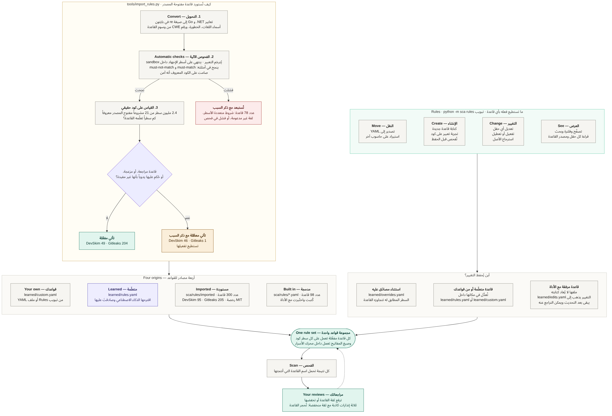

### 13.1 القواعد المستوردة: ماذا أُضيف وكيف؟

أُضيفت إلى نظام القواعد الستاتيكي **300 قاعدة مستوردة** من مشروعين مفتوحي المصدر برخصة MIT:

| المصدر | نوع القواعد | في المصدر | مستوردة ومفعّلة | مستوردة ومعطّلة | مستبعدة |
|---|---|---:|---:|---:|---:|
| [Microsoft DevSkim](https://github.com/microsoft/DevSkim) | أنماط كود لعدة لغات | 156 | 49 | 46 | 61 |
| [Gitleaks](https://github.com/gitleaks/gitleaks) | صيغ مفاتيح ورموز نحو 200 خدمة | 222 | 204 | 1 | 17 |

فصارت المجموعة **517 قاعدة، منها 470 فعّالة** (217 مدمجة + 253 مستوردة فعّالة). لم تُنسخ القواعد كما هي. السكربت `tools/import_rules.py` يمرّر كل قاعدة على هذه الخطوات:

1. **التحويل**: تعابير ‎.NET و Go تُحوَّل إلى صيغة بايثون، وتُربط أسماء اللغات والخطورة ورقم CWE.
2. **الفحوص الآلية**: التعبير يُترجَم، وينتهي على أسطر الإجهاد داخل العملية المعزولة، وينجح في أمثلة القاعدة نفسها (ما يجب أن تطابقه وما يجب ألّا تطابقه)، ولا يطابق شيئاً في الكود المعروف أنه آمن. من يفشل يُستبعد ويُكتب السبب.
3. **القياس على كود حقيقي**: شُغّلت القواعد الناجحة على 2,384,751 سطر كود من 21 مشروعاً مفتوح المصدر معروفاً (Django و Flask و Redis و Laravel و Express وغيرها).
4. **القرار**: القاعدة التي يصنّفها DevSkim نفسه «للمراجعة اليدوية»، أو التي طابقت كثيراً، أو التي قُرئت مطابقاتها يدوياً وتبيّن أنها غير مفيدة، تأتي **معطَّلة** مع ذكر السبب في حقل `note`، وتستطيع تفعيلها.

السجل الكامل لكل قاعدة (قُبلت أم لا ولماذا وكم طابقت) في `evaluation/import_report.json`، والجداول التفصيلية في [RULES.md](RULES.md).

**الأثر المقاس للاستيراد** على ثلاثة مشاريع كبيرة (1.17 مليون سطر): زادت النتائج المحتملة 21 نتيجة، ولم تزد النتائج المؤكَّدة، وصار الفحص أبطأ بنحو 40%. وعلى العيّنات المعلَّمة لم تتغيّر الدقة ولا الاسترجاع.

**ما لا يثبته ذلك:** القواعد المستوردة لم تُختبر واحدةً واحدة على ثغرات حقيقية. القياس يبيّن أنها هادئة على كود ناضج، ولا يبيّن كم تكتشف.

### 13.2 حقول القاعدة

| الحقل | المعنى |
|---|---|
| `id` | اسم فريد، مثل `MY-SQLI-001` |
| `title` | وصف قصير يظهر في قائمة النتائج |
| `languages` | اللغات، أو `any` للجميع |
| `files` | اختياري: أنماط أسماء ملفات (مثل `**/web/index.html` أو `*.sh`) تقصر القاعدة على ملفات بعينها. تُقارَن دون تمييز حالة الأحرف بالمسار وباسم الملف. الفارغ يعني كل ملفات اللغات المذكورة |
| `cwe` | نوع الثغرة برقم CWE. منه يؤخذ الشرح والإصلاح وفئة OWASP |
| `severity` | `critical` أو `high` أو `medium` أو `low` أو `info` |
| `confidence` | من 0 إلى 1. ابدأ القاعدة الجديدة بين 0.5 و 0.6 |
| `pattern` | تعبير نمطي يعلّم السطر المصاب |
| `exclude` | اختياري: إن طابق السطر أيضاً فيُتجاهل |
| `ignore_case` | تجاهل حالة الأحرف |
| `near` و `within` | سياق اختياري: لا تعمل القاعدة إلا إذا طابق `near` سطراً يبعد `within` أسطر على الأكثر. مثال: رقم عشوائي قرب كلمة token |
| `requires_taint` | القيمة `true` تجعلها قاعدة «مصبّ»: تبقى صامتة ما لم تُتتبَّع مدخلات المستخدم إلى السطر. تصلح للقواعد التي تذكر دالة شائعة مثل فتح ملف |
| `message` و `fix` | شرح ونصيحة اختياريان |
| `examples_vulnerable` | أسطر يجب أن تطابقها القاعدة. تُفحص عند كل حفظ |
| `examples_safe` | أسطر يجب ألّا تطابقها القاعدة |

### 13.3 كتابة قاعدة جديدة يدوياً

**من الواجهة:** تبويب القواعد ← **قاعدة جديدة**. املأ الحقول، اضغط **افحص القاعدة** لترى الأخطاء والتحذيرات دون حفظ، ثم **احفظ القاعدة**. وقبل ذلك جرّب التعبير في **تجربة تعبير**: الصق كوداً وشاهد أي الأسطر يعلّمها.

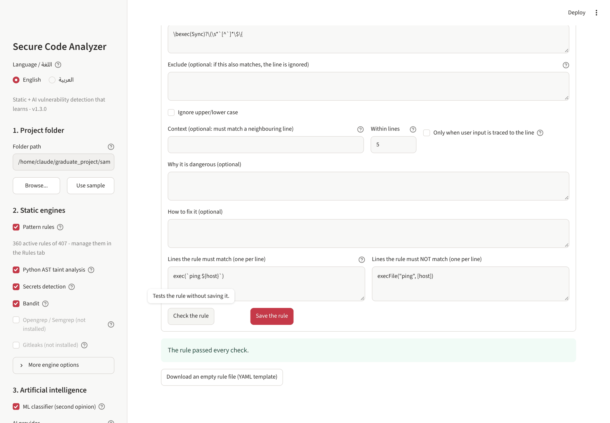

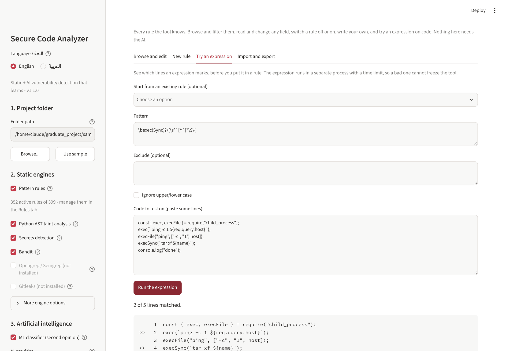

**من سطر الأوامر:**

```bash
python -m sca rules template > my-rule.yaml    # قالب فارغ
# عدّل الملف ثم:
python -m sca rules new my-rule.yaml           # تُفحص القاعدة ثم تُضاف
python -m sca rules test MY-RULE-001 مسار/     # أي الأسطر تعلّمها في مشروعك؟
```

**ماذا تفحص الأداة عند الحفظ؟** الأخطاء تمنع الحفظ: حقل ناقص أو غير صحيح، تعبير لا يُترجَم، تعبير بطيء جداً (يُشغَّل في عملية معزولة بحدّ زمني)، أو مثال من أمثلة القاعدة تفشل فيه. التحذيرات تُعلمك ولا تمنع: القاعدة تطابق كوداً عادياً أو كوداً معروفاً أنه آمن، أو تكرّر قاعدة موجودة. قاعدتك تُحفظ في `learned/custom.yaml`.

**نصائح للكتابة:** ابدأ من سطر مصاب حقيقي ومن نسخته الآمنة. ثبّت التعبير على اسم دالة، ثم صِف ما يجعل الاستدعاء خطراً. ضع الصيغة الآمنة في `exclude`. تجنّب `.*` في الطرفين والتكرار المتداخل مثل `(a+)+`.

### 13.4 تعديل قاعدة موجودة وتعطيلها

**من الواجهة:** تبويب القواعد ← **تصفّح وتعديل**. فلتر حسب المصدر واللغة والثغرة والحالة أو ابحث بالاسم، ثم اختر القاعدة. تظهر كل حقولها في نموذج قابل للتعديل، ومعه أزرار **عطّل / فعّل** و **استرجاع الأصل** (أو **احذف القاعدة** لقواعدك والمتعلَّمة)، وسجل القاعدة في مراجعاتك، واستثناءاتها المصادَق عليها.

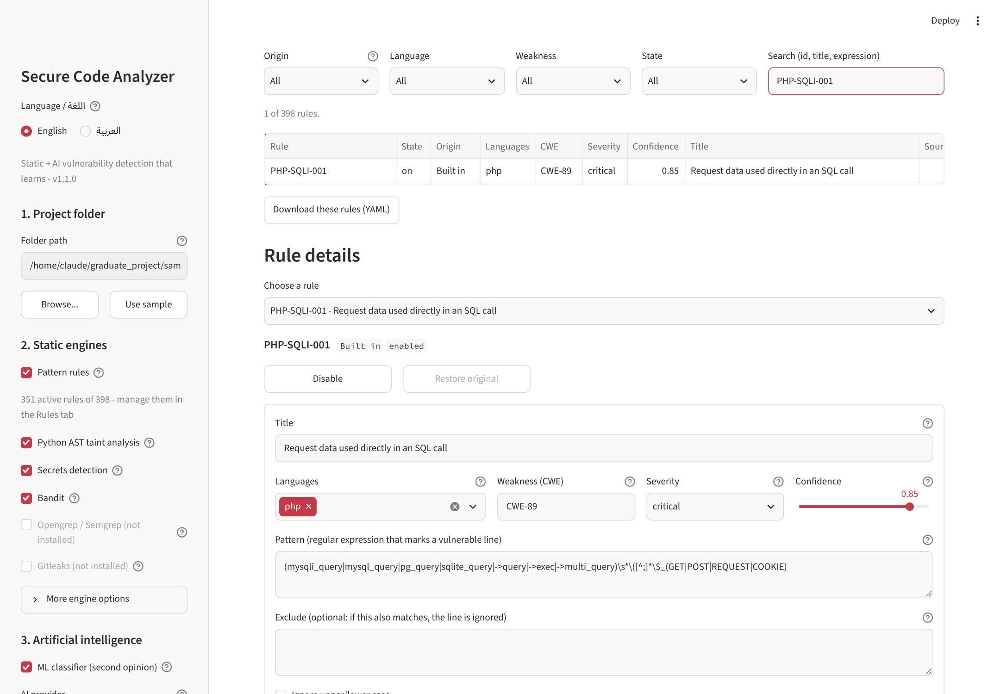

**من سطر الأوامر:**

```bash
python -m sca rules catalog --lang php                 # كل قواعد لغة
python -m sca rules catalog --disabled                 # القواعد المعطّلة
python -m sca rules show DEVSKIM-DS425070              # قاعدة كاملة مع مصدرها ورخصتها
python -m sca rules disable JS-EVAL-001                # تعطيل (enable للتفعيل)
python -m sca rules disable --origin imported --lang swift   # تعطيل كل ما يطابق الفلاتر
python -m sca rules edit PHP-SQLI-001 --set severity=medium --set confidence=0.5
python -m sca rules reset PHP-SQLI-001                 # التراجع عن تعديلاتك
python -m sca rules delete MY-RULE-001                 # حذف قاعدة من قواعدك
python -m sca rules export --origin custom -o my-rules.yaml
python -m sca rules import my-rules.yaml               # على حاسوب آخر
```

**أين يُحفظ التعديل؟** القواعد المرفقة مع الأداة (المدمجة والمستوردة) لا يُعاد كتابة ملفاتها. تعديلك يُحفظ في `learned/edits.yaml`، فيبقى بعد تحديث الأداة ويمكن التراجع عنه. قواعدك والقواعد المتعلَّمة تُعدَّل في ملفاتها مباشرة. والتعديل الخاطئ لا يوقف الفحص: إن كُتب في الملف يدوياً تعبير لا يُترجَم، تبقى القاعدة الأصلية سارية.

| الملف | محتواه |
|---|---|
| `sca/rules/*.yaml` | القواعد المدمجة |
| `sca/rules/imported/*.yaml` | القواعد المستوردة مع مصدرها ورخصتها |
| `learned/rules.yaml` | القواعد المتعلَّمة المصادَق عليها |
| `learned/custom.yaml` | قواعدك |
| `learned/edits.yaml` | تعديلاتك على القواعد المرفقة (ومنها التعطيل) |
| `learned/overrides.yaml` | الاستثناءات المصادَق عليها |

### 13.5 إضافة قاعدة مدمجة للمشروع نفسه (للمطوّر)

1. افتح الملف المناسب في `sca/rules/` وأضف القاعدة بالصيغة في 7.1.
2. أضف سطراً مصاباً في `RULE_VULNERABLE` وسطراً آمناً في `RULE_SAFE` داخل `tests/test_engines.py`.
3. `python -m pytest tests -q`

لتجاهل سطر في مشروعك أضف في نهايته التعليق `# sca:ignore` أو `# nosec`.

**الفحوص البنيوية لتطبيقات Flutter و Android ليست قواعد.** فحص ملف manifest أو Gradle أو
`Info.plist` أو `pubspec.lock` يحتاج تحليل بنية الملف (أيّ مكوّن مُصدَّر، وما القيمة الافتراضية
للنظام)، فهو مكتوب بالكود في `sca/flutter/checks.py` ولا يظهر في تبويب القواعد، ولا يُكرَّر كقاعدة
تعبير نمطي. ولإضافة فحص جديد: أضف مدخلاً `Check` في الجدول `CHECKS`، وحقوله كلها إلزامية:
المعرّف، والعنوان بالإنجليزية والعربية، ورقم CWE، والخطورة، والثقة، والمجال `area` (مفتاح من
`AREAS`: manifest أو network أو gradle أو signing أو ios أو app أو dependencies)، والهدف `target`
(مفتاح من `TARGETS`: source للمشروع المصدري، أو app لحزمة التطبيق، أو both لكليهما). ثم اكتب الفحص
في أحد الأجزاء المحمية من `analyze`، وأضف اختباره في `tests/test_flutter_checks.py`. أما قواعد
Dart فتُضاف في `sca/rules/dart.yaml` مثل أي قاعدة.

---

## 14. حدود المشروع

1. لا يثبت خلوّ الكود من الثغرات، ولا يضمن خلوّ النتائج من الإنذارات الكاذبة.
2. تتبّع البيانات في بايثون بعمق استدعاء واحد وداخل الملف الواحد.
3. اللغات الأخرى تُفحص سطراً سطراً مع تتبّع تقريبي.
4. القاعدة المتعلَّمة تعبير نمطي على سطر واحد، فلا تعبّر عن الثغرات المنطقية أو متعددة الأسطر.
5. الذكاء الاصطناعي قد يخطئ في الاتجاهين، وجودة كل ما يعتمد عليه تتبع النموذج المستخدم.
6. مع مزوّد سحابي يغادر الكود جهازك، والإخفاء يشمل الأسرار المكتشفة فقط.
7. بيانات تدريب المصنّف الأساسية اصطناعية.
8. درجة الأمان مؤشر من تصميمنا وليست معياراً رسمياً.
9. لا يوجد فحص عام للمكتبات الخارجية المصابة (SCA). الاستثناء حزم Dart: يُقارَن `pubspec.lock` بقائمة منتقاة من التنبيهات الأمنية محفوظة محلياً، وليست استعلاماً حياً من قاعدة OSV.
10. نسخة الإصدار من تطبيق Flutter تُقرأ من نصوصها لا من تعليمات الآلة، فالثغرة التي هي بنية في الكود (دالة تقبل كل شهادة، أو تدفق رمز الدخول إلى السجل) لا تُكتشف إلا في المصدر أو في نسخة التصحيح. ولا يوجد محرك تدفق بيانات للغة Dart، ولا تحليل يربط Dart بكود Kotlin أو Java عبر قنوات المنصة.
11. منطق التفويض، والروابط العميقة التي تنفّذ عمليات حساسة، وغياب دفاعات وقت التشغيل (كشف الروت والتلاعب، و FLAG_SECURE)، وسلوك الذكاء الاصطناعي داخل التطبيق: كل هذا لا تراه الفحوص الستاتيكية (القسم 7.8).
12. في التطبيق المبني بنسخة إصدار تكون إصدارات الحزم مجهولة غالباً، فتأتي نتيجة الاعتمادية المصابة فيه (FLUTTER-PUB-001) بدرجة «معلومة» وثقة 0.3، أو بخطورة التنبيه وثقة 0.35 إذا كانت كل الإصدارات مصابة. ولا تُفكّ تطبيقات iOS (‎`.ipa`)، ويُفحص فقط ملف `Info.plist` في المشروع المصدري.
13. فئات OWASP Mobile Top 10 و MASVS ربط من وضع المشروع انطلاقاً من أرقام CWE.
14. القاعدة DART-TLS-002 لا تنظر إلا إلى السطر الذي يلي بداية دالة التحقق من الشهادة مباشرة، فإن جاء قبل `return true` سطرُ تسجيل (log) فاتتها الثغرة. والقاعدة FLUTTER-BUILD-001 لا تفحص أمر `flutter build` الممتد على عدة أسطر بالعلامة `\`.
15. درجة حزمة التطبيق لا تحسب إلا الأسطر المفكوكة والمستعادة، لا ملفات النصوص المستخرجة، فتأتي درجة نسخ الإصدار منخفضة غالباً (القسم 7.8).
16. جرد واجهات API والمفاتيح يقرأ العناوين ولا يتصل بها: لا يختبر هل قاعدة بيانات Firebase أو حاوية التخزين علنية فعلاً، ولا هل المفتاح ما زال يعمل. ولا يذكر استدعاءات API إلا حيث يوجد نص الكود (المصدر ونسخ debug ومخرجات jadx)، ويعرف خدمة الخادم من جدول ثابت فيه 106 لاحقة لأسماء الخوادم (88 خدمة)، ولا يتحقق من توقيع رمز JWT.

---

## 15. أسئلة متوقعة في المناقشة

**ما الجديد في مشروعك مقارنة بـ Semgrep أو Bandit؟**
أربعة أشياء: دمج عدة محركات بثقة مشتركة، تصنيف النتائج إلى مؤكَّدة ومحتملة بأدلة مستقلة، مراجعة وشرح بالعربية عبر أي مزوّد ذكاء اصطناعي، وحلقة تعلّم تحوّل اكتشافات النموذج إلى قواعد ستاتيكية بعد تحقق آلي ومصادقة بشرية.

**كيف «يتعلّم» النظام؟ هل تعيدون تدريب النموذج اللغوي؟**
لا. التعلّم هنا على ثلاثة مستويات لا تمسّ النموذج اللغوي: قواعد جديدة تُضاف لقاعدة المعرفة، ثقة كل قاعدة تُحدَّث بمراجعات المستخدم (تحديث بايزي بتوزيع Beta)، والمصنّف الخطي يُعاد تدريبه بالأسطر المراجَعة. النموذج اللغوي يعمل معلّماً والمحرك الستاتيكي تلميذاً.

**لماذا لا تثقون بالقاعدة التي يكتبها النموذج مباشرة؟**
لأنه قد يكتب نمطاً خاطئاً، أو عاماً يغرق المستخدم بالإنذارات، أو بطيئاً يعلّق الفحص (ReDoS). لذلك تسعة فحوص آلية ثم مصادقة بشرية. وفي الاختبارات رُفضت قواعد فعلاً لكل سبب من هذه.

**هل تضمنون صفر إنذارات كاذبة؟**
لا، ولا يستطيع أحد (مبرهنة Rice). نقدّم وضعاً صارماً يعرض ما له دليل مستقل فقط، وقسنا ثمنه: Precision 1.0 مقابل Recall 0.61 على عيناتنا، ونتيجة مؤكَّدة واحدة في 1.19 مليون سطر من مكتبات حقيقية.

**ما هو Catastrophic Backtracking وكيف تعاملتم معه؟**
تعبير نمطي مثل `(x|xx)+y` يحتاج زمناً أسّياً على مدخلات معينة. نرفض الأنماط ذات المكرِّرات المتداخلة، ونجرّب كل نمط في عملية معزولة تُقتل بعد مهلة.

**لماذا API وليس نموذجاً محلياً فقط؟**
النماذج السحابية أقوى في كتابة القواعد وتحليل الكود، والمحلية تحفظ الخصوصية. المنصة تدعم الاثنين بواجهة واحدة والمستخدم يختار حسب حساسية الكود.

**ما هو Prompt Injection وكيف تعاملتم معه؟**
أن يحتوي الكود المفحوص تعليمات تخدع النموذج. الكود يُعامَل كبيانات، الإخراج JSON يُتحقق من كل حقل فيه، ولا يُحذف شيء ولا تُفعَّل قاعدة بكلام النموذج وحده.

**ما الفرق بين التحليل داخل الدالة وبين الدوال؟**
الأول يتتبع البيانات داخل دالة واحدة. الثاني يتبعها عند المرور كمعامل لدالة أخرى. نفّذنا الثاني بملخصات الدوال (function summaries) بعمق استدعاء واحد.

**لماذا Logistic Regression وليس شبكة عصبية؟**
سريع، بلا GPU، قابل للتفسير، ويُعاد تدريبه في أقل من ثانية مع كل مراجعة. وسكربت CodeBERT متوفر للمقارنة.

---

## 16. ما اختُبر وما لم يُختبر

| الجزء | الحالة |
|---|---|
| القواعد المستوردة | كل قاعدة مفحوصة آلياً ومقاسة على 2.38 مليون سطر من 21 مشروعاً معروفاً. **لم تُثبَت واحدةً واحدة على ثغرات حقيقية أو مفاتيح مسرَّبة حقيقية** |
| التحكم بالقواعد (الواجهة وسطر الأوامر) | مختبر آلياً: إنشاء، تعديل، تعطيل، استرجاع، حذف، تصدير، استيراد |
| التنزيل والتشغيل | جُرِّب من نسخة نظيفة من المستودع في بيئة جديدة على لينكس: التنصيب، فحص بأربع صيغ تقارير، سطر الأوامر، والواجهة في متصفح |
| معيار خارجي | OWASP Benchmark للغتي Java و Python (القسم 11.1) |
| البرامج الخارجية Gitleaks و Opengrep و Semgrep | **لم تُشغَّل فعلياً** (تعذّر تنصيبها في بيئة التطوير). اختُبرت صيغة مخرجاتها فقط، والمحركات المدمجة لا تعتمد عليها |
| المحركات، الدمج، التقييم، التقارير، قاعدة البيانات | 1,394 اختباراً آلياً على لينكس وويندوز (GitHub Actions). وفي آخر تشغيل كامل على ويندوز، مع حزم APK الحقيقية وحزم التطبيقين التجريبيين و jadx، نجحت كلها؛ ودون هذه الحزم يتخطّى pytest الاختبارات التي تحتاجها |
| قرّاء حزم التطبيقات (ZIP و XML الثنائي و protobuf و resources.arsc و DEX والتوقيعات ونواة Dart ولقطة AOT) | مختبرة آلياً بحزم مصنوعة في الاختبارات، ومنها حزم مشوَّهة عمداً، ثم على حزم حقيقية بُنيت بـ Flutter 3.44.8 (debug و release و release مموَّه و AAB) ومقارنة بمخرجات `aapt2` و `apksigner`. الحزم فُكّت وقُرئت فقط ولم تُثبَّت ولم تُشغَّل |
| ما يبقى بعد الترجمة | التطبيق التجريبي `samples/flutter_apk_probe` بُني بأربعة أنواع ونُشرت نتيجة كل نوع في `evaluation/flutter_results.md` |
| جرد واجهات API والمفاتيح | مقاس على `samples/flutter_api_probe` في المصدر وفي ثلاث حزم مبنية منه (debug و release و release مموَّه)، والنتيجة في القسم 6 من `evaluation/flutter_results.md`. لم يُتصل بأي عنوان |
| jadx و apksigner | جُرّبا فعلياً (jadx 1.5.6 و apksigner من build-tools 36.1.0) على حزمة الإصدار التجريبية: فُكّت ترجمة 5 أصناف، وتحقق التوقيع v2 |
| مختبرات Flutter (DVMA و DVFA و Ostorlab) | فُحصت كاملة، ووُضعت لـ DVFA و Ostorlab ملفات إجابات صحيحة كتبناها من توثيقهما |
| حزم iOS (‎`.ipa`) | غير مدعومة |
| كود حقيقي كبير | فحص 1.19 مليون سطر (pandas و scikit-learn و streamlit و bandit) دون أعطال |
| الواجهة | مختبرة آلياً وفي متصفح حقيقي باللغتين، ومنها مسار التعلّم والمصادقة وتبويب القواعد وتبويب التعليمات |
| عملاء الـ API (OpenAI-compatible و Anthropic و Ollama) | مختبرة مقابل خوادم محلية وهمية تقلّد صيغ هذه الخدمات. **لم يُجرَ أي اتصال بخدمة حقيقية** |
| حلقة التعلّم، الفحوص، المصادقة، الحجر، الوضع الصارم | مختبرة آلياً بنموذج وهمي إجاباته مكتوبة في الاختبار |
| جودة القواعد التي يكتبها نموذج حقيقي | غير مقاسة. هذه تجربتك في القسم 12 |
| عناوين المزوّدين (Gemini و Groq وغيرها) | من وثائقهم العامة، غير مجرَّبة |
| Opengrep/Semgrep و Gitleaks | مختبرة على مخرجات نموذجية فقط |
| `experiments/train_codebert.py` | لم يُشغَّل |

إذا رفض مزوّدٌ الطلب، رسالة الخطأ تظهر في حالة المحرك `AI llm`، وعنوان الـ API قابل للتعديل من الواجهة أو بـ `--base-url`. صيغة طلب Claude API رُوجعت على وثائقه الحالية (لا تُرسَل معاملات مثل temperature لأن الإصدار الأحدث يرفضها). الأداة ترسل ترويسة الإصدار `2023-06-01`، ويمكن تغييرها بالمتغير `SCA_ANTHROPIC_VERSION` إذا طلب المزوّد إصداراً أحدث.

لتشغيل الاختبارات:

```bash
pip install -r requirements-dev.txt
python -m pytest tests -q
```

**تنبيه:** المجلدات `samples/vulnerable_app` و `samples/flutter_vulnerable_app` و `samples/flutter_apk_probe` و `samples/flutter_api_probe` مصابة عمداً ووظيفتها اختبار الأداة فقط. لا تنشرها على خادم، ولا تثبّت أو تنشر حزمة مبنية منها.
