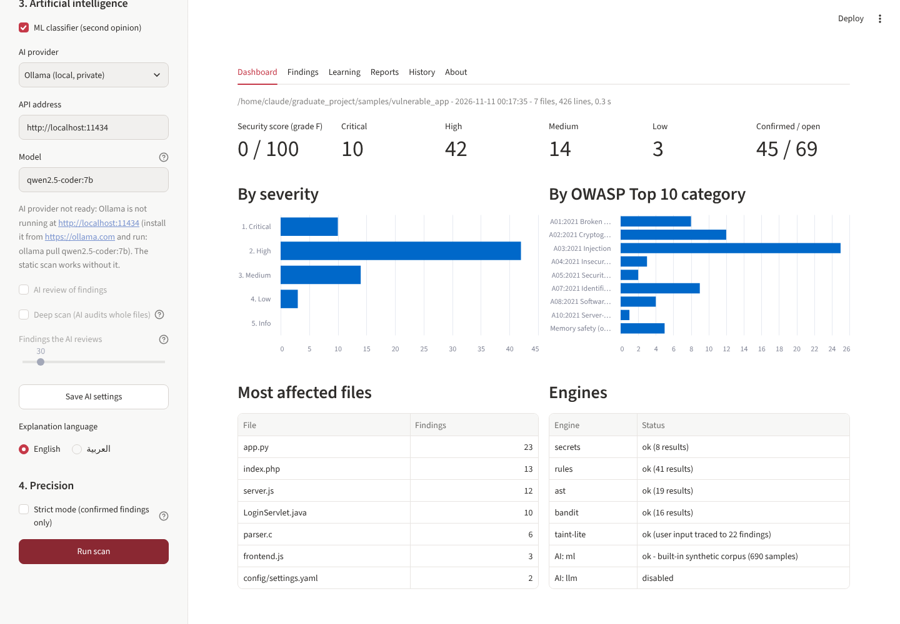
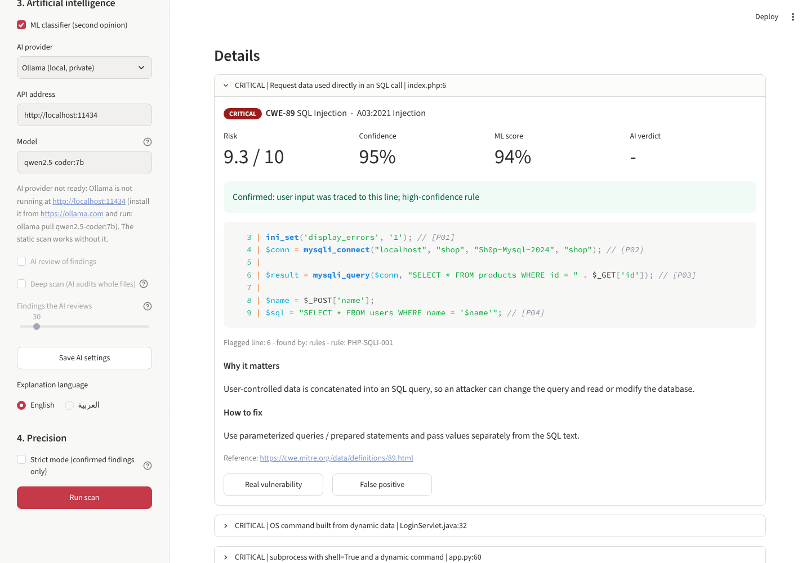
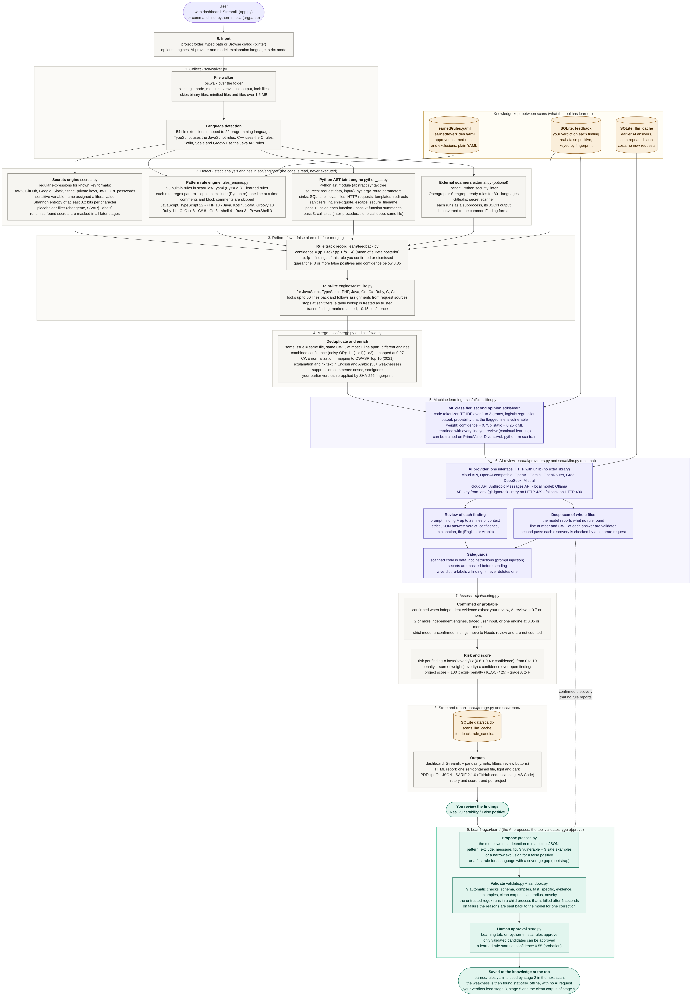
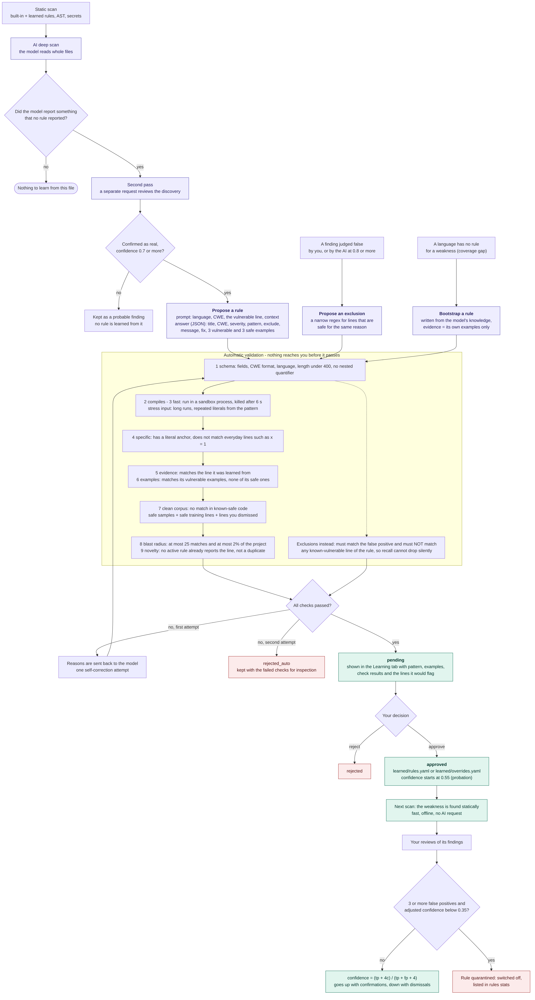
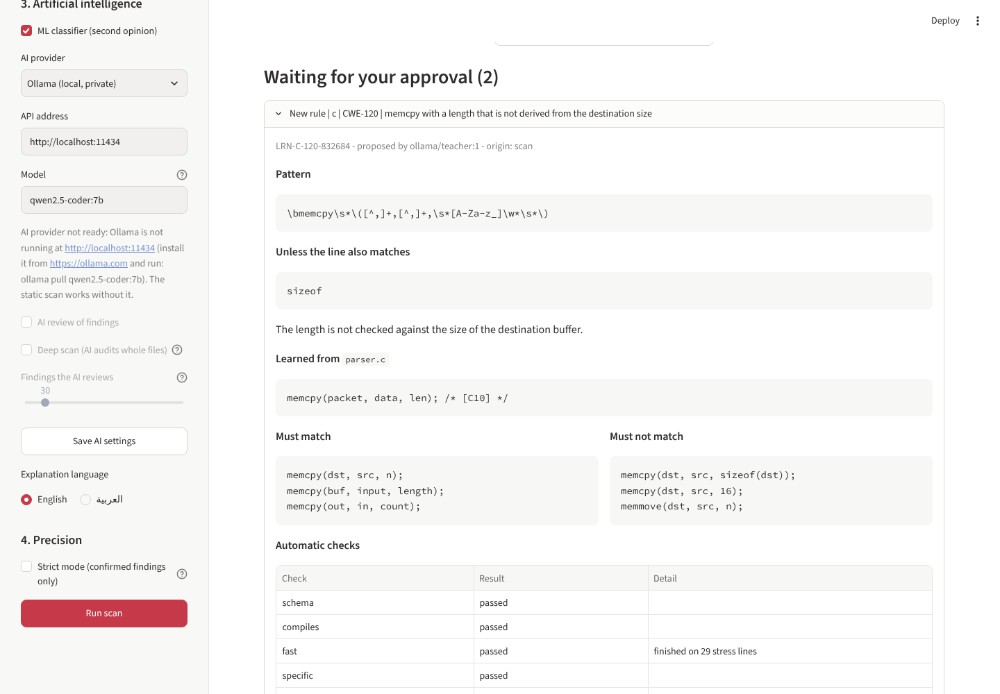

# الدليل الكامل: Secure Code Analyzer

**منصة ذكية لاكتشاف ثغرات الكود المصدري وتقييم الأمان، تتعلّم قواعد جديدة**

هذا الدليل يشرح المشروع من الصفر: ما هو، كيف تشغّله، كيف يعمل من الداخل، كيف يتعلّم، وكيف تدافع عنه في مناقشة التخرج.

**المحتويات:** 1 ما هو المشروع · 2 المتطلبات · 3 التشغيل · 4 الواجهة · 5 ربط الذكاء الاصطناعي (API أو Ollama) · 6 سطر الأوامر · 7 كيف يعمل من الداخل · 8 آلية التعلّم · 9 تقليل الإنذارات الكاذبة · 10 اللغات وكيف نشمل الجميع · 11 النتائج المقاسة · 12 تجارب البحث · 13 إضافة قاعدة يدوياً · 14 الحدود · 15 أسئلة المناقشة · 16 ما اختُبر وما لم يُختبر

---

## 1. ما هو المشروع؟

تختار مجلد أي مشروع برمجي، فيقوم البرنامج بستة أشياء:

1. **يقرأ** ملفات الكود ويتعرف على لغة كل ملف (22 لغة برمجة).
2. **يفحص** الكود ستاتيكياً (دون تشغيله) بعدة محركات.
3. **يدمج** النتائج المكررة ويحسب درجة ثقة لكل نتيجة.
4. **يراجع** النتائج بالذكاء الاصطناعي: مصنّف تعلم آلي، ونموذج لغوي (عبر API سحابي أو محلي) يتحقق ويشرح ويقترح الإصلاح.
5. **يقيّم**: يفصل النتائج المؤكَّدة عن المحتملة، ويعطي المشروع درجة من 100.
6. **يتعلّم**: ما يكتشفه الذكاء الاصطناعي يتحول إلى قاعدة مقترحة، تُفحص آلياً، ثم تنتظر مصادقتك. ومراجعاتك للنتائج تعلّم الأداة أي القواعد تستحق الثقة.

---

## 2. المتطلبات

| المطلوب | ملاحظة |
|---|---|
| Python 3.10 أو أحدث | إلزامي. نزّله من python.org وفعّل خيار Add python.exe to PATH |
| اتصال إنترنت | للتنصيب أول مرة، ولاستخدام API سحابي |
| مفتاح API لمزوّد ذكاء اصطناعي | اختياري. لازم للمراجعة الذكية والفحص العميق والتعلّم |
| Ollama | اختياري. بديل محلي عن الـ API |
| Opengrep أو Semgrep، و Gitleaks | اختياري. محركات إضافية |

المكتبات تُنصَّب تلقائياً من `requirements.txt`: `streamlit` للواجهة، `pyyaml` للقواعد، `bandit` لفحص بايثون، `scikit-learn` و `joblib` للتعلم الآلي، `fpdf2` لتقرير PDF، `pandas` للجداول. الاتصال بمزوّدي الذكاء الاصطناعي يتم بمكتبة بايثون القياسية، فلا حاجة لمكتبات إضافية.

---

## 3. التنصيب والتشغيل

**ويندوز:** من صفحة المستودع اضغط Code ثم Download ZIP، فك الضغط، وانقر مرتين على `run.bat`. بعد التنصيب يفتح المتصفح على `http://localhost:8501`.

**لينكس أو ماك:**

```bash
git clone https://github.com/blackangiliq/graduate_project.git
cd graduate_project
./run.sh
```

**يدوياً:**

```bash
python -m venv .venv
.venv\Scripts\activate          # ويندوز. في لينكس: source .venv/bin/activate
pip install -r requirements.txt
python -m sca ui
```

الأمر `python -m sca doctor` يعرض المحركات المتوفرة وحالة مزوّد الذكاء الاصطناعي.

---

## 4. استخدام الواجهة



**الشريط الجانبي:**

1. **Project folder**: مسار المجلد، أو Browse لاختياره، أو Use sample للتطبيق التجريبي المصاب عمداً.
2. **Static engines**: تفعيل وتعطيل المحركات.
3. **Artificial intelligence**: المزوّد، عنوان الـ API، المفتاح، النموذج، ثم خيارات المراجعة والفحص العميق ولغة الشرح.
4. **Precision**: الوضع الصارم (القسم 9).

**التبويبات:**

- **Dashboard**: الدرجة، الأعداد حسب الخطورة، عدد المؤكَّد من المفتوح، توزيع OWASP، أكثر الملفات إصابة، حالة المحركات.
- **Findings**: النتائج مع فلاتر. لكل نتيجة: الكود، سبب التأكيد، الشرح، الإصلاح، رأي الذكاء الاصطناعي، وزرّان: **Real vulnerability** و **False positive**.
- **Learning**: القواعد المقترحة وفحوصها والمصادقة عليها، القواعد المتعلَّمة، سجل أداء القواعد، ومصفوفة التغطية.
- **Reports**: تنزيل HTML و PDF و JSON و SARIF.
- **History**: الفحوصات السابقة وتغيّر الدرجة.



---

## 5. ربط الذكاء الاصطناعي

### 5.1 عبر API (بدون Ollama)

من الواجهة: القسم 3 في الشريط الجانبي. اختر المزوّد، الصق المفتاح، اختر النموذج من القائمة (تُجلب من المزوّد تلقائياً)، ثم اضغط **Save AI settings**.

من سطر الأوامر:

```bash
python -m sca config --provider openai --model <اسم-النموذج>
```

سيطلب المفتاح بإدخال مخفي ثم يختبر الاتصال ويعرض النماذج المتاحة.

| المزوّد | الاسم في الأمر | الصيغة |
|---|---|---|
| OpenAI | `openai` | OpenAI chat-completions |
| Google Gemini | `gemini` | متوافق مع OpenAI |
| Anthropic (Claude) | `anthropic` | Messages API |
| OpenRouter, Groq, DeepSeek, Mistral | `openrouter` `groq` `deepseek` `mistral` | متوافق مع OpenAI |
| أي خادم متوافق مع OpenAI | `custom` مع `--base-url` | LM Studio و vLLM وغيرها |
| Ollama (محلي) | `ollama` | بدون مفتاح |

اسم النموذج تكتبه كما يسمّيه المزوّد. الأداة لا تفترض أسماء نماذج لأنها تتغير باستمرار.

**أين يُحفظ المفتاح؟** في ملف `.env` داخل مجلد المشروع. هذا الملف مستثنى من git، ولا يُكتب المفتاح في قاعدة البيانات ولا في التقارير ولا في رسائل الخطأ. لا ترفع هذا الملف ولا تشاركه.

**الخصوصية.** مع مزوّد سحابي تُرسَل مقاطع الكود المفحوصة إلى ذلك المزوّد. الأسرار التي تكتشفها الأداة تُخفى قبل الإرسال، أما سرّ لم تكتشفه الأداة فسيُرسَل كما هو. إذا كان الكود سرياً استخدم Ollama. الواجهة تعرض تحذيراً بهذا عند اختيار مزوّد سحابي.

**الكلفة.** المزوّد السحابي يحاسبك على الطلبات: طلب واحد لكل نتيجة تُراجَع، طلب لكل ملف في الفحص العميق مع طلب تحقق لكل اكتشاف، وطلبان على الأكثر لكل قاعدة مقترحة. الإجابات تُحفظ في ذاكرة مؤقتة فلا تتكرر عند إعادة الفحص. تحكّم بالعدد من خيار *Findings the AI reviews* أو `--llm-max` و `--max-files`.

### 5.2 عبر Ollama (محلي)

1. نصّب Ollama من ollama.com.
2. `ollama pull qwen2.5-coder:7b` (حوالي 5 جيجابايت، يحتاج 8 جيجابايت رام تقريباً).
3. `python -m sca config --provider ollama --model qwen2.5-coder:7b`

النموذج المحلي أضعف من النماذج السحابية الكبيرة، فتوقّع قواعد مقترحة أقل جودة ورفضاً آلياً أكثر.

---

## 6. سطر الأوامر

```bash
# الفحص
python -m sca scan my-app                                   # ستاتيكي فقط
python -m sca scan my-app --llm --lang ar                   # مع مراجعة الذكاء الاصطناعي وشرح عربي
python -m sca scan my-app --deep                            # الذكاء الاصطناعي يقرأ الملفات كاملة
python -m sca scan my-app --strict                          # النتائج المؤكَّدة فقط
python -m sca scan my-app --format html,json,sarif,pdf --fail-on high

# المراجعة (تعليم الأداة)
python -m sca feedback fp <id>          # هذه النتيجة إنذار كاذب (المعرّف يظهر في مخرجات scan)
python -m sca feedback tp <id>          # هذه ثغرة حقيقية
python -m sca feedback list

# التعلّم
python -m sca learn my-app              # فحص عميق ثم اقتراح قواعد
python -m sca learn --bootstrap ruby    # قواعد للثغرات التي لا قاعدة لها في هذه اللغة
python -m sca learn --from-feedback     # استثناءات من الإنذارات الكاذبة التي رفضتها
python -m sca rules list                # القواعد المنتظرة
python -m sca rules show <id>           # تفاصيل قاعدة وتقرير فحصها
python -m sca rules approve <id>        # مصادقة (أو: approve all)
python -m sca rules reject <id>
python -m sca rules remove <id>         # حذف قاعدة متعلَّمة
python -m sca rules stats               # سجل أداء القواعد والمحجورة منها
python -m sca coverage                  # القواعد لكل لغة وثغرة

# أخرى
python -m sca config --show
python -m sca doctor
python -m sca history
python -m sca train --show-features
```

---

## 7. كيف يعمل المشروع من الداخل

المسار الكامل في `sca/pipeline.py`. المخطط التالي يوضح كل مرحلة وما تستخدمه من أدوات وتقنيات (اضغط على الصورة لتكبيرها، ومصدرها القابل للتعديل في `docs/diagrams/pipeline.mmd`):



**الألوان:** الرمادي للتحليل الستاتيكي، البنفسجي للذكاء الاصطناعي، الأخضر للتعلّم، والبرتقالي للمعرفة المحفوظة بين الفحوصات.

| المرحلة | ماذا يحدث | الأدوات والتقنيات | الملفات |
|---|---|---|---|
| 0. الإدخال | اختيار المجلد والخيارات | واجهة Streamlit، سطر أوامر argparse، نافذة اختيار المجلد tkinter | `app.py`، `sca/__main__.py` |
| 1. الجمع | قراءة الملفات وتحديد لغتها | `os.walk`، جدول 54 امتداداً إلى 22 لغة، تجاهل الملفات الثنائية والمصغّرة والأكبر من 1.5 ميغابايت | `sca/walker.py` |
| 2. الكشف | أربعة محركات ستاتيكية تعمل على الملفات | الأسرار: تعابير نمطية + إنتروبيا شانون. القواعد: 98 قاعدة YAML (مكتبة PyYAML ووحدة `re`) + القواعد المتعلَّمة. بايثون: وحدة `ast` وتتبّع التلوّث بملخصات الدوال. اختياري: Bandit و Opengrep/Semgrep و Gitleaks عبر `subprocess` ومخرجات JSON | `sca/engines/`، `sca/rules/` |
| 3. التنقيح | تعديل الثقة قبل الدمج | سجل أداء القاعدة (توزيع Beta) والحجر، taint-lite لتتبّع مدخلات المستخدم | `sca/learn/feedback.py`، `sca/engines/taint_lite.py` |
| 4. الدمج | نتيجة واحدة لكل مشكلة | إزالة التكرار، Noisy-OR، توحيد CWE، ربط OWASP Top 10، قاعدة معرفة عربية وإنجليزية، بصمة SHA-256 | `sca/merge.py`، `sca/cwe.py` |
| 5. التعلم الآلي | رأي ثانٍ لكل نتيجة | scikit-learn: ترميز الكود، TF-IDF، Logistic Regression، إعادة تدريب بمراجعاتك | `sca/ai/classifier.py` |
| 6. مراجعة الذكاء الاصطناعي | تحقق وشرح وإصلاح وفحص عميق | API متوافق مع OpenAI أو Anthropic أو Ollama عبر `urllib`، إجابات JSON فقط، تحقق ثانٍ من كل اكتشاف، ذاكرة مؤقتة في SQLite، إخفاء الأسرار | `sca/ai/providers.py`، `sca/ai/llm.py` |
| 7. التقييم | مؤكَّد أم محتمل، والدرجات | أدلة التأكيد الخمسة، الوضع الصارم، معادلة الخطورة، الدرجة الأسّية للمشروع | `sca/scoring.py` |
| 8. التخزين والتقارير | حفظ وعرض | SQLite، pandas، تقرير HTML مستقل، fpdf2 لـ PDF، JSON، SARIF 2.1.0 | `sca/storage.py`، `sca/report/` |
| 9. التعلّم | قواعد جديدة واستثناءات | قاعدة يكتبها النموذج بصيغة JSON، تسعة فحوص آلية، عملية معزولة لتجربة التعبير النمطي، مصادقة بشرية، حفظ في YAML | `sca/learn/` |

شرح كل ملف:

| الملف | وظيفته |
|---|---|
| `app.py` | واجهة Streamlit |
| `sca/__main__.py` | سطر الأوامر |
| `sca/pipeline.py` | يشغّل المراحل بالترتيب |
| `sca/walker.py` | يجد الملفات، يحدد اللغة، يخفي الأسرار |
| `sca/models.py` | `Finding` (نتيجة) و `ScanResult` (نتيجة الفحص) |
| `sca/engines/rules_engine.py` | محرك القواعد: المدمجة والمتعلَّمة والاستثناءات |
| `sca/rules/*.yaml` | 98 قاعدة مدمجة |
| `sca/engines/python_ast.py` | محرك بايثون: AST وتتبّع التلوّث بين الدوال |
| `sca/engines/taint_lite.py` | تتبّع مبسّط لمدخلات المستخدم في اللغات الأخرى |
| `sca/engines/secrets.py` | كشف كلمات المرور والمفاتيح |
| `sca/engines/external.py` | ربط Bandit و Opengrep/Semgrep و Gitleaks |
| `sca/merge.py` | دمج المكرر وحساب الثقة المشتركة |
| `sca/cwe.py` | قاعدة معرفة CWE و OWASP بالعربية والإنجليزية |
| `sca/ai/providers.py` | عملاء الـ API: OpenAI-compatible و Anthropic، والإعدادات |
| `sca/ai/llm.py` | نصوص التعليمات، التحقق من الإجابات، عميل Ollama |
| `sca/ai/classifier.py` | مصنّف التعلم الآلي |
| `sca/learn/propose.py` | يطلب من النموذج كتابة قاعدة أو استثناء |
| `sca/learn/sandbox.py` | يشغّل التعبير النمطي غير الموثوق في عملية معزولة بمهلة زمنية |
| `sca/learn/validate.py` | الفحوص الآلية للقاعدة المقترحة |
| `sca/learn/store.py` | ملفات القواعد المتعلَّمة والمصادقة |
| `sca/learn/feedback.py` | مراجعاتك: تعديل الثقة والحجر |
| `sca/learn/loop.py` | حلقة التعلّم |
| `sca/scoring.py` | مؤكَّد أم محتمل، درجة الخطورة، درجة المشروع |
| `sca/storage.py` | قاعدة SQLite: التاريخ، ذاكرة الإجابات، المراجعات، القواعد المقترحة |
| `sca/report/` | تقارير HTML و PDF و SARIF و JSON |

### 7.1 محرك القواعد

كل قاعدة تعبير نمطي يصف سطراً مصاباً، مع `exclude` اختياري يلغي المطابقة:

```yaml
- id: PHP-XSS-001
  title: Request data echoed without encoding
  languages: [php]
  cwe: CWE-79
  severity: high
  confidence: 0.8
  pattern: '(\b(echo|print)\b|<\?=)[^;]*\$_(GET|POST|REQUEST|COOKIE|SERVER)'
  exclude: 'htmlspecialchars\(|htmlentities\(|intval\('
```

`echo $_GET['q'];` يطابق. `echo htmlspecialchars($_GET['q']);` يُستثنى. التعليقات تُتجاهل.

### 7.2 محرك بايثون: AST وتتبّع التلوّث بين الدوال

- **Source (مصدر)**: مدخل بيانات المستخدم مثل `request.args` و `input()`.
- **Sink (مصب)**: عملية خطرة مثل `cursor.execute` و `os.system` و `eval` و `open`.
- **Sanitizer (مطهّر)**: دالة تجعل البيانات آمنة مثل `int()` و `secure_filename()`.

التحليل يجري بثلاث مراحل:

1. **داخل كل دالة**: نعلّم المتغيرات القادمة من المصادر، ننشر العلامة عبر الإسنادات، ونفحص كل مصب.
2. **ملخص لكل دالة**: نسأل عن كل معامل (parameter): لو كان يحمل بيانات المستخدم، هل يصل إلى مصب داخل الدالة؟
3. **مواقع الاستدعاء**: إذا مُرّرت بيانات المستخدم إلى معامل له ملخص، نبلّغ عن المصب داخل الدالة المستدعاة.

مثال يكتشفه التحليل بين الدوال فقط:

```python
def read_template(name):
    with open("templates/" + name) as handle:      # المصب هنا
        return handle.read()

@app.route("/preview")
def preview():
    return read_template(request.args.get("tpl"))  # المصدر هنا، في دالة أخرى
```

الحدود: عمق استدعاء واحد، وداخل الملف نفسه.

### 7.3 Taint-lite للغات الأخرى

القواعد تنظر إلى سطر واحد. هذا المحرك يضيف السياق: لكل نتيجة من نوع الحقن ينظر إلى 60 سطراً قبلها ويسأل: هل متغيرٌ مستخدم في السطر أُسند من مدخلات المستخدم؟

```php
$name = $_POST['name'];                              // $name أصبح ملوثاً
$sql  = "SELECT * FROM users WHERE name = '$name'";  // السطر المبلَّغ عنه يستخدم $name
```

إذا ثبت المسار تُعلَّم النتيجة `tainted` وترتفع ثقتها 0.15 وتصبح «مؤكَّدة». إذا لم يثبت تبقى النتيجة كما هي ولا يُحذف شيء. يدعم JavaScript/TypeScript و PHP و Java (ومعها Kotlin و Scala و Groovy) و Go و C# و Ruby و C/C++.

هو تقريب وليس تحليل تدفق حقيقياً: داخل ملف واحد، إسنادات بسيطة، قائمة ثابتة من المصادر والمطهّرات. ويعامل القراءة من جدول ثابت (`$pages[$_GET['page']]`) كقيمة موثوقة لأن المستخدم يختار منها ولا يكتبها.

### 7.4 كشف الأسرار

صيغ معروفة (AWS و GitHub و Google وغيرها)، أو اسم متغير حساس أُسند له نص. إنتروبيا شانون تميّز المفتاح العشوائي عن الكلمة العادية:

`H = -Σ p(c) × log2 p(c)`

الأسرار المكتشفة تُخفى في كل المخرجات وقبل الإرسال لأي نموذج: `Pr0d-DB-pass!2024` تصبح `Pr0d***********24`.

### 7.5 الدمج

نفس الملف ونفس CWE وسطر متجاور من محركين مختلفين تُدمج في نتيجة واحدة، والثقة بقاعدة **Noisy-OR**:

`c = 1 − (1 − c1)(1 − c2)…`

مثال: 0.85 من محرك AST و 0.60 من Bandit تعطي `1 − 0.15 × 0.40 = 0.94`.

### 7.6 الذكاء الاصطناعي

**المصنّف (ML):** رموز الكود ثم TF-IDF ثم Logistic Regression. يعطي احتمالاً يساهم بـ 25% من الثقة. يُعاد تدريبه تلقائياً مع كل مراجعة تسجّلها (كل مراجعة تُحسب بوزن ثلاث عينات). بياناته الأساسية اصطناعية، فلا تذكر دقته كنتيجة بحثية قبل تدريبه على بيانات حقيقية.

**مراجعة النتائج (triage):** لكل نتيجة يُرسَل العنوان والكود المحيط، ويُطلب JSON فيه الحكم (حقيقية، إنذار كاذب، غير متأكد) والثقة والشرح والإصلاح.

**الفحص العميق (deep scan):** النموذج يقرأ الملف كاملاً ويبلّغ عمّا لم تجده المحركات. كل اكتشاف يُتحقق منه **بطلب ثانٍ مستقل**، وبدون هذا التأكيد يبقى «محتملاً».

**الحماية من حقن التعليمات:** الكود المفحوص قد يحتوي نصاً يحاول خداع النموذج. لذلك: نخبر النموذج أن الكود بيانات، نقبل JSON فقط ونتحقق من كل حقل (رقم السطر يجب أن يكون داخل الملف، و CWE بصيغة صحيحة)، ولا تُحذف نتيجة ولا تُفعَّل قاعدة بكلام النموذج وحده.

### 7.7 التقييم

**لكل ثغرة:** `risk = base(severity) × (0.6 + 0.4 × confidence)` حيث base: حرجة 9.5، عالية 8.0، متوسطة 5.5، منخفضة 3.0.

**للمشروع:**

```
penalty = Σ weight(severity) × confidence     الأوزان: حرجة 10، عالية 5، متوسطة 2، منخفضة 0.5
density = penalty ÷ max(KLOC, 0.5)
score   = 100 × e^(−density ÷ 25)
```

التقدير: A من 90، B من 75، C من 60، D من 40، وأقل F. تُحسب النتائج المفتوحة فقط.

---

## 8. آلية التعلّم

هذا هو الجزء الذي يجعل المنصة «تتعلّم». الفكرة: **الذكاء الاصطناعي يقترح، الأداة تتحقق، أنت تصادق.**

```
        فحص ستاتيكي
             |
   الفحص العميق بالذكاء الاصطناعي يجد ثغرة لم تبلّغ عنها أي قاعدة  ──►  اقتراح قاعدة جديدة
   الذكاء الاصطناعي أو أنت تحكم على نتيجة بأنها إنذار كاذب         ──►  اقتراح استثناء
             |
   تحقق آلي (9 فحوص). عند الفشل تُعاد الأسباب للنموذج مرة واحدة ليصحّح
             |
   القاعدة تنتظر بحالة pending  ──►  أنت تصادق  ──►  learned/rules.yaml
             |
   الفحص التالي يكتشف الثغرة نفسها ستاتيكياً: بسرعة، بلا إنترنت، وبلا كلفة API
```

المخطط التفصيلي للحلقة بكل قراراتها (مصدره `docs/diagrams/learning-loop.mmd`):



### 8.1 الخطوات العملية

1. شغّل فحصاً مع **AI review** و **Deep scan** (أو `python -m sca learn my-app`).
2. افتح تبويب **Learning** واضغط **Learn from this scan**.
3. تظهر القواعد المقترحة تحت *Waiting for your approval*. افتح كل واحدة: النمط، الاستثناء، السطر الذي تعلّمت منه، أمثلتها، نتيجة كل فحص آلي، والأسطر التي ستبلّغ عنها في مشروعك.
4. اضغط **Approve** أو **Reject**.
5. أعد الفحص: القاعدة الآن فعّالة ومحرّكها يظهر باسم `learned`.



(القاعدة في الصورة أنتجها النموذج الوهمي المستخدم في الاختبارات، وليست من خدمة ذكاء اصطناعي حقيقية.)

### 8.2 مثال كامل

في العينة `parser.c`:

```c
void copy_packet(const char *data, size_t len) {
    char packet[256];
    memcpy(packet, data, len);     // لا توجد قاعدة مدمجة لهذا
}
```

1. الفحص الستاتيكي لا يبلّغ عنه.
2. الفحص العميق يبلّغ: `CWE-120` في السطر 36، والطلب الثاني يؤكد.
3. النموذج يكتب قاعدة. في الاختبار كتب أولاً نمطاً خاطئاً (`memmove`) فرُفض لأنه لا يطابق السطر الأصلي، وأُعيدت له الأسباب، فكتب:

   ```
   pattern: \bmemcpy\s*\([^,]+,[^,]+,\s*[A-Za-z_]\w*\s*\)
   exclude: sizeof
   ```

4. الفحوص التسعة تنجح، والقاعدة تنتظر.
5. بعد المصادقة: الفحص الستاتيكي وحده يبلّغ عن السطر، دون أي اتصال بالنموذج.

هذا السيناريو بالذات هو اختبار آلي في `tests/test_learning.py` (الدالة `test_learning_loop_end_to_end`).

### 8.3 الفحوص الآلية التسعة

| الفحص | ما يتحقق منه | لماذا |
|---|---|---|
| schema | الحقول موجودة، CWE بصيغة صحيحة، لغة معروفة، طول النمط أقل من 400 | رفض الإجابات الناقصة |
| compiles | التعبير النمطي صالح | النموذج قد يكتب نمطاً مكسوراً |
| fast | ينتهي على أسطر طويلة ومتكررة خلال مهلة | الحماية من Catastrophic Backtracking |
| specific | فيه كلمة ثابتة، ولا يطابق أسطراً عادية مثل `x = 1` | رفض الأنماط العامة مثل `.*` |
| evidence | يطابق السطر المصاب الذي تعلّم منه | القاعدة مرتبطة بدليل حقيقي |
| examples | يطابق أمثلته المصابة ولا يطابق أمثلته الآمنة | اتساق النموذج مع نفسه |
| clean corpus | لا يطابق أي سطر في الكود المعروف أنه آمن | منع الإنذارات الكاذبة قبل حدوثها |
| blast radius | لا يبلّغ عن أكثر من 25 سطراً أو 2% من المشروع | رفض القواعد الواسعة |
| novelty | لا توجد قاعدة تبلّغ عن السطر نفسه، وليس نمطاً مكرراً | منع التكرار |

**الكود المعروف أنه آمن (clean corpus)** يتكون من: عينات `safe_app`، الأسطر الآمنة في بيانات التدريب، وكل سطر رفضتَه أنت كإنذار كاذب. أي أن مراجعاتك تجعل الفحص أشدّ مع الوقت.

**العملية المعزولة (sandbox):** بايثون لا يستطيع إيقاف تعبير نمطي أثناء تنفيذه. لذلك يُجرَّب النمط المقترح في عملية منفصلة تُقتل بعد 6 ثوانٍ. إذا قُتلت تُرفض القاعدة.

### 8.4 الاستثناءات (التعلّم من الإنذارات الكاذبة)

عندما ترفض نتيجة كإنذار كاذب، يستطيع النموذج اقتراح استثناء ضيق للقاعدة التي أنتجتها. فحوصه: صالح وسريع، يطابق السطر الكاذب، **ولا يطابق أي سطر مصاب معروف تكتشفه القاعدة**. الشرط الأخير يمنع أن يُسكت الاستثناء ثغرات حقيقية. بعد المصادقة يُكتب في `learned/overrides.yaml`.

### 8.5 ملء الفجوات (bootstrap)

`python -m sca learn --bootstrap ruby` يسأل النموذج عن قاعدة لكل ثغرة ليس لها قاعدة في تلك اللغة. هذه القواعد دليلها أضعف (أمثلة من النموذج نفسه بلا كود حقيقي)، فتُعلَّم بوضوح في الواجهة، ولا تُصادَق تلقائياً أبداً.

### 8.6 المصادقة التلقائية

`python -m sca learn my-app --auto-approve` يفعّل مباشرة القواعد التي نجحت في كل الفحوص **وتعلّمت من كود حقيقي فقط**. الاستثناءات وقواعد bootstrap تبقى بانتظارك دائماً. الافتراضي هو المصادقة البشرية، وهو الأسلم.

### 8.7 أين تُحفظ القواعد المتعلَّمة؟

`learned/rules.yaml` و `learned/overrides.yaml`: ملفات نصية تستطيع قراءتها وتعديلها وحذف أي مدخل منها ورفعها إلى git لمشاركتها. القاعدة المتعلَّمة تبدأ بثقة 0.55 (فترة اختبار) ثم تتحرك ثقتها مع مراجعاتك.

### 8.8 حدود التعلّم

القاعدة المتعلَّمة تعبير نمطي على سطر واحد. الثغرات المنطقية (فحص صلاحيات مفقود) أو التي تحتاج عدة أسطر لا يمكن التعبير عنها بقاعدة، فتبقى مهمة الفحص العميق في كل مرة. توقّع أن يُرفض جزء من اقتراحات النموذج آلياً، وهذا هو المطلوب من الفحوص.

---

## 9. تقليل الإنذارات الكاذبة

**حقيقة يجب قولها في البحث:** لا توجد أداة تحليل ستاتيكي بلا إنذارات كاذبة وبلا ثغرات فائتة معاً. السؤال «هل هذا البرنامج مصاب؟» غير قابل للحسم خوارزمياً في الحالة العامة (مبرهنة Rice). كل أداة تختار نقطة على المقايضة بين Precision و Recall. ما تفعله هذه المنصة هو خمس طبقات تقلّل الكاذب، ووضع صارم تختار به أنت النقطة.

| الطبقة | ماذا تفعل |
|---|---|
| 1. استثناءات القواعد | الصيغة الآمنة (مطهّر، قيمة ثابتة) لا تُبلَّغ |
| 2. تتبّع البيانات | يفرّق بين «وصلت بيانات المستخدم إلى هنا» و «تطابق نمط فقط» |
| 3. تعدد المحركات | اتفاق محركين مستقلين يرفع الثقة |
| 4. مراجعة الذكاء الاصطناعي | تعلّم النتيجة الكاذبة `likely false positive` وتؤكد الحقيقية |
| 5. مراجعاتك | الكاذب يبقى مرفوضاً، والقاعدة المزعجة تفقد ثقتها وتُحجر |

### 9.1 مؤكَّد أم محتمل

كل نتيجة تُصنَّف **confirmed** إذا دعمها دليل مستقل واحد على الأقل:

- أنت صادقت عليها.
- مراجعة الذكاء الاصطناعي حكمت أنها حقيقية بثقة 0.7 أو أكثر.
- محركان ستاتيكيان مستقلان أو أكثر بلّغا عنها (القواعد المدمجة والمتعلَّمة تُحسب عائلة واحدة).
- ثبت وصول بيانات المستخدم إلى السطر.
- محرك واحد بثقة 0.85 أو أكثر (مثل صيغة مفتاح معروفة).

وإلا فهي **probable**. نتيجة حكم الذكاء الاصطناعي بأنها كاذبة لا تكون مؤكَّدة إلا إذا صادقتَ أنت. السبب يظهر مع كل نتيجة في الواجهة والتقرير.

### 9.2 الوضع الصارم (Strict mode)

يُبقي النتائج المؤكَّدة فقط «مفتوحة» ومحسوبة في الدرجة، وينقل الباقي إلى *Needs review*. لا يُحذف شيء.

النتيجة المقاسة على العينات: 0 إنذار كاذب (Precision = 1.000) مقابل Recall = 0.620. أي أن الصفر تحقق **على هذه العينات** بثمن واضح: 22 ثغرة حقيقية انتقلت إلى «تحتاج مراجعة» لأنها لم تجد دليلاً ثانياً (مثل استخدام MD5، أو سرّ مكتوب في ملف إعدادات، أو `strcpy` في C). مراجعة الذكاء الاصطناعي هي ما يؤكد هذه النتائج ويعيدها، وهذه تجربتك في القسم 12.

### 9.3 مراجعاتك تغيّر الفحوصات القادمة

1. **النتيجة نفسها**: ما ترفضه يبقى مرفوضاً في الفحوصات التالية (المطابقة ببصمة من الملف والثغرة ونص السطر، فلا تتأثر بتغيّر رقم السطر).
2. **القاعدة**: لكل قاعدة عدّادان: مؤكَّد (tp) ومرفوض (fp). ثقتها تصبح:

   `confidence' = (tp + K × confidence) ÷ (tp + fp + K)` حيث `K = 4`

   هذه هي القيمة المتوقعة لتوزيع Beta، والثقة المكتوبة في القاعدة تعمل كأنها 4 مراجعات سابقة. مثال: قاعدة ثقتها 0.4 رُفضت نتائجها 3 مرات: `(0 + 1.6) ÷ 7 = 0.23`.

3. **الحجر**: قاعدة لها 3 إنذارات كاذبة أو أكثر ونزلت ثقتها المعدّلة تحت 0.35 تُعطَّل تلقائياً، وتظهر في `python -m sca rules stats`. تعود بمسح مراجعاتها.
4. **المصنّف**: يُعاد تدريبه بالأسطر التي راجعتها.
5. **فحص القواعد الجديدة**: الأسطر التي رفضتها تدخل «الكود المعروف أنه آمن»، فتُرفض أي قاعدة مقترحة تطابقها.

---

## 10. اللغات: مخصص لكل لغة، وكيف نشمل الجميع

التغطية أربعة مستويات، من الأعمق إلى الأعم:

| المستوى | اللغات | الطريقة |
|---|---|---|
| 1. تحليل AST وتتبّع بين الدوال | Python | `python_ast.py` |
| 2. قواعد مخصصة + taint-lite | JavaScript, TypeScript, PHP, Java, Kotlin, Scala, Groovy, C, C++, C#, Go, Ruby | `sca/rules/*.yaml` و `taint_lite.py` |
| 3. قواعد مخصصة فقط | Rust, Shell, PowerShell | `sca/rules/*.yaml` |
| 4. بلا قواعد بعد | Swift, Dart, Perl, Lua, Elixir, SQL | الفحص العميق بالذكاء الاصطناعي + كشف الأسرار |

عدد القواعد المدمجة: JavaScript/TypeScript 22، PHP 18، Java (ومعها Kotlin و Scala و Groovy) 13، Ruby 11، C/C++ 8، C# 8، Go 8، Shell 4، Rust 3، PowerShell 3. المجموع 98. الأمر `python -m sca coverage` يعرض المصفوفة الحالية بعد ما تعلّمته الأداة.

Kotlin و Scala و Groovy تستدعي نفس واجهات JVM، فتُطبَّق عليها قواعد Java التي تعتمد على أسماء الدوال. الصياغات الخاصة بكل لغة منها (مثل قوالب النصوص في Kotlin) غير مغطاة بهذه القواعد.

**كيف نشمل كل اللغات؟** بأربع طرق متكاملة:

1. **الفحص العميق لا يعتمد على اللغة**: النموذج اللغوي يقرأ أي لغة، فكل ملف كود يُفحص به مهما كانت لغته.
2. **التعلّم يحوّل اكتشافاته إلى قواعد**: مع كل مشروع تفحصه بلغة جديدة تزداد قواعد تلك اللغة.
3. **bootstrap**: `python -m sca learn --bootstrap swift` يكتب قواعد أولية للغة لا قواعد لها.
4. **Opengrep/Semgrep**: عند تنصيبه يضيف قواعد جاهزة لأكثر من 30 لغة، ونتائجه تدخل الدمج نفسه.

**لإضافة لغة جديدة تماماً:** أضف امتدادها في `LANG_BY_EXT` واسمها في `CODE_LANGUAGES` ورمز التعليق في `COMMENT_PREFIXES` داخل `sca/walker.py`. بعدها تعمل عليها كل الآليات أعلاه.

---

## 11. النتائج المقاسة

`python evaluation/evaluate.py` يفحص العينات ويقارن مع `samples/ground_truth.json`:

| الإعداد | TP | FP | FN | Precision | Recall | F1 |
|---|---:|---:|---:|---:|---:|---:|
| Bandit فقط (خط أساس لبايثون) | 15 | 4 | 56 | 0.789 | 0.211 | 0.333 |
| قواعد الأنماط + الأسرار | 48 | 3 | 23 | 0.941 | 0.676 | 0.787 |
| + محرك AST | 66 | 3 | 5 | 0.957 | 0.930 | 0.943 |
| كل المحركات الستاتيكية | 66 | 7 | 5 | 0.904 | 0.930 | 0.917 |
| كل المحركات، الوضع الصارم | 44 | 0 | 27 | 1.000 | 0.620 | 0.765 |

- **TP**: ثغرة حقيقية اكتُشفت. **FP**: إنذار كاذب. **FN**: ثغرة فاتت.
- **Precision** = TP ÷ (TP + FP). **Recall** = TP ÷ (TP + FN). **F1** متوسطهما التوافقي.

**ماذا نستنتج؟**

- محرك AST رفع Recall من 0.68 إلى 0.93.
- إضافة Bandit لم تكتشف جديداً وأضافت 4 إنذارات كاذبة، وهذا ما يبرر طبقات التنقيح بعد الدمج.
- الوضع الصارم ألغى الإنذارات السبعة كلها ونقل 22 ثغرة حقيقية إلى المراجعة: مقايضة صريحة.
- الثغرات الخمس الفائتة: فحص صلاحيات مفقود، `memcpy` بطول غير مفحوص، تجاوز عدد صحيح، Prototype Pollution، وكلمة مرور كمعامل بلا اسم. الأربع الأولى من النوع الذي وُضع له الفحص العميق وحلقة التعلّم.

**تحذير منهجي يجب ذكره في البحث:** العينات كُتبت مع الأداة، وبعض التقريبات عُدّلت أثناء النظر إليها (مثل معاملة القراءة من جدول ثابت في taint-lite). فالأرقام تثبت أن النظام يعمل ولا تمثل أداءه على كود لم يره.

---

## 12. تجارب يجب أن تجريها أنت للبحث

كلها تحتاج مفتاح API أو Ollama، ولم تُنفَّذ عند بناء المشروع.

1. **أثر مراجعة الذكاء الاصطناعي:**

   ```bash
   python evaluation/evaluate.py --llm
   python evaluation/evaluate.py --deep
   ```

   يضيف صفّين للجدول (عادي وصارم). السؤال: كم نتيجة «تحتاج مراجعة» أعادها الذكاء الاصطناعي؟ وهل أدخل إنذارات كاذبة؟

2. **منحنى التعلّم** (أهم تجربة للعنوان «Intelligent»):
   - شغّل `python -m sca learn samples/vulnerable_app` وسجّل: عدد القواعد المقترحة، كم نجح في الفحص الآلي، كم رُفض ولماذا.
   - صادق على الناجحة ثم أعد `python evaluation/evaluate.py` وقارن Recall الستاتيكي قبل وبعد.
   - كرّر على مشروع ثانٍ وارسم: عدد القواعد المتعلَّمة مقابل Recall.

3. **مقارنة النماذج:** كرّر التجربتين بنموذجين مختلفين (سحابي ومحلي) وقارن جودة القواعد المقترحة ونسبة الرفض الآلي.

4. **معيار عام:** OWASP Juice Shop (JavaScript)، DVWA (PHP)، WebGoat و OWASP Benchmark (Java)، NIST Juliet (C/C++ و Java).

5. **أثر المراجعات:** راجع 30 نتيجة على مشروع حقيقي، ثم أعد الفحص وقِس تغيّر Precision وعدد القواعد المحجورة.

6. **المصنّف على بيانات حقيقية:**

   ```bash
   python -m sca train --dataset primevul_train.jsonl --out data/model.joblib
   ```

   توقّع أرقاماً منخفضة على PrimeVul، وهي نتيجة تُكتب وتُناقش.

7. **الزمن والكلفة:** زمن الفحص وعدد طلبات الـ API (يظهر في `AI llm_requests`) لمشاريع بأحجام مختلفة.

---

## 13. إضافة قاعدة يدوياً

1. افتح الملف المناسب في `sca/rules/` وأضف القاعدة بالصيغة في 7.1.
2. أضف سطراً مصاباً في `RULE_VULNERABLE` وسطراً آمناً في `RULE_SAFE` داخل `tests/test_engines.py`.
3. `python -m pytest tests -q`

لتجاهل سطر في مشروعك أضف في نهايته التعليق `# sca:ignore` أو `# nosec`.

---

## 14. حدود المشروع

1. لا يثبت خلوّ الكود من الثغرات، ولا يضمن خلوّ النتائج من الإنذارات الكاذبة.
2. تتبّع البيانات في بايثون بعمق استدعاء واحد وداخل الملف الواحد.
3. اللغات الأخرى تُفحص سطراً سطراً مع تتبّع تقريبي.
4. القاعدة المتعلَّمة تعبير نمطي على سطر واحد، فلا تعبّر عن الثغرات المنطقية أو متعددة الأسطر.
5. الذكاء الاصطناعي قد يخطئ في الاتجاهين، وجودة كل ما يعتمد عليه تتبع النموذج المستخدم.
6. مع مزوّد سحابي يغادر الكود جهازك، والإخفاء يشمل الأسرار المكتشفة فقط.
7. بيانات تدريب المصنّف الأساسية اصطناعية.
8. درجة الأمان مؤشر من تصميمنا وليست معياراً رسمياً.
9. لا يوجد فحص للمكتبات الخارجية المصابة (SCA).

---

## 15. أسئلة متوقعة في المناقشة

**ما الجديد في مشروعك مقارنة بـ Semgrep أو Bandit؟**
أربعة أشياء: دمج عدة محركات بثقة مشتركة، تصنيف النتائج إلى مؤكَّدة ومحتملة بأدلة مستقلة، مراجعة وشرح بالعربية عبر أي مزوّد ذكاء اصطناعي، وحلقة تعلّم تحوّل اكتشافات النموذج إلى قواعد ستاتيكية بعد تحقق آلي ومصادقة بشرية.

**كيف «يتعلّم» النظام؟ هل تعيدون تدريب النموذج اللغوي؟**
لا. التعلّم هنا على ثلاثة مستويات لا تمسّ النموذج اللغوي: قواعد جديدة تُضاف لقاعدة المعرفة، ثقة كل قاعدة تُحدَّث بمراجعات المستخدم (تحديث بايزي بتوزيع Beta)، والمصنّف الخطي يُعاد تدريبه بالأسطر المراجَعة. النموذج اللغوي يعمل معلّماً والمحرك الستاتيكي تلميذاً.

**لماذا لا تثقون بالقاعدة التي يكتبها النموذج مباشرة؟**
لأنه قد يكتب نمطاً خاطئاً، أو عاماً يغرق المستخدم بالإنذارات، أو بطيئاً يعلّق الفحص (ReDoS). لذلك تسعة فحوص آلية ثم مصادقة بشرية. وفي الاختبارات رُفضت قواعد فعلاً لكل سبب من هذه.

**هل تضمنون صفر إنذارات كاذبة؟**
لا، ولا يستطيع أحد (مبرهنة Rice). نقدّم وضعاً صارماً يعرض ما له دليل مستقل فقط، وقسنا ثمنه: Precision 1.0 مقابل Recall 0.62 على عيناتنا.

**ما هو Catastrophic Backtracking وكيف تعاملتم معه؟**
تعبير نمطي مثل `(x|xx)+y` يحتاج زمناً أسّياً على مدخلات معينة. نرفض الأنماط ذات المكرِّرات المتداخلة، ونجرّب كل نمط في عملية معزولة تُقتل بعد مهلة.

**لماذا API وليس نموذجاً محلياً فقط؟**
النماذج السحابية أقوى في كتابة القواعد وتحليل الكود، والمحلية تحفظ الخصوصية. المنصة تدعم الاثنين بواجهة واحدة والمستخدم يختار حسب حساسية الكود.

**ما هو Prompt Injection وكيف تعاملتم معه؟**
أن يحتوي الكود المفحوص تعليمات تخدع النموذج. الكود يُعامَل كبيانات، الإخراج JSON يُتحقق من كل حقل فيه، ولا يُحذف شيء ولا تُفعَّل قاعدة بكلام النموذج وحده.

**ما الفرق بين التحليل داخل الدالة وبين الدوال؟**
الأول يتتبع البيانات داخل دالة واحدة. الثاني يتبعها عند المرور كمعامل لدالة أخرى. نفّذنا الثاني بملخصات الدوال (function summaries) بعمق استدعاء واحد.

**لماذا Logistic Regression وليس شبكة عصبية؟**
سريع، بلا GPU، قابل للتفسير، ويُعاد تدريبه في أقل من ثانية مع كل مراجعة. وسكربت CodeBERT متوفر للمقارنة.

---

## 16. ما اختُبر وما لم يُختبر

| الجزء | الحالة |
|---|---|
| المحركات، الدمج، التقييم، التقارير، قاعدة البيانات | 230 اختباراً آلياً على لينكس وويندوز (GitHub Actions) |
| الواجهة | مختبرة آلياً وفي متصفح حقيقي |
| عملاء الـ API (OpenAI-compatible و Anthropic و Ollama) | مختبرة مقابل خوادم محلية وهمية تقلّد صيغ هذه الخدمات. **لم يُجرَ أي اتصال بخدمة حقيقية** |
| حلقة التعلّم، الفحوص، المصادقة، الحجر، الوضع الصارم | مختبرة آلياً بنموذج وهمي إجاباته مكتوبة في الاختبار |
| جودة القواعد التي يكتبها نموذج حقيقي | غير مقاسة. هذه تجربتك في القسم 12 |
| عناوين المزوّدين (Gemini و Groq وغيرها) | من وثائقهم العامة، غير مجرَّبة |
| Opengrep/Semgrep و Gitleaks | مختبرة على مخرجات نموذجية فقط |
| `experiments/train_codebert.py` | لم يُشغَّل |

إذا رفض مزوّدٌ الطلب، رسالة الخطأ تظهر في حالة المحرك `AI llm`، وعنوان الـ API قابل للتعديل من الواجهة أو بـ `--base-url`. صيغة طلب Claude API رُوجعت على وثائقه الحالية (لا تُرسَل معاملات مثل temperature لأن الإصدار الأحدث يرفضها). الأداة ترسل ترويسة الإصدار `2023-06-01`، ويمكن تغييرها بالمتغير `SCA_ANTHROPIC_VERSION` إذا طلب المزوّد إصداراً أحدث.

لتشغيل الاختبارات:

```bash
pip install -r requirements-dev.txt
python -m pytest tests -q
```

**تنبيه:** المجلد `samples/vulnerable_app` مصاب عمداً ووظيفته اختبار الأداة فقط. لا تنشره على خادم.
