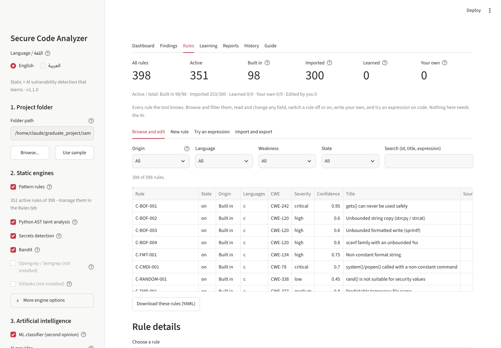
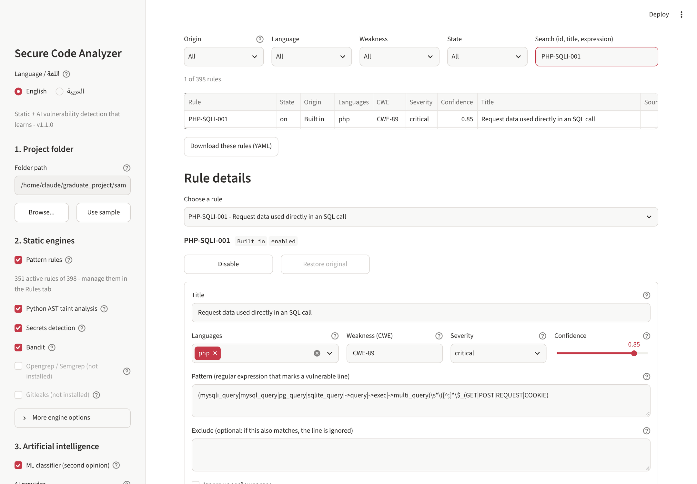
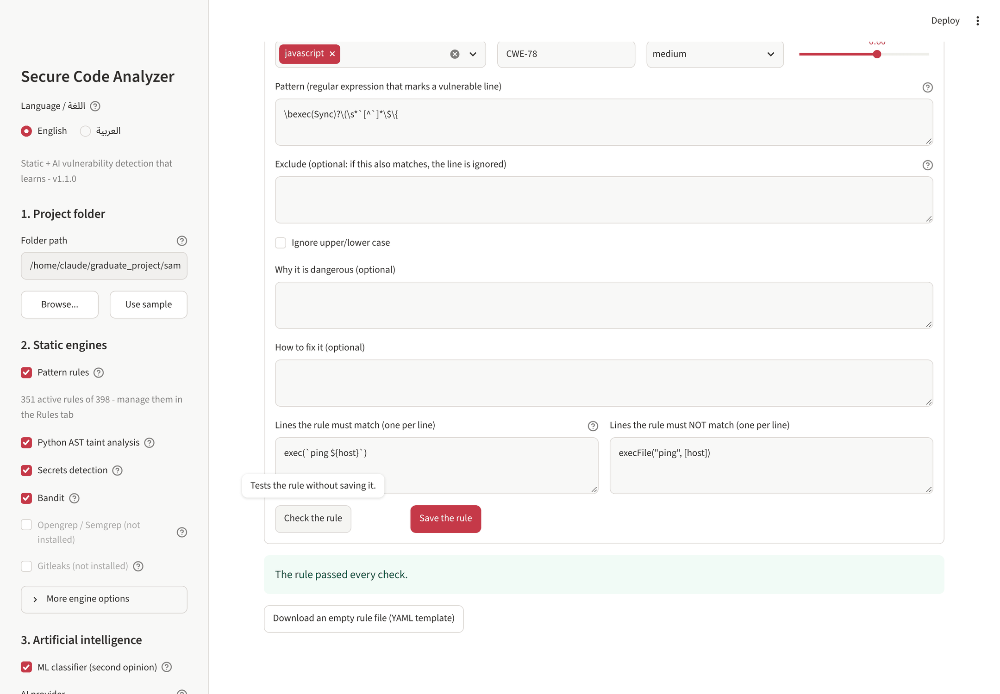
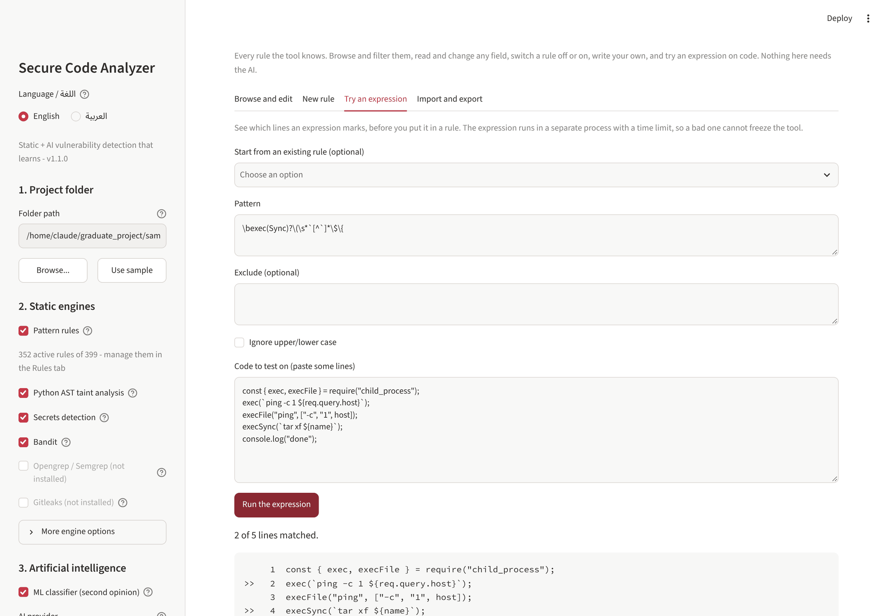
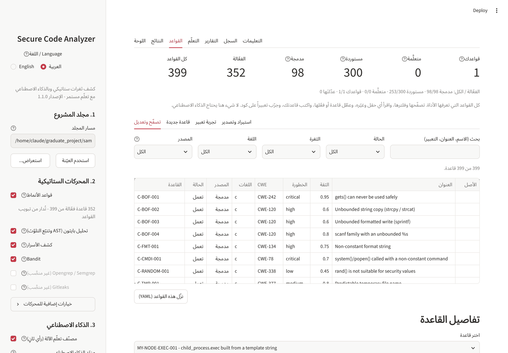

# Rules guide / دليل القواعد

*English first, العربية في النصف الثاني.* Generated by `tools/build_docs.py` from the texts of
the dashboard and from `evaluation/import_report.json`.

## The rule set

The tool ships **398 rules, 351 of them active**: 98 built in and
300 imported from open-source rule sets (253 active). 205 of the
imported rules are credential formats and run inside the secrets engine. Rules learned from
the AI and rules you write yourself are added on top.



## Imported rules

The imported rules come from two MIT-licensed projects (licence texts in
`THIRD_PARTY_NOTICES.md`):

- **Microsoft DevSkim** - regular-expression rules for many languages, each with its own
  "must match" and "must not match" examples.
- **Gitleaks** - regular expressions for the key and token formats of about 200 services.

`tools/import_rules.py` converts them (import of 2026-11-11). A rule is accepted only if it
converts to this engine, compiles in Python, finishes on stress lines, passes its own
examples (DevSkim) or matches a string built from its own expression (Gitleaks), and stays
silent on the known-safe sample code. Accepted rules were then run on 2,384,751 code lines
of 21 well-known open-source projects (Django, Flask, Redis, Laravel, Express, and
others). A DevSkim rule ships **disabled** when DevSkim itself marks it as a manual-review
rule, when it fired more than 0.5 times per 10,000 lines, or when its matches were
read by hand and found harmless; a Gitleaks rule ships disabled when it matched any product
code. Every disabled rule carries the reason in its `note` and can be switched on.

| Source | Rules in the source | Imported, enabled | Imported, disabled | Left out |
|---|---:|---:|---:|---:|
| DevSkim | 156 | 49 | 46 | 61 |
| Gitleaks | 222 | 204 | 1 | 17 |

| Reason a rule was left out | Rules |
|---|---:|
| uses conditions on neighbouring lines (this engine works line by line) | 24 |
| outside the scope | 18 |
| the same key format is already built in | 9 |
| language not scanned | 6 |
| matches the known-safe sample | 5 |
| could not be shown to match a string built from its own expression | 5 |
| does not compile | 4 |
| applies only to files selected by name | 3 |
| misses its own | 1 |
| matches its own | 1 |
| the tool has its own generic secret detector | 1 |
| matches file names, not file content | 1 |

Lines of real code the rules were measured on:

| Language | Code lines measured |
|---|---:|
| python | 463,947 |
| php | 368,056 |
| c | 318,726 |
| html | 306,566 |
| javascript | 253,511 |
| csharp | 163,383 |
| java | 152,266 |
| config | 139,835 |
| powershell | 47,883 |
| rust | 40,016 |
| shell | 36,893 |
| ruby | 35,265 |
| go | 31,177 |
| swift | 26,755 |
| lua | 397 |
| sql | 75 |
| **total** | **2,384,751** |

Active pattern rules per language after the import (Python's main engine is the AST taint
analysis, so it has no built-in pattern rules):

| Language | Built in | Imported, enabled | Imported, disabled |
|---|---:|---:|---:|
| c (+ cpp) | 8 | 9 | 15 |
| config | 0 | 3 | 1 |
| csharp | 8 | 13 | 13 |
| dart | 0 | 0 | 6 |
| elixir | 0 | 0 | 6 |
| go | 8 | 1 | 7 |
| html | 0 | 0 | 6 |
| java (+ kotlin, scala, groovy) | 13 | 3 | 11 |
| javascript (+ typescript) | 22 | 2 | 10 |
| lua | 0 | 0 | 6 |
| perl | 0 | 0 | 6 |
| php | 18 | 7 | 8 |
| powershell | 3 | 6 | 11 |
| python | 0 | 6 | 11 |
| ruby | 11 | 2 | 8 |
| rust | 3 | 1 | 7 |
| shell | 4 | 3 | 6 |
| sql | 0 | 1 | 6 |
| swift | 0 | 2 | 6 |
| any language | 0 | 5 | 5 |

What this does **not** show: the imported rules were not each proven against real
vulnerabilities, and the generated test strings for Gitleaks formats are not real keys.
The measurement shows how quiet the rules are on mature code, not how much they find.


## What a rule is

A rule is one regular expression that marks a dangerous line, plus the information shown
with the finding. The engine reads each code line (comments and very long generated lines
are skipped) and reports the line if `pattern` matches and `exclude` does not.

| Field | Meaning |
|---|---|
| `id` | Unique name, for example `MY-SQLI-001`. |
| `title` | Short description shown in the findings list. |
| `languages` | The languages the rule applies to, or `any`. TypeScript uses the JavaScript rules, C++ the C rules, Kotlin/Scala/Groovy the Java rules. |
| `cwe` | The weakness, as a CWE number (`CWE-89` = SQL injection). It decides the explanation, the fix text and the OWASP category. |
| `severity` | `critical`, `high`, `medium`, `low` or `info`. |
| `confidence` | 0 to 1: how sure the rule is on its own. Start a new rule around 0.5 to 0.6; your reviews move it. |
| `pattern` | Regular expression (Python `re` syntax) that marks a vulnerable line. |
| `exclude` | Optional expression; if it also matches, the line is ignored. This is how a rule is taught about a safe variant. |
| `ignore_case` | Match upper and lower case alike. |
| `message`, `fix` | Optional explanation and advice shown with the finding. |
| `examples_vulnerable` | Lines the rule must match. Checked every time the rule is saved. |
| `examples_safe` | Lines the rule must not match. |

## Writing a good rule

1. Start from a real vulnerable line and a safe version of the same line.
2. Anchor the expression on a literal name (a function or API), then describe what makes
   the call dangerous: `db\.query\(\s*"[^"]*"\s*\+` means "db.query( followed by a string
   and a +", which is string concatenation into SQL.
3. Put the safe variant in `exclude` instead of making `pattern` complicated.
4. Avoid `.*` at both ends and nested repetition such as `(a+)+`: they make a rule slow and
   broad. The tool refuses an expression that does not finish on its stress lines.
5. Add both kinds of examples. They are your regression test.
6. Use **Try an expression** to see what the rule marks in real code before saving.

## What happens when you save

The tool checks the rule first. **Errors** block saving: a missing field, an expression
that does not compile or is too slow, an example of its own that the rule fails.
**Warnings** inform you but do not block: the rule matches everyday code or known-safe
code, or repeats another rule.

## Editing rules that ship with the tool

Built-in and imported rules are never rewritten. Your change (a new severity, a stricter
pattern, or simply switching the rule off) is stored in `learned/edits.yaml`. It survives
an update of the tool, and **Restore original** removes it.

## Where the rules are stored

| Origin | File | Changed by |
|---|---|---|
| built-in | `sca/rules/*.yaml` | the project (edit through the Rules tab) |
| imported | `sca/rules/imported/*.yaml` | `tools/import_rules.py` |
| learned | `learned/rules.yaml` | the Learning tab, after your approval |
| your own | `learned/custom.yaml` | the Rules tab, `python -m sca rules new` |
| your edits | `learned/edits.yaml` | the Rules tab, `python -m sca rules edit` |
| exclusions | `learned/overrides.yaml` | approved exclusions from the Learning tab |

## An empty rule

```yaml
# A rule for Secure Code Analyzer. Fill it in and add it with:
#     python -m sca rules new this-file.yaml
- id: MY-RULE-001                 # unique name
  title: Short description of the weakness
  languages: [javascript]         # any, python, javascript, typescript, php, java, kotlin, scala, groovy, c, cpp, csharp, go, ruby, rust, swift, dart, shell, powershell, perl, lua, elixir, sql, config, html
  cwe: CWE-89                     # https://cwe.mitre.org
  severity: high                  # critical, high, medium, low, info
  confidence: 0.6                 # 0..1: how sure the rule is on its own
  pattern: 'db\.query\(\s*"[^"]*"\s*\+'     # marks a vulnerable line
  exclude: ''                     # optional: if this also matches, the line is ignored
  ignore_case: false
  message: Why this line is dangerous.
  fix: How to write it safely.
  examples_vulnerable:            # lines the rule MUST match (checked when you save)
    - 'db.query("SELECT * FROM t WHERE id=" + id)'
  examples_safe:                  # lines the rule must NOT match
    - 'db.query("SELECT * FROM t WHERE id=?", [id])'
```

## In the dashboard

Rules tab → **Browse and edit**: filter by origin, language, weakness and state; choose a
rule to see every field, switch it off or on, edit it, or restore the original.



Rules tab → **New rule**: fill in the form, press *Check the rule*, then *Save the rule*.



Rules tab → **Try an expression**: paste code and see which lines an expression marks.



## On the command line

```bash
python -m sca rules list                                       # Proposed rules waiting for approval.
python -m sca rules approve ID                                 # Approve a proposed rule.
python -m sca rules catalog --lang php                         # Every rule for a language.
python -m sca rules show ID                                    # One rule in full.
python -m sca rules disable ID                                 # Switch a rule off (enable = on again).
python -m sca rules edit ID --set severity=low --set confidence=0.4 # Change fields of a rule.
python -m sca rules reset ID                                   # Undo your changes to a shipped rule.
python -m sca rules template > my-rule.yaml                    # An empty rule to fill in.
python -m sca rules new my-rule.yaml                           # Add your own rule from a file.
python -m sca rules test ID PATH                               # Show the lines a rule marks in a file or folder.
python -m sca rules export --origin custom -o rules.yaml       # Export your rules.
python -m sca coverage                                         # Rules per language and weakness.
```

---

# دليل القواعد

## مجموعة القواعد

تأتي الأداة مع **398 قاعدة، منها 351 فعّالة**: 98 مدمجة و 300
مستوردة من مجموعات قواعد مفتوحة المصدر (253 منها فعّالة). من المستوردة 205
صيغة مفتاح تعمل داخل محرك الأسرار. وتُضاف فوقها القواعد المتعلَّمة من الذكاء الاصطناعي
والقواعد التي تكتبها أنت.



## القواعد المستوردة

جاءت القواعد المستوردة من مشروعين برخصة MIT (نص الرخصة في `THIRD_PARTY_NOTICES.md`):

- **Microsoft DevSkim**: قواعد بتعابير نمطية للغات كثيرة، ومع كل قاعدة أمثلتها: ما يجب أن
  تطابقه وما يجب ألّا تطابقه.
- **Gitleaks**: تعابير نمطية لصيغ مفاتيح ورموز نحو 200 خدمة.

السكربت `tools/import_rules.py` يحوّلها (استيراد بتاريخ 2026-11-11). لا تُقبل القاعدة إلا إذا
أمكن تحويلها إلى هذا المحرك، وتُرجمت في بايثون، وانتهت على أسطر الإجهاد، ونجحت في أمثلتها
(DevSkim) أو طابقت نصاً مولَّداً من تعبيرها نفسه (Gitleaks)، وبقيت صامتة على الكود المعروف
أنه آمن. بعد ذلك شُغّلت القواعد المقبولة على 2,384,751 سطر كود من 21 مشروعاً
مفتوح المصدر معروفاً (Django و Flask و Redis و Laravel و Express وغيرها). تأتي قاعدة DevSkim
**معطَّلة** إذا كان DevSkim نفسه يصنّفها قاعدة مراجعة يدوية، أو إذا طابقت أكثر من 0.5
مرة لكل 10,000 سطر، أو إذا قُرئت مطابقاتها يدوياً وتبيّن أنها غير مفيدة. وتأتي قاعدة Gitleaks
معطَّلة إذا طابقت أي كود إنتاجي. كل قاعدة معطَّلة تحمل السبب في حقل `note` ويمكن تفعيلها.

| المصدر | قواعد المصدر | مستوردة ومفعّلة | مستوردة ومعطّلة | مستبعدة |
|---|---:|---:|---:|---:|
| DevSkim | 156 | 49 | 46 | 61 |
| Gitleaks | 222 | 204 | 1 | 17 |

| سبب استبعاد القاعدة (كما سجّله سكربت الاستيراد) | العدد |
|---|---:|
| uses conditions on neighbouring lines (this engine works line by line) | 24 |
| outside the scope | 18 |
| the same key format is already built in | 9 |
| language not scanned | 6 |
| matches the known-safe sample | 5 |
| could not be shown to match a string built from its own expression | 5 |
| does not compile | 4 |
| applies only to files selected by name | 3 |
| misses its own | 1 |
| matches its own | 1 |
| the tool has its own generic secret detector | 1 |
| matches file names, not file content | 1 |

أسطر الكود الحقيقي التي قيست عليها القواعد:

| اللغة | أسطر الكود المقاسة |
|---|---:|
| python | 463,947 |
| php | 368,056 |
| c | 318,726 |
| html | 306,566 |
| javascript | 253,511 |
| csharp | 163,383 |
| java | 152,266 |
| config | 139,835 |
| powershell | 47,883 |
| rust | 40,016 |
| shell | 36,893 |
| ruby | 35,265 |
| go | 31,177 |
| swift | 26,755 |
| lua | 397 |
| sql | 75 |
| **المجموع** | **2,384,751** |

قواعد الأنماط لكل لغة بعد الاستيراد (المحرك الأساسي لبايثون هو تحليل AST، ولهذا ليس لها قواعد
أنماط مدمجة):

| اللغة | مدمجة | مستوردة ومفعّلة | مستوردة ومعطّلة |
|---|---:|---:|---:|
| c (+ cpp) | 8 | 9 | 15 |
| config | 0 | 3 | 1 |
| csharp | 8 | 13 | 13 |
| dart | 0 | 0 | 6 |
| elixir | 0 | 0 | 6 |
| go | 8 | 1 | 7 |
| html | 0 | 0 | 6 |
| java (+ kotlin, scala, groovy) | 13 | 3 | 11 |
| javascript (+ typescript) | 22 | 2 | 10 |
| lua | 0 | 0 | 6 |
| perl | 0 | 0 | 6 |
| php | 18 | 7 | 8 |
| powershell | 3 | 6 | 11 |
| python | 0 | 6 | 11 |
| ruby | 11 | 2 | 8 |
| rust | 3 | 1 | 7 |
| shell | 4 | 3 | 6 |
| sql | 0 | 1 | 6 |
| swift | 0 | 2 | 6 |
| كل اللغات (any) | 0 | 5 | 5 |

ما **لا** يثبته هذا القياس: القواعد المستوردة لم تُختبر واحدةً واحدة على ثغرات حقيقية،
والنصوص المولَّدة لاختبار صيغ Gitleaks ليست مفاتيح حقيقية. القياس يبيّن مدى هدوء القواعد على
كود ناضج، ولا يبيّن كم تكتشف.


## ما هي القاعدة؟

القاعدة تعبير نمطي واحد يعلّم السطر الخطر، مع المعلومات التي تظهر مع النتيجة. يقرأ المحرك
كل سطر كود (تُتجاوز التعليقات والأسطر الطويلة جداً المولَّدة آلياً) ويبلّغ عن السطر إذا
طابقه `pattern` ولم يطابقه `exclude`.

| الحقل | المعنى |
|---|---|
| `id` | اسم فريد، مثل `MY-SQLI-001`. |
| `title` | وصف قصير يظهر في قائمة النتائج. |
| `languages` | اللغات التي تنطبق عليها القاعدة، أو `any` للجميع. TypeScript تستخدم قواعد JavaScript، و C++ قواعد C، و Kotlin و Scala و Groovy قواعد Java. |
| `cwe` | نوع الثغرة برقم CWE (مثل `CWE-89` لحقن SQL). منه يؤخذ الشرح ونص الإصلاح وفئة OWASP. |
| `severity` | الخطورة: `critical` أو `high` أو `medium` أو `low` أو `info`. |
| `confidence` | من 0 إلى 1: مدى ثقة القاعدة بنفسها. ابدأ القاعدة الجديدة بين 0.5 و 0.6، ومراجعاتك تحرّكها. |
| `pattern` | تعبير نمطي (بصيغة مكتبة `re` في بايثون) يعلّم السطر المصاب. |
| `exclude` | تعبير اختياري، إن طابق السطر أيضاً فيُتجاهل. بهذا تتعلّم القاعدة الصيغة الآمنة. |
| `ignore_case` | عدم التفريق بين الأحرف الكبيرة والصغيرة. |
| `message` و `fix` | شرح ونصيحة اختياريان يظهران مع النتيجة. |
| `examples_vulnerable` | أسطر يجب أن تطابقها القاعدة. تُفحص عند كل حفظ. |
| `examples_safe` | أسطر يجب ألّا تطابقها القاعدة. |

## كتابة قاعدة جيدة

1. ابدأ من سطر مصاب حقيقي ومن نسخة آمنة للسطر نفسه.
2. ثبّت التعبير على اسم حرفي (دالة أو واجهة)، ثم صِف ما يجعل الاستدعاء خطراً. مثلاً
   `db\.query\(\s*"[^"]*"\s*\+` تعني: db.query( يتبعها نص ثم علامة +، أي دمج نص داخل SQL.
3. ضع الصيغة الآمنة في `exclude` بدلاً من تعقيد `pattern`.
4. تجنّب `.*` في الطرفين والتكرار المتداخل مثل `(a+)+` لأنهما يجعلان القاعدة بطيئة
   وواسعة. الأداة ترفض التعبير الذي لا ينتهي على أسطر الإجهاد.
5. أضف النوعين من الأمثلة، فهي اختبارك عند أي تعديل لاحق.
6. استخدم **تجربة تعبير** لترى ما تعلّمه القاعدة في كود حقيقي قبل الحفظ.

## ماذا يحدث عند الحفظ؟

تفحص الأداة القاعدة أولاً. **الأخطاء** تمنع الحفظ: حقل ناقص، أو تعبير لا يُترجَم أو بطيء
جداً، أو مثال من أمثلة القاعدة تفشل فيه. **التحذيرات** تُعلمك ولا تمنع: القاعدة تطابق
كوداً عادياً أو كوداً معروفاً أنه آمن، أو تكرّر قاعدة أخرى.

## تعديل القواعد المرفقة مع الأداة

القواعد المدمجة والمستوردة لا يُعاد كتابة ملفاتها. تعديلك (خطورة جديدة، أو نمط أدق، أو
مجرد تعطيل القاعدة) يُحفظ في `learned/edits.yaml`، فيبقى بعد تحديث الأداة، وزر
**استرجاع الأصل** يزيله.

## أين تُحفظ القواعد؟

| المصدر | الملف | من يغيّره |
|---|---|---|
| مدمجة | `sca/rules/*.yaml` | المشروع (عدّلها من تبويب القواعد) |
| مستوردة | `sca/rules/imported/*.yaml` | السكربت `tools/import_rules.py` |
| متعلَّمة | `learned/rules.yaml` | تبويب التعلّم بعد مصادقتك |
| قواعدك | `learned/custom.yaml` | تبويب القواعد أو `python -m sca rules new` |
| تعديلاتك | `learned/edits.yaml` | تبويب القواعد أو `python -m sca rules edit` |
| الاستثناءات | `learned/overrides.yaml` | الاستثناءات المصادَق عليها في تبويب التعلّم |

## من الواجهة

- تبويب القواعد ← **تصفّح وتعديل**: فلتر حسب المصدر واللغة والثغرة والحالة، ثم اختر قاعدة
  لترى كل حقولها وتعطّلها أو تفعّلها أو تعدّلها أو تسترجع أصلها.
- تبويب القواعد ← **قاعدة جديدة**: املأ النموذج واضغط *افحص القاعدة* ثم *احفظ القاعدة*.
- تبويب القواعد ← **تجربة تعبير**: الصق كوداً وشاهد أي الأسطر يعلّمها التعبير.
- تبويب القواعد ← **استيراد وتصدير**: انقل قواعدك بين الحواسيب بملف YAML.

## من سطر الأوامر

```bash
python -m sca rules list                                       # القواعد المقترحة التي تنتظر المصادقة.
python -m sca rules approve ID                                 # المصادقة على قاعدة مقترحة.
python -m sca rules catalog --lang php                         # كل القواعد الخاصة بلغة.
python -m sca rules show ID                                    # عرض قاعدة كاملة.
python -m sca rules disable ID                                 # تعطيل قاعدة (enable لإعادتها).
python -m sca rules edit ID --set severity=low --set confidence=0.4 # تعديل حقول قاعدة.
python -m sca rules reset ID                                   # التراجع عن تعديلاتك على قاعدة مرفقة.
python -m sca rules template > my-rule.yaml                    # قالب قاعدة فارغ لتملأه.
python -m sca rules new my-rule.yaml                           # إضافة قاعدتك من ملف.
python -m sca rules test ID PATH                               # عرض الأسطر التي تعلّمها قاعدة في ملف أو مجلد.
python -m sca rules export --origin custom -o rules.yaml       # تصدير قواعدك.
python -m sca coverage                                         # عدد القواعد لكل لغة وثغرة.
```
