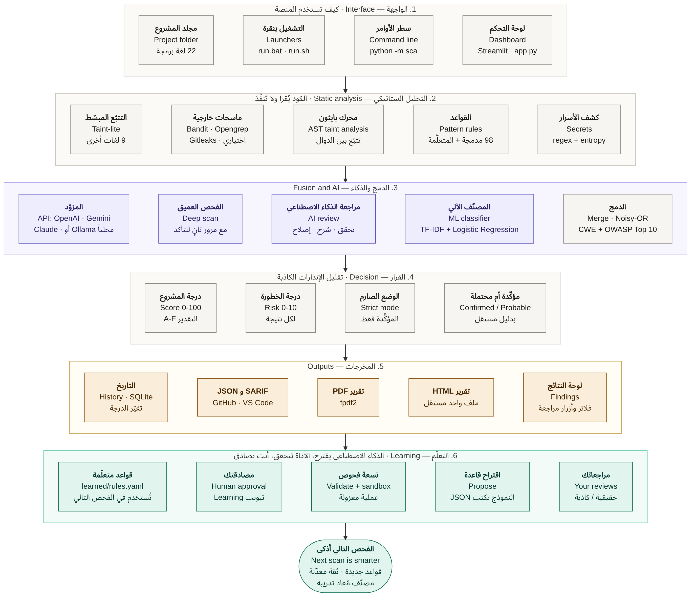
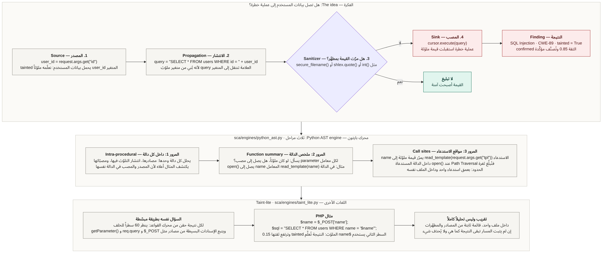
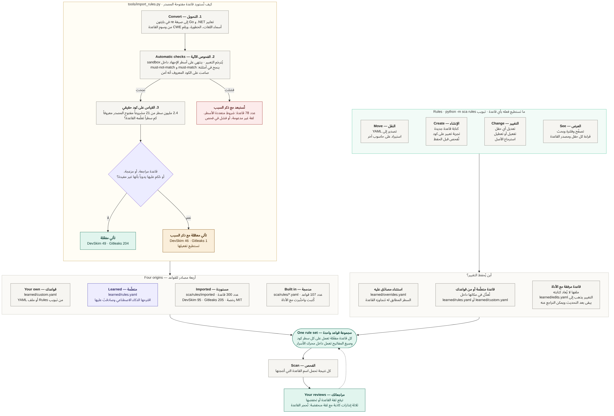
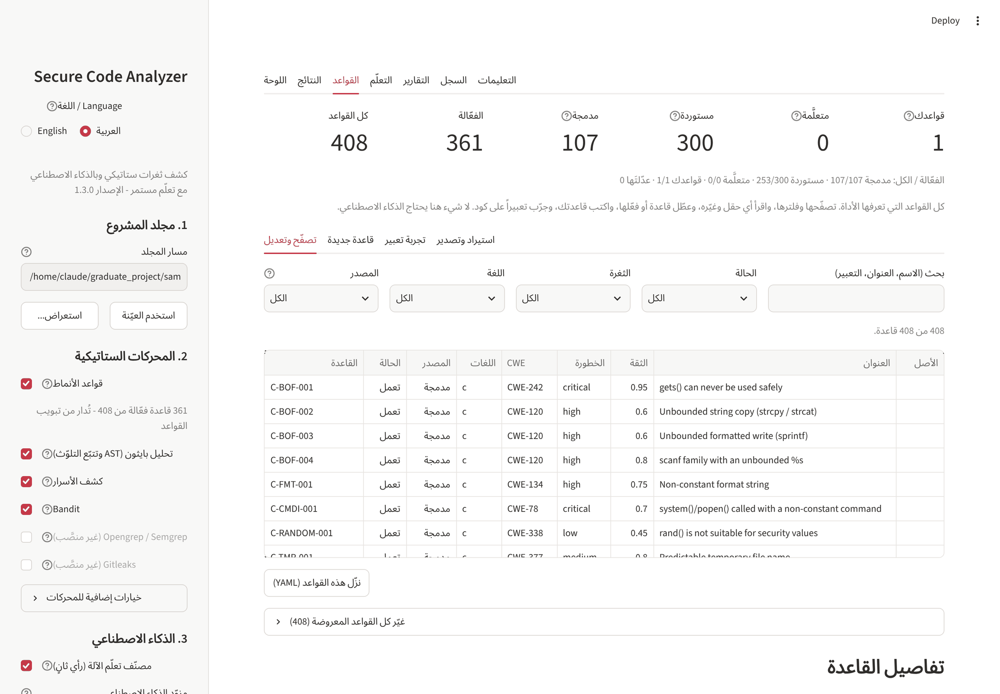
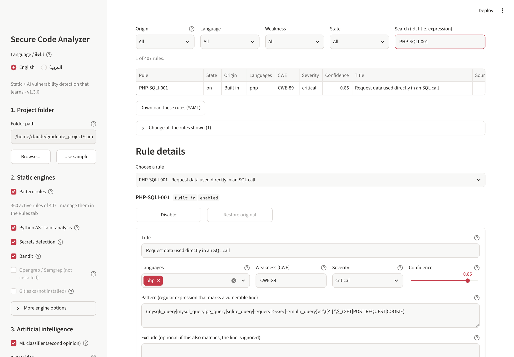
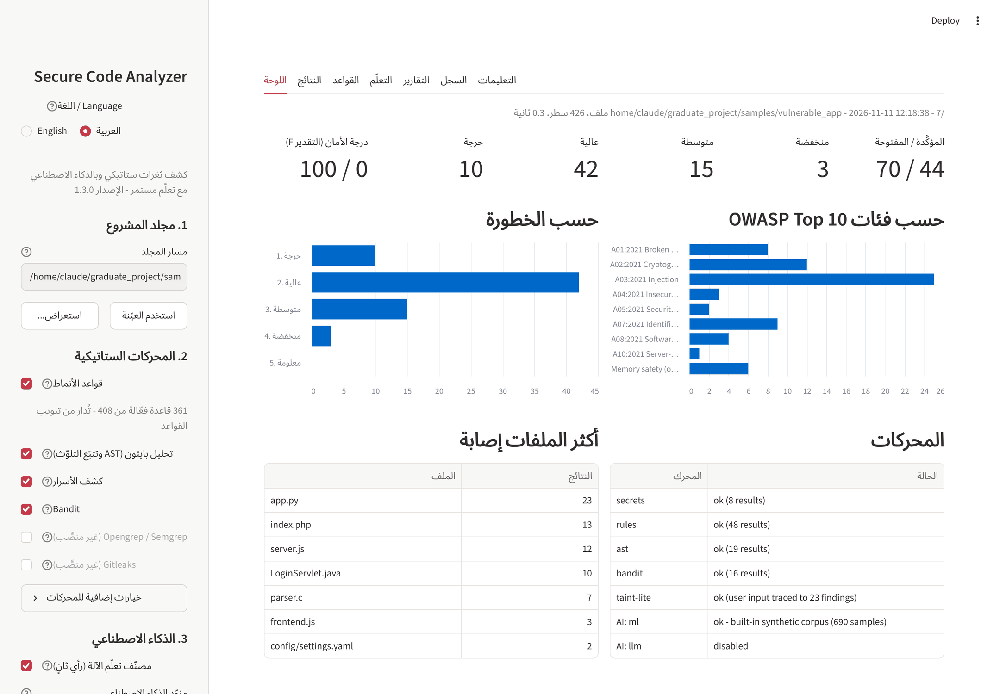
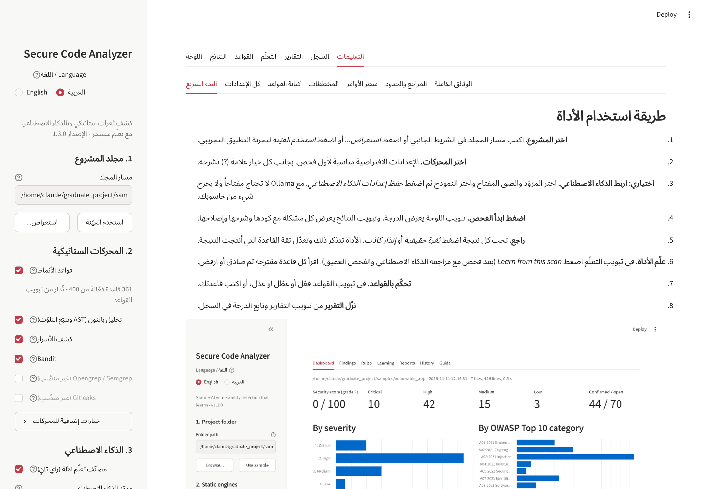

# وثيقة المشرف

## Secure Code Analyzer: منصة ذكية لاكتشاف ثغرات الكود المصدري وتقييم الأمان

*Intelligent Source Code Vulnerability Detection and Security Assessment Platform*

| | |
|---|---|
| نوع العمل | مشروع تخرج: منصة برمجية تعمل محلياً، مع واجهة ويب وسطر أوامر |
| المستودع | <https://github.com/blackangiliq/graduate_project> |
| الإصدار | 1.3.0 |
| لغة التنفيذ | Python 3.10 فأحدث |
| حجم الكود | نحو 13,000 سطر بايثون: 8,360 للنواة، 690 للواجهة، 2,250 للاختبارات، والباقي للأدوات والتقييم |
| الاختبارات | 306 اختبارات آلية، تعمل على لينكس وويندوز عبر GitHub Actions |
| القواعد | 407 قواعد كشف، منها 360 فعّالة |
| التقييم الخارجي | OWASP Benchmark: درجة +0.44 للغة Java و +0.43 للغة Python (القسم 9.2) |
| اللغات | تتعرّف المنصة على 22 لغة برمجة (54 امتداداً) |
| لغة الواجهة | العربية والإنجليزية |

هذه الوثيقة تلخّص للمشرف ما يغطيه النظام، وكيف بُني، وما قيس فعلاً، وما لم يُختبر بعد. كل
رقم فيها ناتج عن تشغيل فعلي مسجَّل في المستودع، وكل حدّ معروف مذكور في القسم 11.

---

## 1. الملخص

المنصة تأخذ مجلد مشروع برمجي وتفحص كوده دون تنفيذه. تعمل فيها عدة محركات تحليل ستاتيكي
معاً، ثم تُدمج بلاغاتها، ثم يراجعها مصنّف تعلّم آلة ونموذج لغوي (عبر API سحابي أو نموذج محلي)،
ثم تُقسم النتائج إلى مؤكَّدة ومحتملة ويُحسب للمشروع درجة أمان من 100.

ما يميّز المشروع عن تشغيل أداة فحص جاهزة ثلاثة أمور:

1. **التعلّم بمصادقة بشرية.** ما يكتشفه الذكاء الاصطناعي يتحوّل إلى قاعدة مقترحة، تمرّ على
   تسعة فحوص آلية، ولا تُفعَّل إلا بعد موافقة المستخدم. بعدها تكشف الأداة الثغرة نفسها ستاتيكياً
   دون الحاجة إلى الذكاء الاصطناعي.
2. **التحكم الكامل بالقواعد.** كل قاعدة ظاهرة للمستخدم، وقابلة للقراءة والتعديل والتعطيل
   والاسترجاع، ويمكن كتابة قواعد جديدة وتجربتها من الواجهة.
3. **تقليل الإنذارات الكاذبة بدليل مستقل.** لا تُعتبر النتيجة مؤكَّدة لمجرد أن قاعدة طابقت
   سطراً، بل تحتاج دليلاً: تتبّع مدخلات المستخدم حتى السطر، أو تأكيد المراجعة، أو تأكيد المستخدم.



---

## 2. مشكلة البحث والأهداف

**المشكلة.** أدوات التحليل الستاتيكي المعروفة تعاني من أمرين: كثرة الإنذارات الكاذبة التي
تجعل المطوّر يتجاهل التقرير، وثبات قواعدها فلا تتعلّم من المشروع الذي تفحصه. والنماذج اللغوية
تكتشف ثغرات لا تصفها القواعد، لكنها بطيئة ومكلفة وقد تخطئ، ولا يصحّ الاعتماد على حكمها وحده.

**الهدف.** بناء منصة تجمع الطريقتين بحيث تعوّض كل واحدة ضعف الأخرى: القواعد سريعة ومجانية
وقابلة للتدقيق، والنموذج اللغوي يكتشف الجديد ويشرح، وحلقة التعلّم تنقل اكتشافات النموذج إلى
قواعد ثابتة بعد فحصها والمصادقة عليها.

**الأهداف التفصيلية:**

- فحص محلي لمجلد كامل بعدة لغات برمجة.
- تحليل أعمق من مطابقة الأنماط للغة واحدة على الأقل (بايثون: تتبّع البيانات بين الدوال).
- مراجعة النتائج وشرحها واقتراح إصلاحها بالذكاء الاصطناعي، مع بقاء الفحص الستاتيكي يعمل بدونه.
- تعلّم قواعد جديدة بمصادقة بشرية، وتعلّم من مراجعات المستخدم.
- تمييز المؤكَّد من المحتمل، ووضع صارم يعرض المؤكَّد فقط.
- تقييم أمني: خطورة لكل نتيجة، ودرجة وتقدير للمشروع، وربط بتصنيفي CWE و OWASP Top 10.
- واجهة كاملة وتقارير بصيغ قياسية.

---

## 3. ما يغطيه النظام

| المتطلَّب | كيف نُفِّذ | أين في المستودع | الحالة |
|---|---|---|---|
| فحص محلي لمجلد يختاره المستخدم | قراءة الملفات وتحديد لغتها وتجاوز المجلدات غير المهمة | `sca/walker.py` | منفَّذ ومختبَر |
| تحليل ستاتيكي بقواعد | محرك قواعد بتعابير نمطية مع استثناءات | `sca/engines/rules_engine.py` و `sca/rules/` | منفَّذ ومختبَر |
| تحليل تدفق البيانات | شجرة AST لبايثون وتتبّع التلوّث بين الدوال (بعمق استدعاء واحد داخل الملف) | `sca/engines/python_ast.py` | منفَّذ ومختبَر |
| تتبّع مدخلات المستخدم للغات أخرى | تتبّع مبسّط للإسنادات في 9 لغات | `sca/engines/taint_lite.py` | منفَّذ ومختبَر، وهو تقريب |
| كشف الأسرار | صيغ مفاتيح معروفة + إنتروبيا شانون + حجب الأسرار في التقارير | `sca/engines/secrets.py` | منفَّذ ومختبَر |
| قواعد من مصادر مفتوحة | استيراد 300 قاعدة من DevSkim و Gitleaks مع فحص وقياس | `tools/import_rules.py` و `sca/rules/imported/` | منفَّذ ومقاس (القسم 5) |
| التحكم الكامل بالقواعد | عرض وتعديل وتعطيل واسترجاع وإنشاء وتجربة وتصدير واستيراد | `sca/rulebook.py` وتبويب القواعد | منفَّذ ومختبَر |
| أدوات خارجية | Bandit، واختيارياً Opengrep/Semgrep و Gitleaks | `sca/engines/external.py` | Bandit مختبَر، والبقية على مخرجات نموذجية |
| دمج النتائج | نتيجة واحدة لكل مشكلة، والثقة بقاعدة Noisy-OR | `sca/merge.py` | منفَّذ ومختبَر |
| مصنّف تعلّم آلة | TF-IDF مع انحدار لوجستي، يُعاد تدريبه بمراجعات المستخدم | `sca/ai/classifier.py` | منفَّذ ومختبَر، مدرَّب على بيانات اصطناعية |
| مراجعة بالذكاء الاصطناعي | تحقق وشرح وإصلاح، وفحص عميق لملفات كاملة | `sca/ai/llm.py` | منفَّذ، ومختبَر بخوادم وهمية فقط |
| مزوّدو الذكاء الاصطناعي | OpenAI و Gemini و Anthropic و OpenRouter و Groq و DeepSeek و Mistral وأي عنوان متوافق، أو Ollama محلياً | `sca/ai/providers.py` | منفَّذ، **ولم يُجرَّب على خدمة حقيقية** |
| التعلّم بمصادقة | اقتراح، 9 فحوص آلية، تصحيح ذاتي مرة واحدة، مصادقة بشرية | `sca/learn/` | منفَّذ ومختبَر بنموذج وهمي |
| التعلّم من المراجعات | ثقة القاعدة تتبع سجلّها، وحجر القاعدة المتكررة الخطأ | `sca/learn/feedback.py` | منفَّذ ومختبَر |
| مؤكَّد ومحتمل ووضع صارم | دليل مستقل شرط للتأكيد | `sca/scoring.py` | منفَّذ ومقاس |
| التقييم الأمني | خطورة 0-10، درجة 0-100، تقدير A-F، CWE و OWASP Top 10 | `sca/scoring.py` و `sca/cwe.py` | منفَّذ. الدرجة مقياس خاص بالأداة |
| الواجهة | لوحة، نتائج، قواعد، تعلّم، تقارير، سجل، تعليمات، بلغتين | `app.py` و `sca/ui/` | منفَّذ ومختبَر آلياً وفي متصفح |
| سطر الأوامر | scan و config و learn و rules و feedback و coverage و doctor و history | `sca/__main__.py` | منفَّذ ومختبَر |
| التقارير | HTML و PDF و JSON و SARIF 2.1.0 | `sca/report/` | منفَّذ ومختبَر |
| السجل | قاعدة SQLite محلية وتغيّر الدرجة عبر الزمن | `sca/storage.py` | منفَّذ ومختبَر |
| تقييم على معيار خارجي | سكربت يشغّل الأداة على OWASP Benchmark ويحسب TPR و FPR لكل فئة | `evaluation/owasp_benchmark.py` | منفَّذ ومقاس (القسم 9.2) |
| التوثيق | دليل عربي، دليل القواعد، شرح المخططات باللغتين، المعمارية، هيكل البحث | `docs/` وتبويب التعليمات | منفَّذ |

---

## 4. كيف يعمل: المراحل والتقنيات

| # | المرحلة | التقنية |
|---|---|---|
| 1 | جمع الملفات | `os.walk`، خريطة امتدادات، تجاوز الملفات الثنائية والمصغَّرة |
| 2 | الكشف | تعابير نمطية بقواعد YAML، مكتبة `ast`، إنتروبيا شانون، Bandit |
| 3 | التنقية | تتبّع المدخلات، وتعديل الثقة بتوزيع بيتا: `(tp + 4c) / (tp + fp + 4)` |
| 4 | الدمج | الملف نفسه + نوع الثغرة نفسه + سطر متقارب، والثقة `1 - ∏(1 - c)` |
| 5 | المصنّف | TF-IDF لمقاطع من 1 إلى 3 رموز + انحدار لوجستي، بوزن ربع الثقة |
| 6 | النموذج اللغوي | طلبات JSON فقط، مرور ثانٍ للتأكد من الاكتشافات، دفاع ضد حقن التعليمات |
| 7 | التقييم | `risk = base × (0.6 + 0.4 × confidence)` و `score = 100 × exp(-(penalty / KLOC) / 25)` |
| 8 | التخزين والتقارير | SQLite، HTML مستقل، fpdf2، SARIF |
| 9 | التعلّم | قواعد يكتبها النموذج، تُجرَّب في عملية معزولة قابلة للإيقاف، ثم مصادقة بشرية |

المخطط التفصيلي لكل مرحلة مع أدواتها في `docs/images/pipeline.ar.png`، وشرحه في
`docs/DIAGRAMS_AR.md`، وهو معروض أيضاً داخل الواجهة.

**تتبّع التلوّث** هو أعمق ما في التحليل الستاتيكي هنا. الفكرة: القيمة القادمة من المستخدم
تُعلَّم بأنها ملوّثة، وتنتقل العلامة عبر الإسناد وبناء النصوص، ويزيلها المعقِّم، فإن وصلت إلى
عملية خطرة فهذه ثغرة بدليل.



---

## 5. نظام القواعد

### 5.1 المصادر

| المصدر | العدد | الفعّال | الملف |
|---|---:|---:|---|
| مدمجة، كُتبت واختُبرت مع الأداة | 107 | 107 | `sca/rules/*.yaml` |
| مستوردة من Microsoft DevSkim (رخصة MIT) | 95 | 49 | `sca/rules/imported/devskim.yaml` |
| مستوردة من Gitleaks (رخصة MIT)، صيغ مفاتيح | 205 | 204 | `sca/rules/imported/gitleaks.yaml` |
| متعلَّمة من الذكاء الاصطناعي بعد المصادقة | تزداد مع الاستخدام | | `learned/rules.yaml` |
| قواعد المستخدم | حسب ما يكتب | | `learned/custom.yaml` |

### 5.2 كيف استُوردت القواعد

لم تُنسخ القواعد المفتوحة المصدر كما هي. سكربت الاستيراد يحوّل كل قاعدة إلى صيغة المحرك ثم
يختبرها:

1. يُترجَم التعبير في بايثون (الأصل مكتوب لـ ‎.NET أو Go).
2. ينتهي على أسطر إجهاد طويلة ومتكررة، داخل عملية معزولة بحدّ زمني.
3. ينجح في أمثلة القاعدة نفسها: يطابق ما يجب ولا يطابق ما لا يجب.
4. لا يطابق شيئاً في الكود المعروف أنه آمن.
5. يُقاس على **2,384,751 سطر كود من 21 مشروعاً مفتوح المصدر معروفاً** (Django و Flask و Redis
   و Laravel و Express و Gson وغيرها).

| المصدر | في المصدر | مفعّلة | معطّلة مع السبب | مستبعدة مع السبب |
|---|---:|---:|---:|---:|
| DevSkim | 156 | 49 | 46 | 61 |
| Gitleaks | 222 | 204 | 1 | 17 |

القاعدة تأتي معطَّلة إذا كان مصدرها يصنّفها «للمراجعة اليدوية»، أو طابقت كثيراً في الكود
الحقيقي، أو قُرئت مطابقاتها يدوياً وتبيّن أنها غير مفيدة (ست قواعد، وسبب كل واحدة مكتوب معها).
السجل الكامل في `evaluation/import_report.json`.

**أثر الاستيراد المقاس** على ثلاثة مشاريع كبيرة (1.17 مليون سطر):

| المشروع | أسطر الكود | النتائج قبل ← بعد | المؤكَّدة قبل ← بعد | الزمن قبل ← بعد |
|---|---:|---:|---:|---:|
| redis | 346,353 | 199 ← 216 | 2 ← 2 | 15 ث ← 22 ث |
| laravel/framework | 373,034 | 394 ← 398 | 0 ← 0 | 15 ث ← 22 ث |
| django | 449,759 | 496 ← 496 | 5 ← 5 | 27 ث ← 36 ث |

أي أن الاستيراد أضاف 21 نتيجة محتملة في 1.17 مليون سطر، ولم يضف نتائج مؤكَّدة، وجعل الفحص
أبطأ بنحو 40%.

### 5.3 التحكم بالقواعد

من تبويب **القواعد** في الواجهة، أو بالأمر `python -m sca rules`:

- **العرض:** كل القواعد مع فلاتر (المصدر، اللغة، الثغرة، الحالة) وبحث، وكل حقول القاعدة ومصدرها ورخصتها.
- **التعديل:** أي حقل (النمط، الاستثناء، الخطورة، الثقة، اللغات، الشرح)، والتفعيل والتعطيل، واسترجاع الأصل.
- **الإنشاء:** نموذج لكتابة قاعدة جديدة تُفحص قبل الحفظ، وصفحة لتجربة تعبير على كود.
- **شروط القاعدة:** يمكن أن تحمل القاعدة شرط سياق (لا تعمل إلا إذا طابق تعبير آخر سطراً مجاوراً)، أو أن تكون قاعدة «مصبّ» تبقى صامتة ما لم تُتتبَّع مدخلات المستخدم إلى السطر. بهذا لا تُغرق القاعدة التي تذكر دالة شائعة التقريرَ.
- **التغيير الجماعي:** تفعيل أو تعطيل كل القواعد المعروضة بعد الفلترة دفعة واحدة.
- **النقل:** تصدير واستيراد بصيغة YAML.

القواعد المرفقة مع الأداة لا يُعاد كتابة ملفاتها: تعديل المستخدم يُحفظ في ملف منفصل
(`learned/edits.yaml`)، فيبقى بعد التحديث ويمكن التراجع عنه. والقاعدة الجديدة تُرفض إذا كان فيها
حقل خاطئ، أو تعبير لا يُترجَم أو بطيء جداً، أو فشلت في مثال من أمثلتها.







---

## 6. الذكاء الاصطناعي وحلقة التعلّم

**ثلاثة أدوار للذكاء الاصطناعي:**

1. **مصنّف محلي** يعطي كل نتيجة درجة، ويُعاد تدريبه بالأسطر التي يراجعها المستخدم.
2. **مراجعة النتائج:** النموذج اللغوي يقرأ النتيجة مع الكود المحيط، ويحكم ويشرح ويقترح إصلاحاً.
   النتيجة التي يحكم بأنها كاذبة تبقى وتُعلَّم ولا تُحذف.
3. **الفحص العميق:** النموذج يدقق ملفات كاملة ويبلّغ عمّا لم تجده القواعد، وطلب ثانٍ مستقل يجب أن
   يؤكد كل اكتشاف.

**حلقة التعلّم:**

1. **الاقتراح:** لكل اكتشاف مؤكَّد يكتب النموذج قاعدة بصيغة JSON مع أمثلة. ولكل إنذار كاذب يكتب استثناءً ضيقاً.
2. **تسعة فحوص آلية:** البنية صحيحة، التعبير يُترجَم، سريع على أسطر الإجهاد، محدَّد وليس عاماً،
   يطابق السطر الذي تعلّم منه، ينجح في أمثلته، صامت على الكود الآمن، لا يبلّغ عن نسبة غير معقولة
   من المشروع، وليس مكرَّراً.
3. **تصحيح ذاتي:** عند الفشل تُعاد أسباب الفشل إلى النموذج مرة واحدة.
4. **المصادقة البشرية:** القاعدة الناجحة تنتظر في تبويب التعلّم مع نتائج فحوصها.
5. **فترة تجربة:** القاعدة المصادَق عليها تبدأ بثقة 0.55، ثم ترفعها مراجعات المستخدم أو تحجرها.

يمكن تكرار الحلقة حتى لا تجد جولة شيئاً جديداً (`--rounds`)، وطلب قواعد لكل ثغرة لا قاعدة لها
في أي لغة (`--bootstrap all`). المخطط التفصيلي في `docs/images/learning-loop.ar.png`.

**الخصوصية:** مع مزوّد سحابي تُرسَل أجزاء من الكود إلى المزوّد، وتُحجب قبل ذلك الأسرار التي
اكتشفتها الأداة فقط. مع Ollama لا يخرج شيء من الحاسوب. مفتاح الـ API يُحفظ في ملف `.env`
مستثنى من git ولا يُكتب في التقارير ولا في قاعدة البيانات.

---

## 7. تقليل الإنذارات الكاذبة

لا يستطيع أي محلل ستاتيكي أن يضمن صفر إنذارات كاذبة، فالمسألة غير قابلة للحسم نظرياً. ما
يفعله النظام هو طبقات متتالية:

| الطبقة | الأثر |
|---|---|
| استثناءات داخل القواعد وقوائم معقِّمات | الصيغ الآمنة لا يُبلَّغ عنها |
| تتبّع المدخلات | يفرّق بين «بيانات المستخدم تصل إلى السطر» و«طابق نمط» |
| عدة محركات مع Noisy-OR | الاتفاق يرفع الثقة |
| مراجعة الذكاء الاصطناعي بمرور ثانٍ | الكاذب يُعلَّم، والاكتشاف يحتاج تأكيداً |
| مراجعات المستخدم | المرفوض يبقى مرفوضاً، والقاعدة المزعجة تفقد ثقتها ثم تُحجر |
| كود الاختبارات | ثقة أقل، ولا تأكيد تلقائي |
| **الوضع الصارم** | يُحتسب فقط ما له دليل مستقل، والباقي يُنقل إلى «تحتاج مراجعة» |

ثغرات الحقن (SQL، أوامر النظام، XSS، المسارات، eval، إلغاء التسلسل) لا تُؤكَّد باتفاق محركين
ولا بثقة عالية، لأنها تحتاج إثبات تدفق بيانات. يؤكّدها تتبّع المدخلات أو المراجعة فقط. هذا
القرار جاء بعد تجربة على كود حقيقي: القاعدة الأولى اعتبرت 56 نتيجة في مكتبة pandas مؤكَّدة،
أغلبها في ملفات الاختبار، وبعد التعديل صار العدد صفراً.

---

## 8. الواجهة

سبعة تبويبات، بالعربية أو الإنجليزية، وبجانب كل خيار شرح لوظيفته:

| التبويب | المحتوى |
|---|---|
| اللوحة | الدرجة والتقدير، الأعداد حسب الخطورة وفئات OWASP، أكثر الملفات إصابة، المحركات |
| النتائج | كل نتيجة مع كودها وسبب تأكيدها وشرحها وإصلاحها، وزرّا المراجعة |
| القواعد | التحكم الكامل بالقواعد (القسم 5.3) |
| التعلّم | القواعد المقترحة وفحوصها والمصادقة، سجل أداء القواعد، التغطية لكل لغة |
| التقارير | HTML و PDF و JSON و SARIF |
| السجل | الفحوص السابقة وتغيّر الدرجة |
| التعليمات | البدء السريع، وظيفة كل إعداد، كتابة القواعد، المخططات السبعة مع شرحها باللغتين، سطر الأوامر، المراجع، والوثائق الكاملة |





---

## 9. النتائج المقاسة

### 9.1 على العيّنات الموسومة

العيّنة: تطبيق مصاب عمداً فيه 71 ثغرة موسومة (5 منها صعبة عمداً) و 21 سطراً آمناً يشبه المصاب،
ومعه تطبيق آمن كل نتيجة فيه إنذار كاذب. الأمر: `python evaluation/evaluate.py`.

| الإعداد | TP | FP | FN | الدقة | الاسترجاع | F1 |
|---|---:|---:|---:|---:|---:|---:|
| Bandit فقط (خط الأساس لبايثون) | 15 | 4 | 56 | 0.789 | 0.211 | 0.333 |
| قواعد الأنماط + الأسرار | 48 | 3 | 23 | 0.941 | 0.676 | 0.787 |
| + محرك بايثون AST | 66 | 3 | 5 | 0.957 | 0.930 | 0.943 |
| كل المحركات الستاتيكية | 66 | 7 | 5 | 0.904 | 0.930 | 0.917 |
| كل المحركات، الوضع الصارم | 43 | 0 | 28 | 1.000 | 0.606 | 0.754 |

### 9.2 على معيار خارجي: OWASP Benchmark

هذا القياس الوحيد على حالات لم تُكتب مع الأداة. المعيار مجموعة عامة من برامج صغيرة، في كل
واحد ثغرة مزروعة، ونحو نصفها آمن يشبه المصاب. الدرجة = نسبة المكتشَف ناقص نسبة الإنذارات
الكاذبة: صفر يساوي التخمين وواحد يساوي الكمال. التشغيل بالمحركات الستاتيكية فقط.

| المعيار | إصدار الأداة | المكتشَف (TPR) | الإنذارات الكاذبة (FPR) | الدرجة | درجة الوضع الصارم |
|---|---|---:|---:|---:|---:|
| Java، 2,740 حالة | 1.2.0، أول تشغيل | 24% | 8% | +0.16 | +0.02 |
| Java، 2,740 حالة | 1.3.0 | 84% | 40% | +0.44 | +0.22 |
| Java، 1,370 حالة لم يُنظر إليها قط | 1.3.0 | 86% | 40% | +0.46 | +0.24 |
| Python، 1,230 حالة | 1.2.0، أول تشغيل | 53% | 31% | +0.22 | +0.25 |
| Python، 1,230 حالة | 1.3.0 | 80% | 37% | +0.43 | +0.33 |
| Python، 615 حالة لم يُنظر إليها قط | 1.3.0 | 80% | 38% | +0.42 | +0.28 |

- **أول تشغيل** أظهر أن الأداة أضعف بكثير على كود لم تره: أنواع كاملة من الثغرات كانت غائبة
  عنها (في Java: العشوائية الضعيفة، ملفات الارتباط غير الآمنة، LDAP، XPath، وكل حقن تُقرأ
  مدخلاته في سطر سابق. في Python: LDAP و XPath و XXE وملفات الارتباط وبيانات الجلسة).
- **الإصدار 1.3** أضافها بالنظر إلى الحالات ذات الأرقام الفردية فقط. الحالات الزوجية لم يُنظر
  إليها قط ونتيجتها مماثلة. لكن حالات الفئة الواحدة مولَّدة من قوالب مشتركة، فهذا النصف فحص
  أضعف من معيار مختلف تماماً.
- **الثغرات الظاهرة في سطر واحد** درجتها عالية (+1.00 في Java للتشفير الضعيف والعشوائية
  الضعيفة وملف الارتباط غير الآمن). **فئات الحقن تبقى منخفضة** (حقن SQL في Java +0.01)، لأن
  الحالة الآمنة فيها لا تختلف عن الحقيقية إلا في مسار البيانات عبر القواميس والقوائم
  والأصناف المساعدة. الناقص الأساسي هو محرك تدفق بيانات حقيقي للغة Java.
- **نسبة الإنذارات الكاذبة هنا (37% إلى 40%) عالية.** المعيار مصمَّم لاستفزاز ذلك، وعلى الكود
  الحقيقي الناضج الأداة أهدأ بكثير (القسم التالي).

الجداول الكاملة لكل فئة في `evaluation/owasp_benchmark.md`، وأول تشغيل محفوظ في
`evaluation/owasp_benchmark_baseline.md`.

### 9.3 على كود حقيقي (اختبار ضجيج، وليس قياس دقة)

أربع مكتبات معروفة: pandas و scikit-learn و streamlit و bandit، مجموعها 1.19 مليون سطر،
بالإصدار 1.3.0 وبكل القواعد. النتيجة: 204 نتائج، 133 منها في كود الاختبارات، وواحدة فقط
مؤكَّدة (استخدام MD5 لبصمة ملف بيانات). وأثر استيراد القواعد على ثلاثة مشاريع أخرى في القسم 5.2.

### 9.4 كيف تُقرأ هذه الأرقام

- العيّنات كُتبت مع الأداة، وبعض القواعد ضُبطت أثناء النظر إليها. فهي تثبت أن السلسلة تعمل،
  ولا تثبت الأداء على كود لم تره الأداة.
- الوضع الصارم وصل إلى صفر إنذارات كاذبة **على هذه العيّنات** بثمن: ثلث الثغرات الحقيقية نُقل
  إلى «تحتاج مراجعة».
- الكود الحقيقي غير موسوم، فلا تُحسب منه دقة ولا استرجاع. ما يُستفاد منه أن الأداة هادئة على
  كود ناضج.

---

## 10. الاختبار والتحقق

| ما اختُبر | كيف |
|---|---|
| كل محرك بحالات مصابة وحالات آمنة | اختبارات آلية |
| السلسلة كاملة، التقارير، قاعدة البيانات | اختبارات آلية |
| عملاء المزوّدين وحلقة التعلّم | خوادم محلية وهمية تقلّد صيغ Ollama و OpenAI و Anthropic، ونموذج وهمي إجاباته مكتوبة في الاختبار |
| القواعد المستوردة | كل قاعدة تُترجَم، وتنجح في أمثلتها، ولها مصدر ورخصة، والمعطّلة لها سبب |
| التحكم بالقواعد | إنشاء، رفض القاعدة الخاطئة بسبب واضح، تعديل، تعطيل، استرجاع، حذف، تصدير، استيراد |
| الواجهة | اختبارات آلية لكل المسارات، ثم تشغيل في متصفح حقيقي عبر كل التبويبات باللغتين |
| أنظمة التشغيل | لينكس وويندوز، بايثون 3.10 و 3.12 (GitHub Actions)، ومحلياً 3.13 |
| التنزيل والتشغيل | نسخة نظيفة من المستودع في بيئة جديدة على لينكس: التنصيب، فحص بأربع صيغ تقارير، سطر الأوامر، والواجهة في متصفح |

المجموع 306 اختبارات آلية. التشغيل: `pip install -r requirements-dev.txt` ثم
`python -m pytest tests -q`.

---

## 11. الحدود وما لم يُختبر

هذه النقاط يجب أن يعرفها المشرف قبل المناقشة:

1. **لم يُجرَ أي اتصال بخدمة ذكاء اصطناعي حقيقية.** عملاء المزوّدين وحلقة التعلّم مختبَرة بخوادم
   وهمية فقط، لأن مفتاح API لم يكن متاحاً أثناء التطوير. جودة المراجعة وجودة القواعد التي يكتبها
   نموذج حقيقي غير مقاسة.
2. **صفر إنذارات كاذبة غير مضمون.** الوضع الصارم يقلّلها بثمن في الاسترجاع.
3. **العيّنات ليست محايدة**، فهي مكتوبة مع الأداة.
4. **القواعد المستوردة** مفحوصة آلياً ومقاسة على كود حقيقي، لكنها لم تُثبَت واحدةً واحدة على
   ثغرات حقيقية ولا على مفاتيح مسرَّبة حقيقية.
5. **القاعدة تعبير نمطي على سطر واحد**، فلا تصف ثغرة تمتد على عدة أسطر أو تعتمد على منطق البرنامج.
6. **تحليل بايثون بين الدوال** بعمق استدعاء واحد وداخل الملف نفسه. واللغات الأخرى تُفحص سطراً سطراً
   مع تتبّع مبسّط.
7. **Dart و Perl و Lua و Elixir** بلا قواعد فعّالة خاصة بها، ويغطيها الفحص العميق والقواعد العامة
   وكشف الأسرار.
8. **المصنّف مدرَّب على بيانات اصطناعية**، ووزنه محدود لهذا السبب.
9. **البرامج الخارجية Opengrep و Semgrep و Gitleaks لم تُشغَّل فعلياً**، لتعذّر تنصيبها في بيئة
   التطوير. اختُبرت صيغة مخرجاتها فقط. المحركات المدمجة لا تعتمد عليها.
10. **درجة الأمان** مقياس خاص بالأداة وليست درجة CVSS.
11. **لا يوجد محرك تدفق بيانات للغة Java.** لهذا تبقى فئات الحقن فيها قريبة من التخمين على
   OWASP Benchmark (القسم 9.2).

---

## 12. ما يتبقى على الطالب

1. تشغيل المنصة بمفتاح API حقيقي، وقياس: دقة مراجعة النموذج على العيّنات، وعدد القواعد التي
   يقترحها، ونسبة ما ينجح منها في الفحوص التسعة، وأثرها على الاسترجاع في الفحص التالي.
2. تقييم على معيار ثانٍ مختلف عن OWASP Benchmark (مثل Juliet للغتي C و Java)، لأن نصف
   المعيار الذي لم يُنظر إليه مولَّد من القوالب نفسها.
3. مقارنة مع أداة أخرى على المشروع نفسه (مثل Semgrep أو CodeQL).
4. كتابة البحث نفسه. الهيكل المقترح مع الجداول الجاهزة في `docs/THESIS_OUTLINE_AR.md`.

---

## 13. طريقة التشغيل للمشرف

```bash
git clone https://github.com/blackangiliq/graduate_project.git
cd graduate_project
./run.sh            # على ويندوز: انقر مرتين على run.bat
```

يفتح المتصفح على `http://localhost:8501`. اختر **العربية** من أعلى الشريط الجانبي، ثم اضغط
**استخدم العيّنة** ثم **ابدأ الفحص**. بعدها:

- تبويب **النتائج** لرؤية الثغرات وشرحها.
- تبويب **القواعد** لتصفّح القواعد وتعديل واحدة أو كتابة جديدة.
- تبويب **التعليمات** لكل الشروحات والمخططات.

ومن سطر الأوامر:

```bash
python -m sca scan samples/vulnerable_app
python -m sca rules catalog --lang php
python -m sca doctor
python evaluation/evaluate.py
```

---

## 14. أين يجد المشرف كل شيء

| الوثيقة | المحتوى |
|---|---|
| `README.md` | نظرة عامة بالإنجليزية مع صور الواجهة |
| `docs/GUIDE_AR.md` | الدليل الكامل بالعربية: التشغيل، العمل الداخلي، التعلّم، القواعد، أسئلة المناقشة |
| `docs/RULES.md` | دليل القواعد بالعربية والإنجليزية مع جداول الاستيراد |
| `docs/DIAGRAMS_AR.md` | شرح المخططات السبعة بالعربية مع مثال متتبَّع بالأرقام |
| `docs/DIAGRAMS.md` | شرح المخططات بالإنجليزية |
| `docs/ARCHITECTURE.md` | المعمارية التقنية بالإنجليزية |
| `docs/THESIS_OUTLINE_AR.md` | هيكل بحث التخرج فصلاً فصلاً |
| `evaluation/results.md` | نتائج التقييم على العيّنات |
| `evaluation/owasp_benchmark.md` | نتائج OWASP Benchmark لكل فئة، وأول تشغيل في `owasp_benchmark_baseline.md` |
| `evaluation/import_report.json` | سجل استيراد القواعد: كل قاعدة وقرارها وقياسها |
| `THIRD_PARTY_NOTICES.md` | رخص المصادر المستوردة |

## 15. المراجع الأساسية

- OWASP Top 10 (2021): <https://owasp.org/Top10/>
- MITRE CWE: <https://cwe.mitre.org/>
- SARIF 2.1.0 (OASIS): <https://www.oasis-open.org/committees/sarif>
- Microsoft DevSkim: <https://github.com/microsoft/DevSkim>
- Gitleaks: <https://github.com/gitleaks/gitleaks>
- Bandit: <https://github.com/PyCQA/bandit>
- Opengrep: <https://github.com/opengrep/opengrep>
- Livshits and Lam, *Finding Security Vulnerabilities in Java Applications with Static Analysis*, USENIX Security 2005: <https://www.usenix.org/conference/14th-usenix-security-symposium/finding-security-vulnerabilities-java-applications-static>
- Feng et al., *CodeBERT: A Pre-Trained Model for Programming and Natural Languages*, 2020: <https://arxiv.org/abs/2002.08155>

القائمة الكاملة مع الروابط في تبويب **التعليمات** ← **المراجع والحدود**.
